# cell-bench 시스템 지도

> **한 줄 요지:** 셀 24대를 사람 없이 방전 → 추출 → 충전으로 돌리고, 사이클마다 기록을 남기는 시스템이다. 시험을 움직이는 것은 제어 PC(TestPC)의 세 프로그램이다. **엔진**이 플러그와 셀을 움직이고, **감시자**가 엔진을 밖에서 지키고, **결과판 서버**가 사람에게 보여 주고 명령을 받는다. 셋은 서로를 부르지 않고 `data/` 폴더의 파일로만 이어진다. 클라우드는 밖에서 보고 명령을 넣는 창이며, 클라우드가 끊겨도 시험은 돈다.

- **기준:** main `cf5c481` (2026-10-11). 코드를 바꾸면 이 지도도 같은 PR에서 고친다. 모듈 · 단계 · 끝난 이유 · 신호등 차선 · 원격 명령 이름이 지도에서 빠지면 `tests/test_system_map.py`가 실패한다.
- **읽는 법:** 위에서 아래로 내려간다. **L0** 한 장 요약 → **L1** 구역(무엇을 하나) → **L2** 흐름(어떤 순서로 하나). 각 장은 결론 → 흐름도 → 왜 → 코드 위치 → 더 깊이 순서다. 흐름도의 점선 상자는 구현됐지만 아직 잠긴 것이다.
- 더 다듬어진 보기용 화면(같은 내용)이 아티팩트로 있다. 쓰는 법은 [README](../README.md), 결정 · 실측 · 사고 기록은 [인수인계](handover.md)에 있다.

## 목차

- [0 한 장 요약](#overview) <sub>L0</sub>
- [1 장비와 두 개의 망](#hardware) <sub>L1</sub>
- [2 엔진](#engine) <sub>L1</sub>
  - [2.1 사이클 한 바퀴](#cycle) · [2.2 20초 표본 한 번](#sample) · [2.3 시작할 때](#startup) · [2.4 끝나는 길](#exits) <sub>L2</sub>
- [3 감시자](#supervisor) <sub>L1</sub>
  - [3.1 1분 점검](#tick) <sub>L2</sub>
- [4 결과판](#board) <sub>L1</sub>
  - [4.1 원격 명령](#command) <sub>L2</sub>
- [5 클라우드](#cloud) <sub>L1</sub>
- [6 안전망과 신호등](#safety) <sub>L1</sub>
  - [6.1 안전망 목록](#guards) · [6.2 신호등](#lights) <sub>L2</sub>
- [7 세트 등록 · 다중 세트](#multiset) <sub>L1</sub>
  - [7.1 등록 10초 검사](#register) · [7.2 짝 검증](#pairing) · [7.3 관문과 재구성](#gates) <sub>L2</sub>
- [8 data 폴더 지도](#files) <sub>L1</sub>
- [9 코드 지도](#code) <sub>L1</sub>

---

<a id="overview"></a>
## 0 한 장 요약 <sub>L0</sub>

**결론: 장비와 직접 말하는 것은 엔진 하나뿐이고, 나머지는 모두 엔진이 남긴 파일을 읽거나 엔진에 명령 파일을 남긴다.** 위에서 아래로 읽는다. 점선은 고장일 때만 움직이는 길이다.

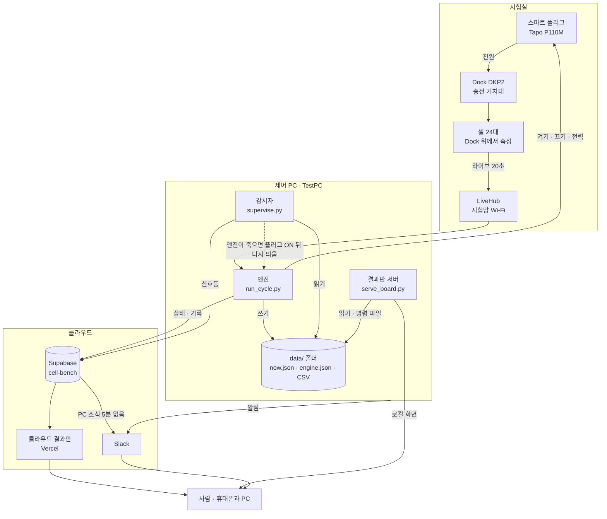

**사이클 한 바퀴의 실제 길이.** 방전은 사이클 2, 충전은 사이클 1의 실측(2026-10-10)이다. 추출은 충전 앞부분에 겹친다. 이 띠가 목표 사이클 수만큼 반복된다.

```mermaid
gantt
  title 사이클 한 바퀴 · 실측 시간 비례
  dateFormat HH:mm
  axisFormat %H:%M
  section 플러그 OFF
  방전 · 100에서 기준선 30까지 3.38 h :a1, 00:00, 203m
  section 플러그 ON
  추출 그리고 충전 · 만충까지 199분 :a2, after a1, 199m
```

**이 시스템을 관통하는 세 원칙**

| 원칙 | 뜻 |
|---|---|
| 모를 때는 충전 쪽 | 안전한 상태는 언제나 **플러그 ON**이다. 끝낼 때, 고장일 때, 엔진이 죽었을 때 모두 플러그를 켠다. 플러그가 꺼진 채 방치되면 셀이 0 %까지 내려가고, 사람이 Dock 버튼을 눌러야 다시 살아난다. |
| 프로그램끼리는 파일로만 | 엔진 · 감시자 · 결과판 서버는 서로를 부르지 않는다. 그래서 하나가 죽어도 나머지 둘은 계속 돈다. 명령도 `control.json` 파일 하나로 전달된다. |
| 판정은 순수 함수 | "방전이 끝났나", "멈췄나", "신호등은 무슨 색인가" 같은 판정은 장비에 닿지 않는 함수로 분리돼 있어, 장비 없이 시험으로 검증된다. 장비를 만지는 코드는 그 판정을 부르는 얇은 배선이다. |

---

<a id="hardware"></a>
## 1 장비와 두 개의 망 <sub>L1</sub>

위치: [한 장 요약](#overview) › 장비와 두 개의 망

**결론: 제어 PC는 인터넷 없는 시험망과 인터넷에 동시에 붙어 있다.** 셀과 플러그는 LiveHub가 만든 시험망에만 있고, 그 망에는 인터넷이 없다. 제어 PC는 Wi-Fi로 시험망에, 유선으로 인터넷에 붙어 두 세계를 잇는다.

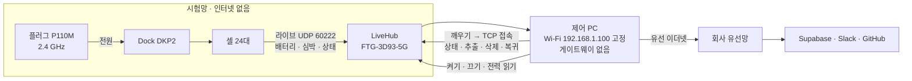

> **왜 주소를 고정하나.** 셀은 라이브 신호를 192.168.1.100 한 곳으로만 보낸다. 그래서 PC Wi-Fi 주소가 바뀌면 셀이 안 들린다. 또 시험망 쪽에 게이트웨이가 생기면 Windows가 인터넷 없는 쪽을 기본 경로로 골라 인터넷이 끊길 수 있어(10-06 사고) Wi-Fi에는 게이트웨이를 두지 않는다. PC 네트워크 설정을 함부로 바꾸지 않는 이유다.

**셀과 주고받는 명령**

| 명령 | 뜻 | 주의 |
|---|---|---|
| `0x10` 깨우기 | 셀이 PC로 TCP 접속을 열게 한다 | 깨우기 전에 주소 ↔ 시리얼을 라이브로 확인 |
| `0x11` 상태 | 저장된 데이터 크기 | |
| `0x12` 추출 | 측정 파일을 받는다 | 6대씩 동시에 받는다 |
| `0x13` 삭제 | 셀 저장을 비운다 | 끝 표지 · 오류 0 · 크기 일치 · 신원 확인이 모두 맞을 때만. 사람이 손으로 보내지 않는다 |
| `0x26` 복귀 | 측정 모드로 되돌린다 | `0x15`로 재부팅하면 측정을 안 하는 대기 모드로 켜진다 |

**설정의 근거가 된 실측값**

| 항목 | 값 | 무엇에 쓰였나 |
|---|---|---|
| 셀 데이터 증가 | 3.45 MB/h | 저장량 추정 |
| 셀 저장 상한 | 약 160 MB (약 46시간) | 추출 뒤 삭제를 기본으로 켬 (10-10) |
| 충전 전력 | 68 W → 만충 뒤 31 W | 만충 판정 · 충전 Wh에서 바닥 전력 빼기 |
| 추출 속도 | 6대 동시 2.88 MB/s | 한 묶음 6대 |
| 플러그 저전력 멈춤 | 1.4 ~ 1.5 W | Dock 저전력 자동 복구 (끊었다 켬) |

코드: `cellbench/cells.py` (LiveListener · CellLink) · `protocol.py` · `plug.py` · `net.py`

---

<a id="engine"></a>
## 2 엔진 <sub>L1</sub>

위치: [한 장 요약](#overview) › 엔진

**결론: 엔진은 장비를 만지는 유일한 프로그램이고, 사이클을 끝까지 책임진다.** `run_cycle.py`가 시작점이고, 실제 일은 `CycleRunner`(`cycle.py`)가 한다. 엔진은 네 가지 일을 하고, 그 결과를 파일 세 종류로 남긴다.

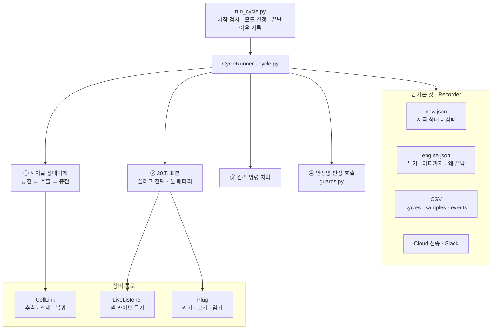

> **엔진 하나만 장비를 만지는 이유.** 셀 라이브 포트(UDP 60222)는 한 프로그램만 열 수 있다. 두 프로그램이 같은 플러그와 셀을 두고 다투지 않도록, 두 번째 엔진은 포트가 이미 열려 있으면 아무 기록도 남기지 않고 끝난다.

더 깊이: [2.1 사이클 한 바퀴](#cycle) · [2.2 20초 표본 한 번](#sample) · [2.3 시작할 때](#startup) · [2.4 끝나는 길](#exits)

<a id="cycle"></a>
### 2.1 사이클 한 바퀴 <sub>L2</sub>

위치: [한 장 요약](#overview) › [엔진](#engine) › 사이클 한 바퀴

**결론: 사이클은 여덟 단계이고, 어디서 깨지든 플러그 ON인 복구 대기로 빠진다.** 초록 굵은 화살표가 정상 흐름이고, 점선은 고장이나 사람의 개입으로만 생기는 길이다. 단계 이름(대문자)은 결과판과 `now.json`의 `phase`에 그대로 보인다.

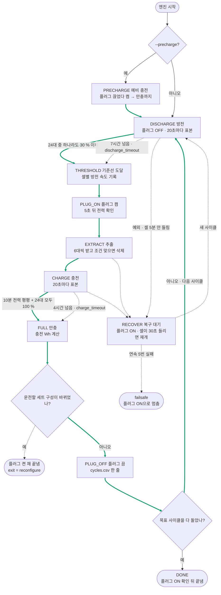

어느 단계에서든 원격 안전 정지가 오면 플러그를 켜고 `STOPPED`로 끝난다(그림에서 생략).

| 단계 | 끝나는 조건 | 그동안 함께 보는 안전망 |
|---|---|---|
| DISCHARGE | 가장 낮은 셀이 기준선(30 %) 이하 · 또는 7시간 한도 | 방전 중 누가 켠 플러그 다시 끄기 · 대기 모드 셀 깨우기 · 방향 대조 |
| PLUG_ON | 켜고 5초 뒤 전력 확인 (10 W 미만이면 이상 기록) | Dock 저전력 복구 |
| EXTRACT | 24대 모두 받기 · 지우기 · 복귀를 시도 | 표본이 멈추므로 셀 진척마다 심박만 찍음 |
| CHARGE | 최근 10분 전력 변동이 작고 24대 모두 100 % · 또는 4시간 한도 | Dock 저전력 복구 · 접촉 불량 셀 알림 |
| RECOVER | 셀이 30초 이상 다시 들림 | 플러그 ON 유지 · 2분마다 Wi-Fi 재연결 · 30분이면 사람 호출 |

> **셀별 작동시간은 직접 잴 수 없다.** 방전은 가장 빠른 셀 하나가 기준선에 닿으면 끝나므로, 나머지 셀은 그 시점까지의 방전 속도로 "0 %까지 몇 시간"을 환산해 `discharge_####.csv`와 추이 분석 화면에 남긴다.

코드: `cycle.py:807` run_cycle · `:1012` precharge · `:1057` run · `:949` _recover · `:53–80` discharge_done · is_full

<a id="sample"></a>
### 2.2 20초 표본 한 번 <sub>L2</sub>

위치: [한 장 요약](#overview) › [엔진](#engine) › 20초 표본 한 번

**결론: 20초마다 한 번의 표본이 엔진의 심장 박동이다.** 방전 · 충전 · 예비 충전 단계는 같은 표본 함수(`_poll`)를 20초마다 부른다. 이 한 번에 측정, 기록, 안전 판정, 명령 처리가 모두 들어 있다.

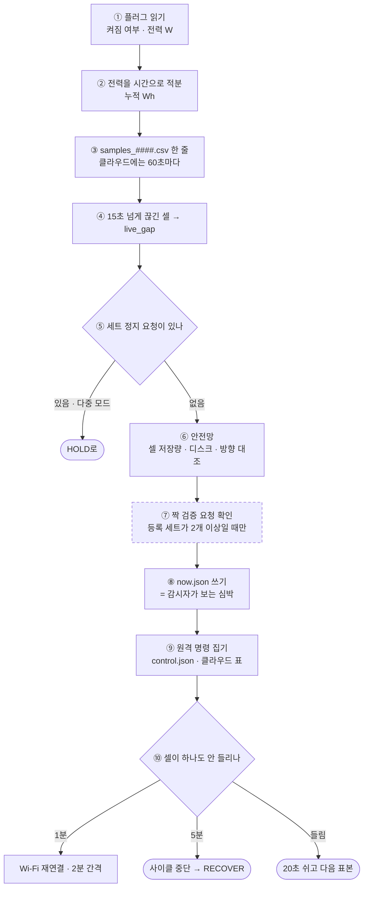

단계별 추가 판정: 방전 중에는 켜진 플러그 · 대기 모드 셀, 충전 중에는 Dock 저전력 · 접촉 불량을 표본 뒤에 본다.

> **now.json이 멈추면 감시자는 엔진이 멈췄다고 본다.** 그래서 화면용 파일 쓰기가 실패해도 시험을 멈추지 않도록 예외를 삼키고, 지표 계산이 실패해도 `metrics`에 오류만 적고 파일은 쓴다. 추출 중에는 표본이 몇 분씩 멈추므로, 셀 진척 로그마다 심박(`beat`)만 따로 찍고 감시자의 멈춤 문턱도 20분으로 늘린다.

코드: `cycle.py:439` _poll · `:191` _publish · `:342` _handle_control · `:405` _watch_link · `record.py:233` now · beat

<a id="startup"></a>
### 2.3 시작할 때 <sub>L2</sub>

위치: [한 장 요약](#overview) › [엔진](#engine) › 시작할 때

**결론: 엔진은 시작하기 전에 설정 · 주소 · 포트를 거르고, 여기서 단일 모드와 다중 모드가 갈린다.**

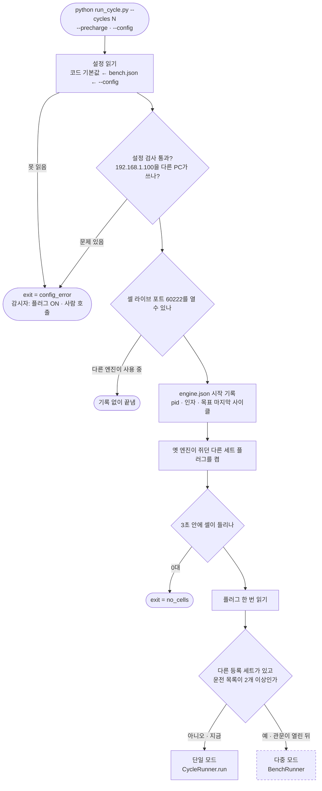

> **TestPC는 `--config data/run_config.json`으로 돈다.** 설정은 세 층(코드 기본값 → `bench.json` → `--config`)이 차례로 덮어쓴다. 감시자가 엔진을 다시 띄울 때도 `engine.json`에 남긴 인자를 그대로 되살려 같은 설정으로 돌게 한다.

코드: `run_cycle.py:41` main · `:333` start_problem · `config.py` Config.load · validate

<a id="exits"></a>
### 2.4 끝나는 길 <sub>L2</sub>

위치: [한 장 요약](#overview) › [엔진](#engine) › 끝나는 길

**결론: 엔진은 끝날 때 이유를 `engine.json`에 남기고, 감시자는 그 이유로 되살릴지 정한다.** 이유(`exit`)가 비어 있는데 프로세스가 사라졌다면 비정상 종료다. 엔진과 감시자 사이의 약속은 이 한 칸이 전부다.

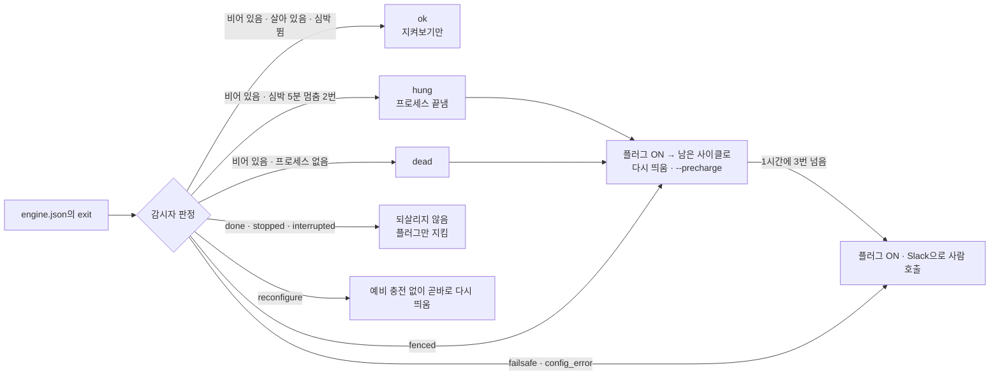

| exit | 언제 | 엔진이 끝내며 한 일 | 감시자 |
|---|---|---|---|
| `done` | 목표 사이클을 다 돎 | 플러그 ON, 1분 뒤 전력으로 확인 | 되살리지 않음 · 플러그 지킴 |
| `stopped` | 원격 안전 정지 | 플러그 ON | 되살리지 않음 |
| `interrupted` | 사람이 Ctrl+C | 플러그 그대로 · 꺼져 있으면 경고 기록 | 되살리지 않음 · 표지가 없으면 10분 안에 플러그 ON |
| `failsafe` | 사이클 연속 5번 실패 · 짝 이상 | 플러그 ON (짝 이상이면 등록된 모든 플러그) | 사람 호출 · 같은 결함을 되풀이하므로 되살리지 않음 |
| `config_error` | 시작 거부 | 플러그를 만지지 않음 | 플러그 ON · 사람 호출 |
| `reconfigure` | 세트 구성 변경, 만충 직후 | 플러그 켠 채 | 예비 충전 없이 곧바로 다시 띄움 |
| `fenced` | 다중 모드에서 세트 실행기가 멈춤 | 모든 플러그 ON | 다시 띄움 |
| `no_cells` | 시작할 때 셀이 하나도 안 들림 | — | 플러그 ON 뒤 다시 띄움 |
| (비어 있음) | 예외 · 강제 종료 · 재부팅 · 정전 | 가능하면 `last_gasp`가 플러그를 한 번 켬 | 플러그 ON 뒤 다시 띄움 |

코드: `supervisor.py:155` engine_verdict · `:242` restart_plan · `run_cycle.py:301` last_gasp · `cycle.py:1175` _safe_end

---

<a id="supervisor"></a>
## 3 감시자 <sub>L1</sub>

위치: [한 장 요약](#overview) › 감시자

**결론: 감시자는 엔진 밖의 두 번째 안전장치다. 엔진이 사라지면 플러그부터 켜고 다시 띄운다.** 엔진 안의 안전장치는 엔진이 살아 있어야 작동한다. 10-08 21:15 Windows 업데이트 재시작으로 엔진이 사라지고 플러그가 꺼진 채 남아, 셀 24대가 방전된 채 33시간 뒤에 발견됐다. 감시자는 그 공백을 메우려고 생겼다.

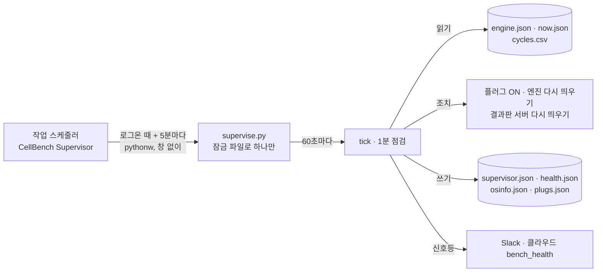

> **감시자를 잠깐 쉬게 하는 표지.** `data/supervisor_pause`가 있으면 점검만 하고 조치하지 않는다. 코드 교체 스크립트(`tools/restart_at_boundary.ps1`)가 교체하는 동안 스스로 두며, 15분(만료 시각이 없으면 2시간) 뒤에는 무시된다. 사람이 일부러 플러그를 꺼 두는 작업 전에도 이 표지를 둔다.

더 깊이: [3.1 1분 점검](#tick) · [2.4 끝나는 길](#exits)

<a id="tick"></a>
### 3.1 1분 점검 <sub>L2</sub>

위치: [한 장 요약](#overview) › [감시자](#supervisor) › 1분 점검

**결론: 1분 점검은 판정 → 플러그 → 엔진 → 신호등 → 기록 순서로 간다.** 순서에 뜻이 있다. 엔진을 다시 띄우기 전에 반드시 플러그를 먼저 켠다. 부팅 직후 첫 점검의 첫 조치도 플러그 ON이다.

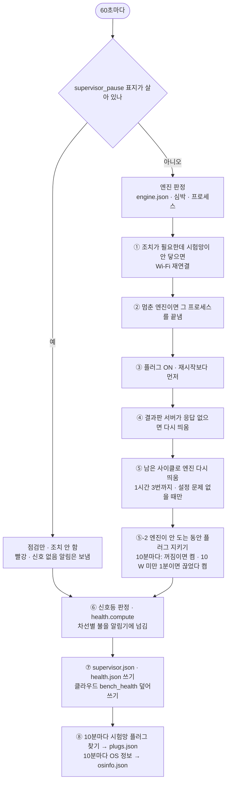

①~⑤는 판정 결과(Plan)가 요구할 때만 한다. 엔진이 정상이면 ④와 ⑥~⑧만 실제로 일을 한다.

> **판정과 손대는 일이 나뉘어 있다.** `engine_verdict` · `restart_plan` · `pause_state`는 순수 함수라 장비 없이 시험된다. 플러그 · 프로세스 · 네트워크를 실제로 만지는 일은 전부 `Deps` 묶음을 거치고, 실물 Deps는 `supervise.py`가 만든다. 감시자는 셀 라이브 포트를 열지 않는다(엔진과 다투지 않게).

코드: `supervisor.py:416` tick · `:759` plug_guard · `:946` run_once · `supervise.py` 실물 Deps

---

<a id="board"></a>
## 4 결과판 <sub>L1</sub>

위치: [한 장 요약](#overview) › 결과판

**결론: 결과판은 화면 파일 하나가 두 곳에서 돈다. 제어 PC에서는 다 할 수 있고, 클라우드에서는 보기와 명령만 한다.**

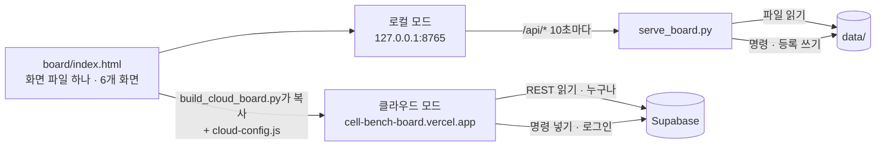

| 할 수 있는 일 | 로컬 (제어 PC) | 클라우드 |
|---|---|---|
| 관제 · 세트 상세 · 추이 분석 · 절차·기준 · 점검 | 있음 | 있음 |
| 원격 명령 (플러그 켜기 · 끄기 · 안전 정지) | PIN | 로그인 |
| 세트 등록 · 해제 | PIN | 없음 |
| 짝 검증 · 운전 켜기 | PIN | 없음 |
| 신호등 '확인' (Slack 반복 멈춤) | 있음 | 없음 |

> **등록이 제어 PC에서만 되는 이유.** 등록 검사에 필요한 플러그와 셀 신호는 시험망 안에만 있고, 짝을 잘못 묶으면 엔진이 엉뚱한 플러그를 꺼 다른 세트 셀을 방전시킨다. 그래서 케이블을 눈으로 볼 수 있는 현장 PC에서만 하게 했다.

화면 주소: 관제 `#ops` · 세트 상세 `#set-1` · 추이 분석 `#trend` · 절차·기준 `#proc` · 점검 `#check` · 세트 등록 `#register`(로컬만).

코드: `serve_board.py:300` make_handler · `board/index.html` · `tools/build_cloud_board.py`

더 깊이: [4.1 원격 명령](#command) · [8 data 폴더 지도](#files)

<a id="command"></a>
### 4.1 원격 명령 <sub>L2</sub>

위치: [한 장 요약](#overview) › [결과판](#board) › 원격 명령

**결론: 원격 명령은 두 통로로 들어와, 엔진의 20초 표본에서 한 곳으로 모인다.**

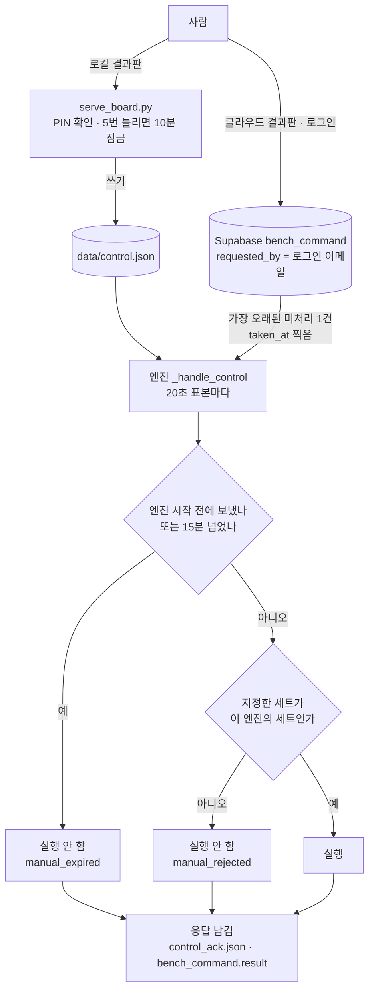

| 명령 | 하는 일 | 단계에 따른 차이 |
|---|---|---|
| `plug_on` 플러그 켜기 | 지금 플러그를 켠다 | 방전 중이면 방전을 끝내고 충전으로 넘어감 |
| `plug_off` 플러그 끄기 | 지금 플러그를 끈다 | 충전 쪽 단계면 만충으로 치고 다음 사이클로 |
| `stop_safe` 안전 정지 | 플러그 ON으로 두고 엔진을 끝낸다 | 다시 시작은 PC에서. 감시자도 되살리지 않음 |

> **왜 오래된 명령을 버리나.** 엔진이 멈춘 동안 받은 명령이 몇 시간 뒤 재시작 때 실행되던 문제가 있었다(QA C-1). 이제 엔진 시작 전에 보낸 명령과 15분 넘은 명령은 실행하지 않고, 버렸다는 사실을 응답과 이상 기록에 남긴다. 엔진이 추출로 몇 분 바빴어도 시작 뒤에 보낸 명령은 실행한다.

코드: `control.py` ControlInbox · PinGuard · command_expired · `cycle.py:378` _apply_command · `cloud.py:412` poll_command

---

<a id="cloud"></a>
## 5 클라우드 <sub>L1</sub>

위치: [한 장 요약](#overview) › 클라우드

**결론: 클라우드는 PC가 올려 보낸 것을 보여 주는 창이고, PC가 침묵하면 대신 알린다.** 전송 방향은 언제나 PC에서 밖으로(HTTPS)다. 회사망으로 들어오는 구멍이 없다. 쓰기 키는 PC의 Windows 자격 증명 관리자에만 있고, 키가 없으면 전송기는 조용히 꺼진 채 돌며 시험은 영향을 받지 않는다.

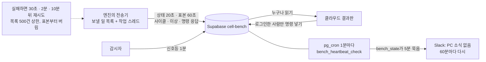

| 표 | 내용 | 쓰는 쪽 |
|---|---|---|
| `bench_state` | 지금 상태 한 줄 (now.json과 같은 내용) | 엔진 |
| `bench_sample` | 표본. 10분 · 1시간 묶음 뷰가 따로 있음 | 엔진 |
| `bench_cycle` · `bench_discharge` | 사이클 한 줄 · 셀별 방전 | 엔진 |
| `bench_event` | 이상 기록 | 엔진 · 심박 감시 함수 |
| `bench_command` | 원격 명령과 응답 | 결과판(로그인) · 엔진 |
| `bench_health` | 신호등 판정 | 감시자 |
| `bench_watch` | 심박 감시 상태 | pg_cron 함수 |

> **아직 적용하지 않은 것 (U1).** 마이그레이션 `20261010174625_bench_multi_set.sql`은 각 표에 세트 번호(`set_id`)를 더하고 스키마 판 2를 알리는 함수를 만든다. 적용 전에는 클라우드 결과판의 확인 요청이 404를 받고 판 1로 읽는다. 적용은 새 엔진이 TestPC에서 한 사이클을 돈 뒤, SQL 전문을 보고 승인하는 순서다.

코드: `cloud.py` Cloud · SetCloud · NoCloud · `supabase/migrations/` · `alert.py` (웹훅은 Vault에서)

---

<a id="safety"></a>
## 6 안전망과 신호등 <sub>L1</sub>

위치: [한 장 요약](#overview) › 안전망과 신호등

**결론: 고장은 세 겹으로 잡는다. 엔진 안, 엔진 밖, PC 밖이다.** 각 겹은 바로 안쪽 겹이 통째로 죽었을 때를 맡는다. 세 겹이 본 것은 모두 신호등 아홉 차선으로 모여 화면과 Slack에 나간다.

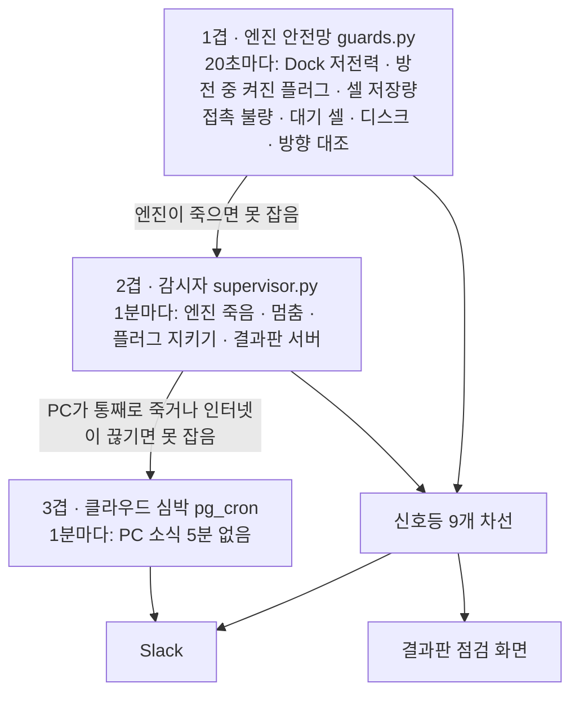

더 깊이: [6.1 안전망 목록](#guards) · [6.2 신호등](#lights)

<a id="guards"></a>
### 6.1 안전망 목록 <sub>L2</sub>

위치: [한 장 요약](#overview) › [안전망과 신호등](#safety) › 안전망 목록

**결론: 엔진은 스스로 잡을 수 있는 고장을 표본마다 보고, 전원을 켜는 쪽으로만 자동 조치한다.** 자동으로 전원을 끊는 조치는 단 하나, "방전 중에 누가 켠 플러그를 다시 끄기"뿐이고, 그것도 셀이 기준선보다 10 %p 넘게 남아 있을 때만이다.

예시로 Dock 저전력 복구의 흐름이다. Dock이 1.5 W로 멈춰 충전을 안 하던 10-08 실측에서 생긴 장치다.

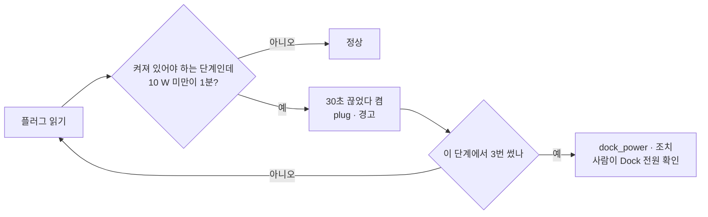

| 무엇을 잡나 | 엔진이 하는 일 | 남기는 이상 |
|---|---|---|
| Dock이 전력을 안 끌어 씀 | 30초 끊었다 켬, 단계마다 3번 | `plug`(경고) · `dock_power`(조치) |
| 방전 중 누가 플러그를 켬 | 다시 끔. 셀이 기준선+10 %p 이하면 그대로 충전으로 | `manual_plug`(경고) |
| 셀 저장이 가득 참 (약 160 MB) | 추출 뒤 삭제. 저장량은 3.45 MB/h로 추정 | `cell_storage`(경고, 80 %) · `cell_storage_critical`(조치, 95 %) |
| 삭제가 엉뚱한 셀로 감 | 깨우기 전 · 접속 때 · 삭제 직전에 주소 ↔ 시리얼 확인 | `identity`(조치) |
| 충전 중 혼자 안 오르는 셀 | 알림만 (접촉 불량) | `cell_not_charging`(경고) |
| 방전 중 대기 모드 셀 | 그 셀만 깨워 복귀, 10분에 한 번 | `cell_waiting`(경고) |
| 짝 셀의 심박 0 (짝 보드 켜짐 · 연결 0) | 10분 넘으면 그 셀에 짝 보드 이름(0x20)을 다시 보냄 · 셀당 30분에 한 번 · 추출 중과 다른 세트의 추출 중에는 안 함 (판정 `hr.repair_due`) | `hr_repair`(경고) · 3번 보내도 안 돌아오면 그 셀은 멈춤(심박이 돌아오면 풀림) — `hr_repair_fail`(경고, 사람 확인) |
| 디스크 여유 부족 | 알림만 | `disk`(경고, 20 GB) · `disk_critical`(조치, 5 GB) |
| 방향이 틀림 (짝 이상) | 충전 중 하락 · 방전 중 상승 · 방전 30분에 3 %p 미만 → 등록된 모든 플러그 ON, failsafe | `pair_mismatch`(조치) |
| 방전 7시간 초과 | 충전으로 넘김 | `discharge_timeout`(조치) |

> **판정과 배선이 나뉘어 있다.** 표의 판정은 모두 `guards.py`의 순수 함수이고, `cycle.py`의 `_guard_*` · `_watch_*`는 그 함수를 부르고 결과대로 플러그를 움직이는 얇은 배선이다. 안전망 자신의 오류는 로그만 남기고 사이클을 깨지 않는다.

코드: `guards.py` PowerWatch · DirectionWatch · CrossWatch · `cycle.py:461–806` 배선 · `record.py` EVENT_LIGHT · ALERT_KINDS

<a id="lights"></a>
### 6.2 신호등 <sub>L2</sub>

위치: [한 장 요약](#overview) › [안전망과 신호등](#safety) › 신호등

**결론: 신호등은 열 차선의 불을 하나의 함수로 판정하고, 시험대 불은 가장 나쁜 차선의 불이다.**

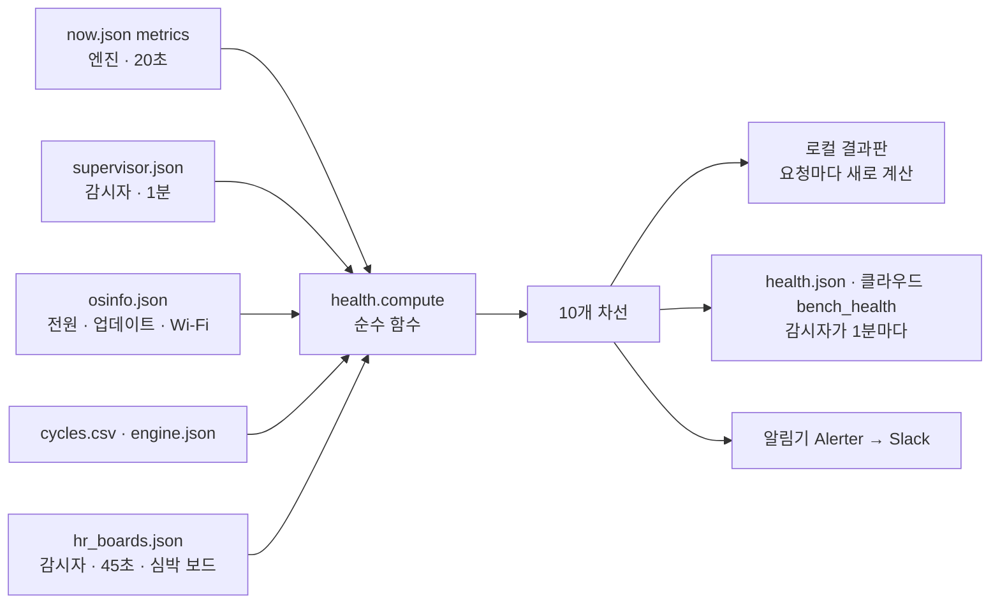

열 차선: 전원·OS · 프로그램 · 무선·LiveHub · 플러그 · Dock·셀 · 셀 수신 · 심박 · 기록·디스크 · 클라우드·알림 · 사람 조작

'심박'(2026-10-15)은 짝 표(bench.json 세트 줄의 `hr_pairs`)가 있는 세트만 판정한다. 짝 있는 셀의 심박이 `hr_zero_s`(180초) 넘게 0 이면 경고, `hr_lost_alarm`(3대) 이상이면 조치이고, 추출 중과 셀 재부팅 직후 `hr_rejoin_grace_s`(120초)는 판정하지 않는다. 끊긴 셀마다 짝 보드 상태(`hr_boards.json`)로 원인을 가른다 — 보드 꺼짐 · 셀이 안 붙음(보드 켜짐 · 연결 0) · 다른 기기 연결 또는 셀 쪽 문제. 짝 표가 없는 세트는 '심박 없음'(회색 · 오류 아님)이다. 판정은 `hr.py`의 순수 함수(judge)이고, 결과판의 세트 카드 · 셀 카드 · 시험실 구성이 같은 요약(`health.json`의 `hr`)을 그린다.

요약 `hr` 의 칸(2026-10-16): `sets`(세트별 judge) · `hubs`(감시 허브 — 키는 세트 + 그 세트 안의 허브 이름 `1A`, 지금 짝 표의 `A` · `B` 는 세트 1 의 허브) ·
`power`(전원만 보드 — 짝 표 `hub` 가 P 로 시작, 세트별 한 묶음. 감시자가 읽지 않고 원인은 '보드 상태 안 읽음') · `usb_devices`(감시자가 센 제어 PC 의 USB 장치 수,
못 세면 없음) · `usb_limit`(설정 `health.usb_limit`, 기본 없음). 시험실 구성은 세트마다 한 줄(왼쪽 줄기 LiveHub 2.4 GHz · 오른쪽 줄기 USB 데이터)이고,
선 색 판정은 결과판 `<topo-link>` 의 세 함수(cloudLink · hubLink · btLink)다.

| 불 | 뜻 | Slack |
|---|---|---|
| 정상 | 지표가 모두 기대 범위 안 | 보내지 않음 |
| 경고 | 추세 · 여유 · 횟수가 문턱을 넘음. 아직 잃은 것은 없음 | 새로 켜질 때 1건, 같은 이유는 1시간에 한 번 |
| 조치 | 이미 잃고 있음 | 즉시 1건, '확인'을 누를 때까지 15분마다 |
| 신호 없음 | 지표를 읽을 수 없음. 조치와 같은 무게 | 조치와 같음 |

> **같은 원인으로 알림이 쏟아지지 않게.** 엔진 기록이 멈추면 엔진만 아는 차선(Dock·셀 · 셀 수신 · 심박 · 사람 조작)은 신호 없음이 되지만, 알림은 '프로그램' 차선 하나로만 나간다. 클라우드 결과판은 `bench_health`가 5분 넘게 묵으면 스스로 전체를 신호 없음으로 그려, PC가 죽어도 불이 켜진다.

코드: `health.py` compute · LANE_KEYS · `alert.py` Alerter · KEY_LABELS · `config.py` HEALTH · HR 문턱 · `hr.py` judge · board_state

---

<a id="multiset"></a>
## 7 세트 등록 · 다중 세트 <sub>L1</sub>

위치: [한 장 요약](#overview) › 세트 등록 · 다중 세트

**결론: 세트 2부터는 등록 → 짝 검증 → 관문 → 경계 재시작 순서로만 운전에 들어간다.** 세트는 플러그 1개 + Dock 1개 + 셀 24대다. 다중 세트 운전은 PR #5로 구현됐지만, 관문 두 개(U1 · U2)가 닫혀 있어 지금은 세트 2를 등록해도 돌지 않는다.

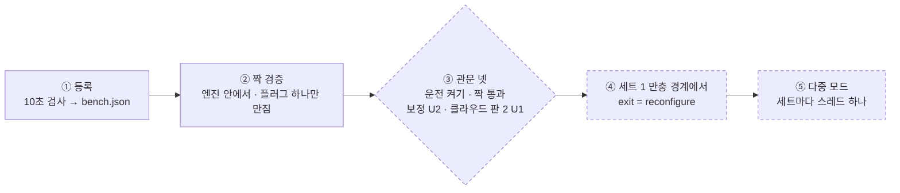

점선은 아직 열리지 않은 단계다. 세트 2 플러그는 시험망에서 이미 "미등록 감지"로 보인다.

> **왜 이렇게 조심스러운가.** 짝을 잘못 묶으면 엔진이 "세트 2 방전"이라며 세트 1의 플러그를 끄고, 아무도 보지 않는 셀이 0 %까지 간다. 그래서 등록, 짝 검증, 운전 중 방향 대조로 세 번 확인하고, 짝 이상이 하나라도 보이면 등록된 모든 플러그를 켠다.

더 깊이: [7.1 등록 10초 검사](#register) · [7.2 짝 검증](#pairing) · [7.3 관문과 재구성](#gates) · 설계 명세는 [다중 세트 설계](design/multi-set-plan.md)

<a id="register"></a>
### 7.1 등록 10초 검사 <sub>L2</sub>

위치: [한 장 요약](#overview) › [세트 · 다중 세트](#multiset) › 등록 10초 검사

**결론: 등록은 네 가지를 검사하고, 앞의 셋을 통과해야 `bench.json`에 한 줄을 붙인다.**

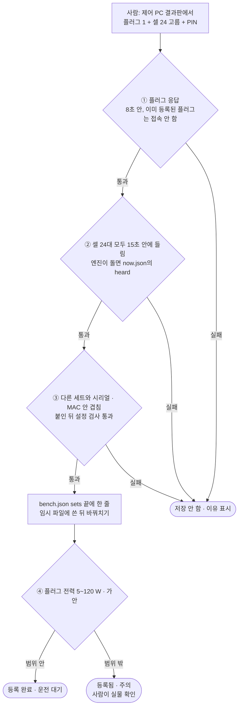

> **등록은 짝이 맞는지까지는 모른다.** 이 검사는 "장비가 응답하고, 겹치지 않는다"까지만 확인한다. 그 플러그가 정말 그 Dock에 꽂혀 있는지는 짝 검증과 운전 중 방향 대조가 확인한다. 등록 해제는 PIN으로 하며, 운전 중인 세트는 해제할 수 없다.

코드: `register.py` judge · add_set · remove_set · `serve_board.py:430` _register

<a id="pairing"></a>
### 7.2 짝 검증 <sub>L2</sub>

위치: [한 장 요약](#overview) › [세트 · 다중 세트](#multiset) › 짝 검증

**결론: 짝 검증은 "세트 k 플러그를 껐다 켤 때 세트 k 셀만 따라 움직이나"를 본다.** 셀 라이브 포트를 엔진이 독점하므로, 검증기는 엔진 안의 스레드로만 돈다. 어떤 길로 끝나든 검증하던 플러그(Pk)를 켠 채 끝낸다.

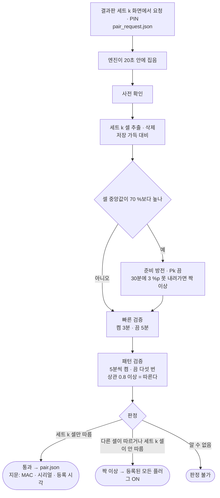

> **보정 실측(U2) 전에는 판정 검증이 잠겨 있다.** 지금 열린 것은 같은 순서로 돌되 판정하지 않고 값만 `calib_<시각>.csv`에 적는 '기록 전용 보정'뿐이다. 이 기록으로 문턱을 정한 뒤에야 판정 검증이 열린다.

코드: `verifier.py` VerifyManager · `pair.py` 판정 순수 함수 · `config.py` PAIR

**자동 합류**(`onboard.py`)는 위 보정 기록 → `derive.py`(문턱 도출, 순수 함수) → 판정 검증 → `bench.json` 의 `run: true` → 다음 경계 합류를 한 번에 잇는다. 상태는 `data/set{k}/onboard.json`, 도출한 문턱은 `pair_thresholds.json`. 감시자(`supervisor.py` set_guard)는 엔진이 도는 동안 운전하지 않는 등록 세트의 플러그와 셀 침묵(`set_silent`)을 지킨다.

<a id="gates"></a>
### 7.3 관문과 재구성 <sub>L2</sub>

위치: [한 장 요약](#overview) › [세트 · 다중 세트](#multiset) › 관문과 재구성

**결론: 관문 넷이 모두 열려야 운전 목록에 들고, 엔진은 세트 1 만충 직후에만 모드를 바꾼다.**

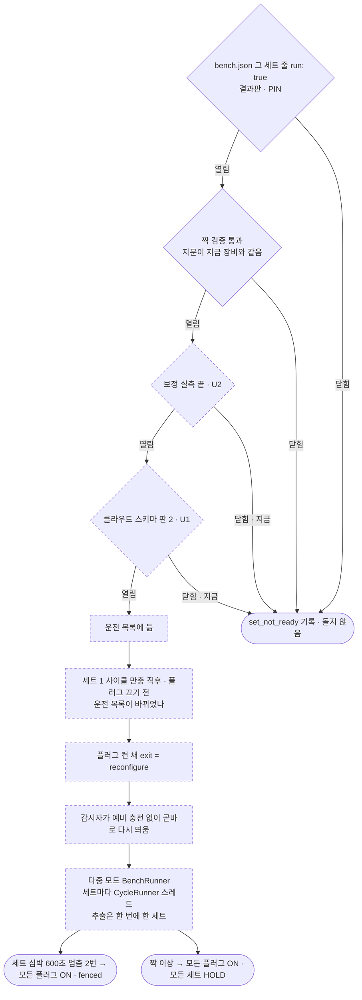

> **왜 만충 직후인가.** 만충 직후에는 플러그가 켜져 있고 셀이 100 %라, 엔진을 끝냈다 다시 띄워도 잃는 것이 없다. 감시자가 일시 중지 중이면(코드 교체 등) 재구성을 미룬다. 그동안 끝난 엔진을 되살릴 주체가 없기 때문이다.

코드: `bench.py` BenchRunner · desired_ids · gate_problems · `shared.py` ExtractGate · LinkGuard · `run_cycle.py:134` boundary_hook

---

<a id="files"></a>
## 8 data 폴더 지도 <sub>L1</sub>

위치: [한 장 요약](#overview) › data 폴더 지도

**결론: `data/` 폴더는 세 프로그램의 공용 칠판이다. 누가 쓰고 누가 읽는지가 곧 연결도다.**

| 파일 | 쓰는 쪽 | 읽는 쪽 | 주기 | 내용 |
|---|---|---|---|---|
| `now.json` | 엔진 | 감시자 · 결과판 서버 · 클라우드 | 20초 | 지금 단계 · 셀 24칸 · 플러그 · 지표 · 심박 · 미등록 셀 |
| `engine.json` | 엔진 | 감시자 · 결과판 서버 · 교체 스크립트 | 시작 · 끝 | pid · 인자 · 목표 마지막 사이클 · 끝난 이유 |
| `cycles.csv` | 엔진 | 감시자 · 결과판 · 신호등 | 사이클마다 | 방전 시간 · 충전 분 · 충전 Wh · 추출 결과 |
| `samples_####.csv` | 엔진 | 결과판 그래프 | 20초 | 단계 · 플러그 · 전력 · 누적 Wh · 배터리 |
| `events.csv` | 엔진 | 결과판 · 신호등 | 이상마다 | 이상 기록 (종류별 색은 EVENT_LIGHT) |
| `discharge_####.csv` | 엔진 | 추이 분석 | 사이클마다 | 셀별 방전 속도 → 작동시간 환산 |
| `cells_####.csv` · `ftg/####/` | 엔진 | 사람 · 저장량 추정 | 추출마다 | 셀별 추출 결과 · 받은 파일 |
| `control.json` · `control_ack.json` | 결과판 서버 / 엔진 | 엔진 / 결과판 | 명령마다 | 원격 명령과 응답 |
| `supervisor.json` · `supervisor.log` | 감시자 | 결과판 · 신호등 | 1분 | 점검 결과 · 플러그 지키기 상태 |
| `health.json` | 감시자 | (클라우드로 올림) | 1분 | 신호등 판정 |
| `osinfo.json` · `plugs.json` | 감시자 | 신호등 · 등록 화면 | 10분 | 전원 · 업데이트 · Wi-Fi / 시험망 플러그 목록 |
| `hr_boards.json` | 감시자(`hr.BoardWatch` 스레드) | 신호등 · 엔진 자동 재연결 | 45초 | 짝 표의 심박 보드마다(전원만 보드 제외) 마지막으로 본 시각 · 심박 · 연결 수 · 응답 여부, 그리고 제어 PC 의 USB 장치 수 `usb_devices` |
| `hr_####.csv` · `hr_pair_log.csv` | 엔진 / `tools/hr_pair.py --go` | 사람 · 추이 | 사이클마다 / 보낼 때마다 | 셀별 방전 구간 심박 수신 비율 (짝 있는 세트만) / 손으로 보낸 이름의 결과 |
| `alert_state.json` · `alert_ack.json` | 알림기 / 결과판 '확인' | 알림기 | — | Slack 발송 기록 · 확인한 원인 |
| `supervisor_pause` | 사람 · 교체 스크립트 | 감시자 | — | 일시 중지 표지 (만료 있음) |
| `run_config.json` | 사람 | 엔진 `--config` | — | TestPC가 쓰는 덮어쓰기 설정 |
| `set{k}/` · `beat.json` · `hold` · `end_request` | 다중 모드 | 감시자 · 엔진 | — | 세트 k 파일 · 엔진 심박 · 세트 정지 · 경계 종료 요청 |

시험대 설정 `bench.json`은 `data/` 바깥(cell-bench 폴더)에 있고, 등록 화면이 운전 중에 고치므로 git에 올리지 않는다.

---

<a id="code"></a>
## 9 코드 지도 <sub>L1</sub>

위치: [한 장 요약](#overview) › 코드 지도

**결론: 코드는 진입점, 실행기, 판정 함수, 장비 · 바깥 통로, 기반의 다섯 층으로 나뉜다.** 화살표는 "위가 아래를 가져다 쓴다"는 뜻이다.

```mermaid
flowchart TD
  subgraph E["진입점"]
    direction LR
    rc["run_cycle.py<br/>엔진"]
    sp["supervise.py<br/>감시자"]
    sbd["serve_board.py<br/>결과판 서버"]
    tl["tools/<br/>수동 도구"]
  end
  subgraph R["실행기"]
    direction LR
    cy["cycle.py"]
    su["supervisor.py"]
    be["bench.py"]
    ve["verifier.py"]
    ob["onboard.py"]
    rg["register.py"]
  end
  subgraph J["판정 · 순수 함수"]
    direction LR
    gu["guards.py"]
    he["health.py"]
    pa["pair.py"]
    dv["derive.py"]
  end
  subgraph D["장비 · 바깥 통로"]
    direction LR
    ce["cells.py + protocol.py"]
    pl["plug.py"]
    ne["net.py · osinfo.py · proc.py · hr.py"]
    cl["cloud.py"]
    al["alert.py"]
  end
  subgraph B["기반"]
    direction LR
    cf["config.py"]
    co["control.py"]
    rd["record.py"]
    sh["shared.py"]
  end
  E --> R
  R --> J
  R --> D
  J --> B
  D --> B
  R --> B
```

**가장 중심에 있는 파일** (가져다 쓰는 곳의 수는 시험 제외, `cf5c481` 기준)

| 파일 | 왜 중요한가 | 가져다 쓰는 곳 |
|---|---|---|
| `config.py` | 모든 숫자 문턱과 설정 불러오기 순서. 무엇이 몇 분 · 몇 %인지는 여기서 찾는다 | 15 |
| `control.py` | 원격 명령 · PIN 잠금 · 원자적 파일 쓰기 | 11 |
| `cycle.py` | 사이클 상태기계. 시스템의 심장 (가장 큰 파일) | 1 |
| `supervisor.py` | 감시자 판정과 1분 점검 | 4 |
| `health.py` | 신호등 10개 차선 판정 | 3 |
| `plug.py` · `cells.py` | 장비와 말하는 유일한 두 통로 | 8 · 6 |
| `record.py` · `cloud.py` | 기록과 전송. 무엇이 어디로 가는지 | 5 · 6 |

**읽는 순서 추천**

1. [`README.md`](../README.md) — 안전망 · 신호등 표까지 한 번에 개요
2. `run_cycle.py`의 `main()` — 엔진이 어떻게 시작하고 끝나나 ([2.3](#startup) · [2.4](#exits))
3. `cellbench/cycle.py`의 `run_cycle()` · `run()` — 사이클 상태기계 ([2.1](#cycle))
4. `cellbench/config.py` — 문턱 값들이 모인 곳
5. `cellbench/guards.py` — 안전망 판정 ([6.1](#guards))
6. `cellbench/supervisor.py`의 `tick()` · `restart_plan()` — 감시자 ([3.1](#tick))
7. `serve_board.py` + `cellbench/control.py` — 화면과 명령 통로 ([4.1](#command))
8. `cellbench/record.py` · `cloud.py` — 기록과 전송 ([5](#cloud))
9. `cellbench/health.py` · `alert.py` — 신호등 ([6.2](#lights))
10. `cellbench/bench.py` · `verifier.py` · `register.py` — 다중 세트, 아직 잠김 ([7](#multiset))

남은 모듈: `hr.py`(심박 짝 표 · 보드 상태 줄 읽기 · 심박 판정 · 자동 재연결 조건) · `osinfo.py`(운영체제 정보 읽기) · `proc.py`(프로세스 도우미) · `net.py`(시험망 재연결) · `protocol.py`(셀 프레임) · `shared.py`(추출 문 · 재연결 관문)

**코드에 없는 것을 찾을 때**

- [인수인계](handover.md) — 결정 · 실측 · 사고 기록, 배포 순서
- [다중 세트 설계 명세](design/multi-set-plan.md) — 설계와 검토 반영
- [원격 모니터링 · 제어](remote-access.md) · [제어 PC 준비](control-pc-setup.md)
