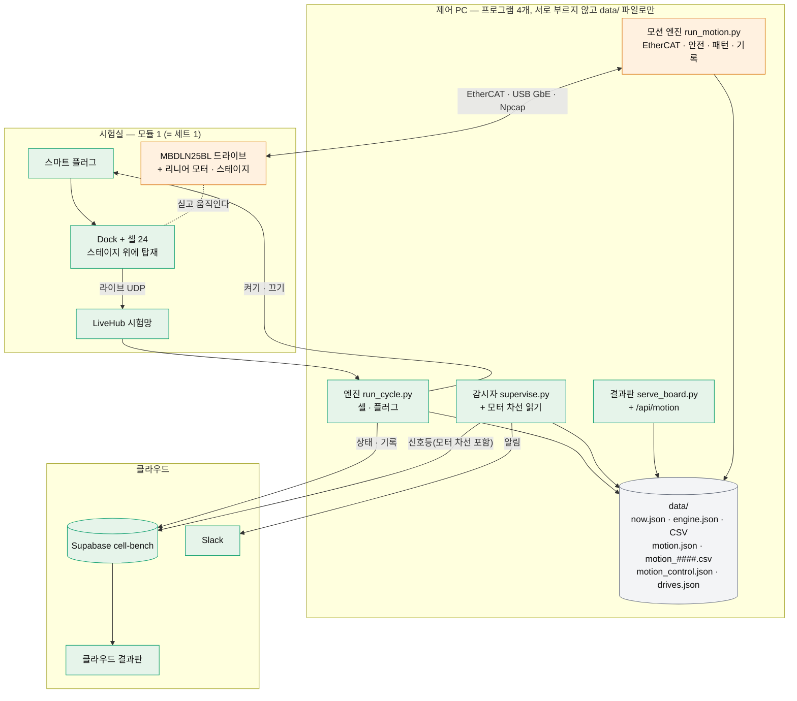
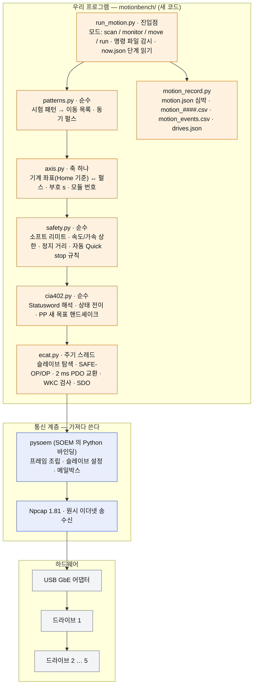
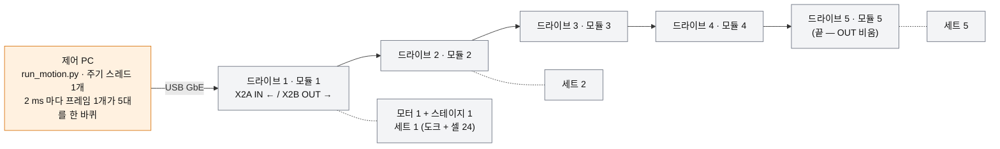
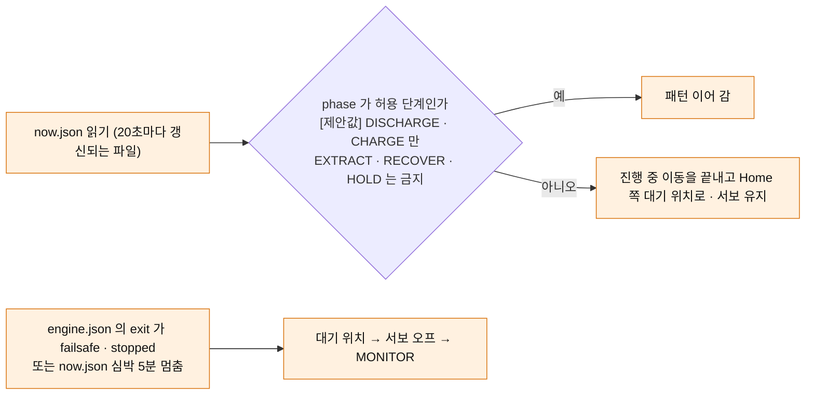
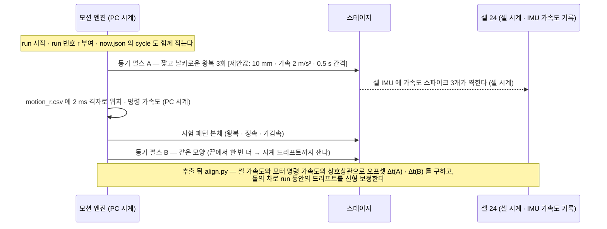
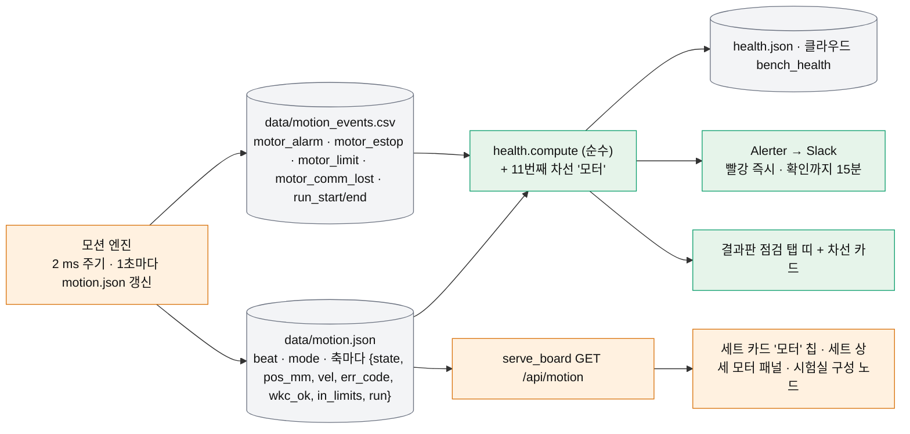
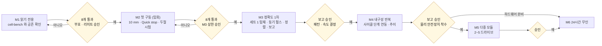
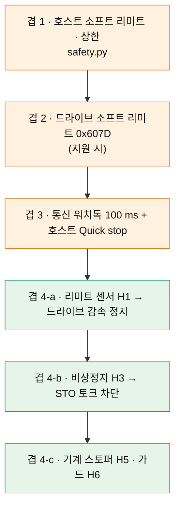
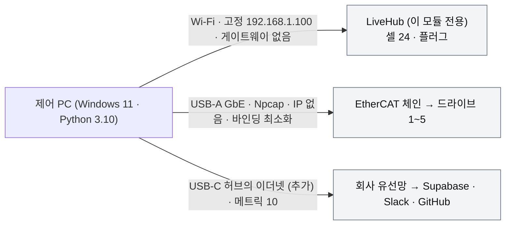

# dynamic-bench 기획 v2 — cell-bench 위에 리니어 모터 층을 얹는다

> **한 줄 결론:** dynamic-bench 는 새 시스템이 아니라 **cell-bench 에 "모션 엔진" 프로세스 하나를 더한 것**이다. 셀 통신·사이클 엔진·감시자·결과판·Slack·Supabase·세트 등록은 그대로 쓰고, 모터는 cell-bench 의 세 원칙(장비는 한 프로세스만 만진다 · 프로그램끼리는 `data/` 파일로만 · 판정은 순수 함수)을 그대로 따르는 **네 번째 프로그램 `run_motion.py`** 가 맡는다. pysoem 은 EtherCAT 프레임을 주고받는 **통신 계층**일 뿐이고, 그 위에 우리가 쓰는 안전·축·패턴·기록 계층이 앉는다. 세트는 **모듈**(모터 1 + 드라이브 1 + 도크 1 + 셀 24 + 플러그 1)로 넓히고, 드라이브 5대는 EtherCAT 한 줄에 데이지체인으로 PC 한 대가 제어한다. 물리 안전장치(리미트 센서 · STO 비상정지 · 가드)가 완비되기 전에는 **사용자 입회 시에만** 모터를 움직인다.

작성: 2026-10-22, kimpm 세션. 파일을 읽고 쓰기만 했다 — 어떤 프로그램도 실행하지 않았고 모터는 움직이지 않았다. v1 (`plan-v1.md`)의 하드웨어 사실·안전 분석·타이밍 분석은 유효하며 여기서는 참조만 한다. 구조는 전부 다시 짰다.

표기 규칙은 v1 과 같다 — `[사실]` 파일에서 읽은 것, `[추정]` 계산·일반 지식, `[제안값]` 사용자가 바꿀 초기값, `[확인 필요]` 매뉴얼·실측으로 확정할 것.

---

## 0. 읽는 법

| 절 | 무엇을 답하나 (지시문 3절 번호) | 바쁘면 |
|---|---|---|
| 1 | v1 에서 무엇이 틀렸고 무엇을 가져오나 | 1.1 표 |
| 2 | **아키텍처** — 재사용 vs 새 층, pysoem 층 구조, 5 드라이브 데이지체인 (①) | 2.1 · 2.3 그림 |
| 3 | **시간 정렬** — 모터 로그와 셀 데이터를 한 시간축에 (②) | 3.1 표 |
| 4 | **supervisor / board / health 확장**, 세트 등록에 모터 넣기 (③) | 4.1 그림 · 4.4 JSON |
| 5 | **마일스톤** M1~M6 와 통과 기준 (④) | 5.1 표 |
| 6 | **cell-bench 변경 목록 vs 새 코드 목록** (⑤) | 6.1 · 6.2 표 |
| 7 | **사용자 하드웨어 요구 목록** (⑥) | 7.1 표 |
| 8 | 네트워크 · Python 3.10 호환 (지시문 2-6 · 2-7) | 8.1 그림 · 8.3 표 |
| 9 | 열린 질문 · 결정 필요 (⑦) | 전부 |
| 10 | 남은 것 · 읽은 파일 | — |

---

## 1. v1 정정 — 무엇을 버리고 무엇을 가져오나

### 1.1 한눈에

| v1 이 말한 것 | v2 의 판정 | 이유 |
|---|---|---|
| "새 CLI `dynbench` 하나에 monitor/move/run/stop 과 로그·CSV·보고를 다 넣는다" | **버린다.** 모니터링·기록·알림·클라우드는 cell-bench 가 이미 한다 | 같은 저장소에 24시간 무인 운전이 검증된 체계가 있다 `[사실: cell-bench/README.md, docs/system-map.md]` |
| "세 스레드(주기·명령·로그) 한 프로세스" | **가져오되 프로세스의 이름이 바뀐다** — `run_motion.py` 가 그 프로세스다. 로그 스레드는 cell-bench 의 Recorder 와 같은 원자적 파일 쓰기(`control.write_json_atomic`)를 재사용한다 | 주기 스레드가 멈추지 않아야 한다는 원칙은 그대로다 |
| pysoem + PP 모드 + FreeRUN 2 ms + 네 겹 안전 | **그대로 가져온다** (v1 1절 · 2절) | 하드웨어 사실이 바뀌지 않았다 |
| 좌표계 = Home 끝 기준, 부호 `s` 는 M1 에서 손으로 밀어 확정 | **그대로** (v1 2.2절) | — |
| M1 읽기 전용 · M2 입회 10 mm ≤ 20 mm/s | **그대로** | 지시문이 유지를 명시 |
| M3 반복 + 로깅 · M4 셀 루틴 | **다시 정의** — cell-bench 의 세트·사이클·결과판 기준으로 (5절) | 목표가 셋(정확도 → 내구성 → QA 합격선)으로 정해졌다 |
| "결정 2: WMX3 구매 검토" | **닫힘** — 쓰지 않는다 | 사용자 결정 2-5 |
| "결정 1: 무인 운전 허용 여부" | **닫힘** — 물리 안전장치 전에는 입회만. 하드웨어 요구 목록(7절)이 그 조건이다 | 사용자 결정 2-4 |

### 1.2 cell-bench 가 이미 주는 것 — 다시 만들지 않는다

| cell-bench 의 것 | 어디에 | dynamic-bench 가 그대로 쓰는 방식 |
|---|---|---|
| 셀 라이브 수신(UDP 60222 독점) · 추출 · 삭제 · 복귀 | `cellbench/cells.py` · `protocol.py` | 손대지 않는다. 모션 엔진은 셀과 **말하지 않는다** — `now.json` 만 읽는다 |
| 사이클 엔진(방전 → 추출 → 충전), 20초 표본, `now.json` 심박 | `run_cycle.py` · `cellbench/cycle.py` | 손대지 않는다. 모션 엔진이 `now.json` 의 `phase` 를 읽어 "지금 움직여도 되는 단계인가"를 정한다 |
| 감시자(1분 점검 · 되살리기 · 플러그 지키기) | `supervise.py` · `cellbench/supervisor.py` | 모션 심박 파일을 **읽기만** 더한다. 모터를 되살리지는 않는다(5절 M6 전까지) |
| 신호등 10차선(순수 함수) · Slack 알림기 | `cellbench/health.py` · `alert.py` | 차선 하나("모터")를 더한다 — 판정은 `data/motion.json` 을 읽는 순수 함수 |
| 결과판(로컬 · 클라우드 같은 HTML) | `serve_board.py` · `board/index.html` | 세트 카드 · 세트 상세 · 시험실 구성에 모터 노드·패널을 더한다 |
| Supabase 전송 · 클라우드 심박 감시 · 클라우드 결과판 | `cellbench/cloud.py` · `supabase/migrations/` | 모터 요약은 `bench_state` 의 `payload` JSON 안에 실린다(스키마 변경 없음). 모션 run 표는 M5 이후 별도 마이그레이션 |
| 세트 등록(10초 검사 · `bench.json` 원자적 쓰기) | `cellbench/register.py` · `config.add_set` | 세트 줄에 `motor` 칸을 더한다 — `hr_pairs` 가 세트 줄 안에 들어간 것과 같은 방식이라 `Config` 의 칸은 늘지 않는다 `[사실: config.py:98 — "새 설정 키는 bench.json 최상위에 두지 않는다"]` |
| 제어 PC 설정 스크립트(절전 · 업데이트 · 어댑터 절전 · 방화벽 · 감시자 등록) | `tools/install.ps1` · `check_env.py` | 그대로 쓴다. EtherCAT 용 USB 랜카드의 절전 해제(`nicpower`)가 특히 필요하다 |

---

## 2. 아키텍처

### 2.1 전체 — 초록은 재사용, 주황은 새 층



**왜 모션 엔진을 cell-bench 엔진 안의 스레드가 아니라 별도 프로세스로 두나.** 세 가지 사실 때문이다. 첫째, cell-bench 엔진은 20초 표본 사이에 `time.sleep` 으로 쉬고 추출 중에는 몇 분씩 블로킹된다 `[사실: cycle.py:228-240, system-map 2.2]` — 그 안에 2 ms 주기 스레드를 넣으면 GIL 과 추출이 주기를 흔든다. 둘째, cell-bench 의 지도 자체가 "장비와 직접 말하는 것은 엔진 하나뿐이고 나머지는 파일로 잇는다"를 원칙으로 세웠다 `[사실: system-map 0절]` — 모터라는 새 장비에는 새 프로그램 하나가 그 원칙에 맞다. 셋째, 모션 엔진이 죽어도 셀 사이클은 계속 돌아야 하고, 그 반대도 같다(드라이브 워치독이 모터를 세우고, 플러그는 엔진이 지킨다).

### 2.2 층 구조 — pysoem 은 통신만 하고, 그 위에 우리 프로그램이 앉는다

쉽게 말하면 pysoem 은 **"우체부"** 다. 2 ms 마다 드라이브에 편지(출력 PDO: Controlword · 목표 위치)를 배달하고 답장(입력 PDO: Statusword · 실제 위치 · 에러 코드)을 받아 오며, 가끔 등기우편(SDO: 설정값 읽기·쓰기)을 나른다. 편지에 **무엇을 쓸지**(언제 서보를 켜고, 목표를 어디로, 넘지 말아야 할 선은 어디인지)는 우체부가 모른다 — 그것이 우리 프로그램이다.



| 층 | 누가 만드나 | 바뀌면 무엇이 흔들리나 |
|---|---|---|
| 하드웨어 · Npcap · pysoem | 가져다 쓴다 | 드라이브 모델이 바뀌면 PDO 매핑(records §7)만 다시 읽는다 |
| `ecat.py` | 새로 | pysoem 을 **이 파일 하나만** 가져다 쓴다. 나중에 C 로 내리거나(v1 대비책) 다른 마스터로 바꿔도 위층은 그대로다 |
| `cia402.py` · `safety.py` · `patterns.py` | 새로 · 순수 함수 | 장비 없이 pytest 로 검사한다 — cell-bench 의 `guards.py` 와 같은 자리 |
| `axis.py` · `run_motion.py` · `motion_record.py` | 새로 | cell-bench 의 파일 규약(원자적 쓰기 · 심박 · CSV)을 따른다 |

### 2.3 5 드라이브 데이지체인 — PC 한 대, EtherCAT 한 줄



- **한 줄에 한 프레임.** EtherCAT 은 프레임 하나가 체인을 한 바퀴 돌며 각 슬레이브가 자기 칸을 읽고 쓴다. 드라이브 5대여도 PC 의 주기 스레드는 하나이고, 프레임 하나에 출력 9 byte × 5 + 입력 23 byte × 5 = 160 byte 가 실린다 `[사실: PDO 크기 records §7]` — 2 ms 에 충분하다 `[추정]`.
- **슬레이브 순서 = 케이블 순서.** pysoem 은 체인에서 가까운 것부터 1, 2, 3… 으로 번호를 준다. 케이블을 바꿔 꽂으면 번호가 바뀌므로 **번호로 모듈을 믿지 않는다.** 모듈 등록(4.4절)은 드라이브의 **시리얼**(SDO 0x1018:04 Identity object, 또는 PANATERM 으로 넣는 Station alias Pr7.40/7.41 `[사실: prm5:368-369 — 지금 alias 0, 선택 1]`)로 묶고, 모션 엔진이 시작할 때마다 "체인 k 번째의 시리얼 = 등록된 모듈 k 의 시리얼"을 대조해 어긋나면 어느 모터도 켜지 않는다 — cell-bench 가 삭제 전에 주소↔시리얼을 세 번 대조하는 것과 같은 정신이다 `[사실: cells.py identity_problem]`. 0x1018:04 가 이 드라이브에서 시리얼을 돌려주는지는 `[확인 필요 — M1]`.
- **드라이브 1대인 지금**은 체인 길이 1 이다. 코드는 처음부터 "슬레이브 목록"으로 쓰고, 세트 1 에만 `motor` 줄이 있으면 1대만 돈다. 5대가 되어도 모션 엔진은 **프로세스 하나**다 — 드라이브 하나의 알람은 그 축만 세우고(그 축 Quick stop → Switch-on-disabled), 통신 두절(WKC 불일치)은 **전 축 Quick stop** 이다. 짝 이상 때 "실제 짝을 모르니 모든 플러그를 켠다"는 cell-bench 의 판단 `[사실: multi-set-plan 0절 4]` 과 같은 꼴이다.
- **케이블 길이·배선 규격**(IN/OUT 포트 방향, 종단 불필요, 전원 투입 순서)은 벤더 매뉴얼 `mn_minas_a6b_ethercat_communication_specification` 에 있다 `[확인 필요 — 이 세션은 PDF 를 읽지 못했다]`.

### 2.4 모션 엔진 안의 스레드와 상태

v1 1.2절의 세 스레드가 그대로다 — ① 2 ms 주기 스레드(절대 멈추지 않는다), ② 명령·패턴 스레드, ③ 기록 스레드. 상태 전이는 v1 2.8절의 상태도를 그대로 쓴다(INIT → MONITOR → ARMED → ENABLED → MOVING, QUICKSTOP · FAULT). 여기에 cell-bench 와 맞물리는 조건 하나가 더해진다.



허용 단계를 방전·충전으로 두는 이유는 추출(EXTRACT)이 Wi-Fi 로 셀 파일을 받는 단계라 움직임이 무선 품질을 흔들 수 있고 `[추정]`, 복구 대기(RECOVER)·세트 정지(HOLD)는 cell-bench 가 "무엇이 잘못됐는지 모르는" 단계라서다. 이 기본값은 9절 질문 3 에 걸려 있다.

---

## 3. 시간 정렬 — 모터 위치(정답)와 셀 데이터를 같은 시간축에

### 3.1 결론 표

| 층 | 재료 | 시계 | 정밀도 | 어디에 쓰나 |
|---|---|---|---|---|
| **L0 · PC 벽시계 하나** | 모든 PC 기록은 `time.time()` 로 찍는다. cell-bench 의 라이브 수신 시각도 `time.time()` 이다 `[사실: cells.py:107 `self._handle(d, a[0], time.time())`]`, 표본 CSV 는 1초 해상도 문자열 `[사실: record.py:98 `_ts`]` | PC 벽시계 | 수신 시각 ±수 ms, CSV 문자열은 1초 | 모든 파일을 한 축에 놓는 기준 |
| **L1 · 모터 로그** | 2 ms 주기마다 `t_wall`(= `time.time()`) 과 `t_mono`(= `time.perf_counter_ns()`) 를 **둘 다** 적고, 드라이브의 실제 위치 · 상태 · 추종 오차를 함께 적는다 | PC 벽시계 + 단조 시계 | 2 ms 격자 · 벽시계 튐에 단조 시계로 보정 | 정답(ground truth) 위치 · 속도 |
| **L2 · 셀 라이브** | cell-bench 엔진이 받는 초당 2회 UDP(배터리 · 심박 · 상태 · RSSI) `[사실: protocol.py 머리말]`. 수신 시각 = PC 벽시계 | PC 벽시계 | ±0.5초(송신 주기) | 모터 run 과 셀 상태(배터리 · 심박 끊김)를 **같은 run 번호**로 묶기 |
| **L3 · 셀 저장 데이터(추출 .bin)** | 추출 때 받는 셀 파일 — 셀 내부 시계로 찍힌 측정값. **이 파일의 시간 칸이 무엇인지(셀 RTC 인지 부팅 후 tick 인지)는 이 저장소에 없다** — 파서는 다른 저장소(hw-data-qa `FtgParser`) 에 있다 `[사실: Documents pptx "FTG reporter"]` | 셀 내부 시계 | 모름 | **정확도 목표(1)의 본체.** 아래 3.2 의 동기 펄스로 모터 로그에 맞춘다 |

정확도 목표는 L3 를 L1 에 ≤ 10 ms `[제안값]` 로 맞추는 일이다. L0~L2 는 PC 시계 하나라 그냥 같은 축이지만, L3 는 셀 시계라 **시계를 맞출 수 없고 신호로 맞춘다.**

### 3.2 동기 펄스 — 시계가 다른 두 기록을 "같은 사건"으로 맞춘다



- **왜 펄스인가.** 셀 시계와 PC 시계는 서로를 모른다. 하지만 "스테이지가 갑자기 움직인 순간"은 두 기록 모두에 찍힌다 — 모터 로그에는 명령·실제 위치의 변화로, 셀에는 가속도 스파이크로. 두 신호의 상호상관(두 파형을 밀어 가며 가장 겹치는 지점을 찾는 계산)이 오프셋을 준다. 펄스를 앞뒤 두 번 두면 드리프트(두 시계가 서로 다른 속도로 가는 것)까지 보인다.
- **셀 IMU 표본률**이 정밀도의 바닥이다. 100 Hz 면 ±5 ms, 50 Hz 면 ±10 ms `[추정]` — 셀 펌웨어 사양은 9절 질문 1.
- **드라이브 쪽 지연.** 모터 로그의 위치는 PC 가 프레임을 받은 시각에 찍힌다. 드라이브가 위치를 샘플한 시각과 1~3 ms 차이가 있고 거의 일정하다 `[추정]`. ≤ 10 ms 목표에는 상수로 두어도 되고, 더 조이려면 DC 타임스탬프를 쓰는 길이 남아 있다(v1 1.4절 — 지금은 FreeRUN).
- **run 번호가 열쇠다.** `motion_r.csv`(모터) · `now.json` 의 `cycle`(cell-bench) · 추출 파일 `ftg/<사이클>/`(셀) 을 run 번호와 사이클 번호 둘로 묶어 두면, 나중에 어떤 분석이든 "이 run 의 셀 파일"을 찾을 수 있다. 모션 엔진은 run 을 시작할 때 `now.json` 의 `cycle` 을 읽어 `motion_runs.csv` 한 줄에 함께 적는다.

### 3.3 정렬 품질 자체를 기록한다

`align.py` 는 오프셋과 함께 **상관 피크의 높이와 폭**을 남긴다. 피크가 낮으면(펄스가 셀에 안 찍혔거나 셀이 스테이지에 단단히 고정되지 않았다) 그 run 의 정확도 판정은 "정렬 불가"로 뺀다 — cell-bench 가 "들리지 않는 셀로 짝을 판정하지 않는다" `[사실: multi-set-plan 3-6]` 고 한 것과 같은 규칙이다.

---

## 4. supervisor · board · health 확장과 세트 등록

### 4.1 흐름 — 모터 상태가 어디를 지나 사람에게 닿나



### 4.2 신호등 '모터' 차선 — 판정 규칙 `[제안값]`

cell-bench 의 차선은 (불, 이유, AI 가 하는 것, 사람이 할 것) 네 칸이 늘 붙고, 같은 원인이면 이유 글이 같아야 한다 `[사실: health.py 머리말 약속 1]`. 모터 차선도 그 틀대로 적는다.

| 재료 (`motion.json` · `motion_events.csv`) | 경고(노랑) | 조치(빨강) | AI 가 하는 것 (코드가 실제로 하는 것만) | 사람이 할 것 |
|---|---|---|---|---|
| `beat` 나이 | 30초 넘음 | 120초 넘음 — 모션 엔진 멈춤 | 없음 — 드라이브 워치독(100 ms)이 모터를 세운다. 감시자는 **되살리지 않는다**(M6 전) | 현장에서 모션 엔진 로그 확인 · 서보 상태 확인 |
| 축 `err_code` (0x603F) | — | 0 이 아님 (알람) | 모션 엔진이 그 축을 Quick stop → disabled 로 | 알람 코드로 PANATERM · 전원 재투입이 필요한 알람(Err26 등)이면 Home 재배치 절차 |
| 축 `wkc_ok` | 1분에 1회 이상 불일치 | 3주기 연속 불일치 | 모션 엔진이 전 축 Quick stop | 케이블 · 어댑터 · Npcap 확인 |
| 축 `in_limits` | 소프트 리미트 여유의 50 % 안으로 접근 | 밖 (있어서는 안 되는 상태) | 모션 엔진이 Quick stop | 좌표계(원점) 재확인 |
| 축 `following_error` (0x60F4) | 문턱의 50 % | 문턱 초과 | Quick stop | 탑재 질량 · 가속 상한 재검토 |
| `estop` (STO 입력 상태, 7절 배선 뒤) | — | 눌림 | 없음 (하드웨어가 이미 세웠다) | 원인 제거 후 리셋 |
| `mode` 가 ENABLED 이상인데 `attended` 표지(`data/motion_attended`)가 없다 | — | **입회 표지 없이 서보 온** | 모션 엔진이 시작을 거부한다(아래) | — |

마지막 줄이 "입회 시에만 구동"을 코드로 강제하는 장치다. 모션 엔진은 `data/motion_attended` 파일(내용: 사람 이름 · 만료 시각, cell-bench 의 `supervisor_pause` 표지와 같은 꼴 `[사실: supervisor.py pause_state]`)이 살아 있을 때만 서보를 켠다. 표지는 결과판의 모터 패널에서 PIN 으로 만들고 **최대 4시간** `[제안값]` 뒤 스스로 만료된다. M6(무인)에서만 이 조건이 "물리 안전장치 확인 표지"로 바뀐다.

### 4.3 결과판 — 어디에 무엇이 보이나

| 화면 | 더하는 것 | 재료 |
|---|---|---|
| 관제 탭 세트 카드 | "모터 · 대기 / 운전 중 / 알람" 칩 한 줄 + 위치 mm | `/api/motion` |
| 세트 상세 (`#set-k`) | 모터 패널 — 상태 · 위치 · 속도 · 알람 코드 · 이번 run(패턴 이름 · 왕복 수 · 남은 시간) · 입회 표지 만들기(PIN) · 정지 단추(PIN 불필요 — 안전 쪽) | `/api/motion` · `POST /api/motion` |
| 시험실 구성 (topo) | 세트 줄에 "드라이브 k ─ 모터 k" 노드와 EtherCAT 줄기(왼쪽 LiveHub · 오른쪽 USB 와 같은 꼴로 세 번째 줄기). 선 색 판정 함수 `ecLink` 를 `<topo-link>` 블록에 더한다 `[사실: index.html:1331-1354 cloudLink · hubLink · btLink]` | `health.json` 의 모터 차선 |
| 점검 탭 | 띠에 11번째 차선 | `health.json` |
| 추이 분석 | M4 부터 — run 별 요약(최대 속도 · 추종 오차 · 정렬 오프셋 · 셀 정확도 지표) | `motion_runs.csv` |
| 클라우드 결과판 | 같은 HTML 이므로 `bench_health` 의 모터 차선과 `bench_state.payload.motor` 를 읽어 같은 칩 · 패널을 그린다. 명령 단추는 **두지 않는다**(원격에서 모터를 움직이지 않는다) | — |

### 4.4 세트 등록에 모터 넣기 — `bench.json` 한 줄

`bench.json` 의 세트 줄은 자유 형식 dict 라서 `hr_pairs` 처럼 칸을 더해도 `Config.load` 가 거부하지 않는다 `[사실: config.py:194 sets: list[dict], hr_pairs 선례]`. 모터는 이렇게 적는다.

```json
{"id": 1, "plug_mac": "20:E1:5D:E6:9C:77", "serials": "11733-11756", "label": "CLBY4B",
 "motor": {"drive_serial": "25010217", "slave": 1, "model": "MBDLN25BL",
           "stroke_mm": 1768, "home_side": "left", "sign": 1,
           "limits_mm": [30, 1738], "vmax_mm_s": 20, "amax_mm_s2": 100,
           "registered_at": 0, "registered_by": ""}}
```

> **[2026-10-27 대체됨]** 위 예시의 `"home_side": "left", "sign": 1` 은 확인되지 않은 값이다 — "왼쪽 Home" 은 보는 방향 없이 옮겨 온 표현이고, M1 의 부호 확정(③)은 미실시였다(records/2026-10-22-m1.md:129). 방향 · Home 쪽의 정본은 `dynamic-bench/config/axis-motor1.json` (Home 쪽은 아직 미확인).

| 칸 | 뜻 | 누가 채우나 |
|---|---|---|
| `drive_serial` | 드라이브 시리얼 — 체인 위치가 바뀌어도 모듈을 잃지 않는 열쇠 | 등록 화면이 `drives.json`(모션 엔진 scan 결과)에서 고른다 |
| `slave` | 등록 당시의 체인 위치 — 시작 때 시리얼과 대조해 다르면 경고 | 등록 화면 |
| `sign` · `home_side` | M1 에서 손으로 밀어 확정한 방향 부호(v1 2.2절) **[2026-10-27 대체됨 — M1 에서 확정되지 않았다(m1 기록 ③ 미실시). 정본은 `dynamic-bench/config/axis-motor1.json`, Home 쪽은 아직 미확인]** | 사람이 M1 결과를 보고 |
| `limits_mm` · `vmax` · `amax` | 소프트 리미트 · 단계별 상한 — 처음엔 M2 값, 승인에 따라 올린다 | 사람 · PIN |

등록 절차는 cell-bench 의 10초 검사 넷 뒤에 **모터 검사 둘**을 더한 꼴이다: ⑤ 그 시리얼의 드라이브가 체인에서 보이고 SAFE-OP 이며 알람 0 (`drives.json`, 모션 엔진이 10분마다 scan — 감시자가 플러그를 찾아 `plugs.json` 에 두는 것과 같은 꼴 `[사실: supervisor ⑧]`), ⑥ 다른 세트와 시리얼 · slave 가 겹치지 않는다. 저장은 `config.add_set` 그대로다(세트 줄에 `motor` 가 들어갈 뿐).

### 4.5 명령 통로 — cell-bench 의 `control.json` 과 섞지 않는다

cell-bench 의 `COMMANDS` 는 플러그 셋뿐이고 `ControlInbox.post` 가 그 밖을 거부한다 `[사실: control.py:32, :83]`. 모터 명령은 **별도 파일 `data/motion_control.json`** 과 별도 엔드포인트 `POST /api/motion` 으로 간다. 같은 `PinGuard` 를 쓴다(잠금도 공유 — PIN 을 틀리면 플러그 명령도 함께 잠긴다, 등록 화면과 같은 규칙).

| 명령 | PIN | 하는 일 |
|---|---|---|
| `motion_stop` | **불필요** | 전 축 Quick stop → disabled. 결과판 어디서든 큰 단추 |
| `motion_park` | 필요 | 대기 위치로 이동 후 서보 유지 |
| `motion_attend {name, hours}` | 필요 | 입회 표지 만들기(4.2) |
| `motion_run {pattern, repeats}` | 필요 + 입회 표지 | 패턴 시작 (M3 이후) |
| `stop_safe` (cell-bench 기존) | 기존 규칙 | 결과판 서버가 **`motion_stop` 도 함께** 쓴다 — 셀 시험을 세울 때 모터가 혼자 움직이지 않게 |

---

## 5. 마일스톤 — M1 · M2 유지, M3 · M4 재정의, M5 · M6 추가

### 5.1 한눈에

| 단계 | 무엇을 | 모터 | 입회 | cell-bench | 통과 기준 (측정 가능) | 다음으로 가는 조건 |
|---|---|---|---|---|---|---|
| **M1** 읽기 전용 | `run_motion.py scan · monitor` — SAFE-OP 까지만, 입력 PDO 2 ms 읽기, `motion.json` · `drives.json` 쓰기 | 없음 | 첫 실행 통보. 손으로 미는 시험은 사용자 | 손대지 않음 | v1 M1 의 6개(WKC 0 · 주기 p99 ≤ 4 ms · 부호 s · 0x60FD 비트 · SDO 제한 객체 표 · 0x603F = 0) + ⑦ 0x1018:04 시리얼 읽힘 여부 + ⑧ `motion.json` 이 1초마다 갱신되고 **cell-bench 감시자가 돌고 있어도 서로 간섭 없음**(둘 다 같은 PC 에서 24시간) | 8개 기록 + 사용자 승인 (부호 · 리미트 수치 = v1 결정 3) |
| **M2** 첫 구동 | `move` 10 mm ≤ 20 mm/s, Quick stop, 통신 두절 시험 | 움직임 | **필수** (입회 표지 + 사람이 전원 옆) | 손대지 않음 | v1 M2 의 7개 그대로 + ⑧ 입회 표지 없이 서보 온 시도가 거부됨 | 7+1 기록 + M3 상한 승인 |
| **M3** 정확도 1차 (cell-bench 기준) | 세트 1 을 스테이지에 탑재. `run` 으로 동기 펄스 + 패턴(왕복, ≤ 500 mm/s `[제안값]`) → 추출 → `align.py` 정렬 → 첫 정확도 보고 | 움직임 | 필수 | **변경 적용**: 모터 차선 · `/api/motion` · 결과판 패널 · 세트 `motor` 줄 | ① 정렬 오프셋을 얻은 run ≥ 3, 상관 피크 품질 기록 ② 정렬 뒤 셀 위치/속도 추정 vs 모터 정답의 오차 분포(평균 · p95) 보고서 1부 ③ 모터 차선이 결과판 · Slack 에 실제로 켜졌다(일부러 알람 1회) ④ run 중 cell-bench 사이클이 정상 진행(방전 표본 누락 0) | 보고서를 사용자가 승인 + 패턴·속도 결정(9절 질문 2) |
| **M4** 내구성 반복 | 사이클 단계에 맞춰 패턴을 반복(방전·충전 중 run, 추출 중 대기) — 수 사이클 입회 운전 | 움직임 | 필수(연속 입회가 아니라 **한 사이클 단위 입회** — 사람이 자리를 비우면 모션 엔진이 표지 만료로 대기) | `motion_runs.csv` 가 추이 분석에 | ① 5 사이클 이상에서 run 자동 시작·종료 ② 자동 Quick stop 오발동 0 ③ 셀 수신 끊김이 정지 때와 통계적으로 같음(live_gaps_1h 비교) ④ 정확도 지표의 run 간 재현성(p95 오차의 변동 ≤ 20 % `[제안값]`) ⑤ 내구성 1차 지표(셀 심박·배터리 추세 vs 정지 사이클) 보고 | 보고 승인 + 물리 안전장치 착수(7절) |
| **M5** 다중 모듈 | 드라이브 2~5대 데이지체인, 세트 k 에 `motor` 등록, 축별 독립 run | 움직임 | 필수 | 다중 세트 운전(U1 · U2 관문)과 **별개** — 모터는 세트 k 가 cell-bench 에서 운전 목록에 들지 않아도 등록만 되면 움직일 수 있게 하되, 기본값은 "운전 중인 세트만" | ① scan 이 5대를 시리얼로 식별, 케이블 순서를 바꿔도 모듈이 안 바뀜 ② 5축 동시 run 에서 주기 p99 ≤ 4 ms ③ 한 축 알람이 다른 축을 세우지 않음 ④ 통신 두절이 전 축을 세움 | 사용자 승인 |
| **M6** 24시간 무인 | 물리 안전장치 완비 뒤 입회 표지 → "안전장치 확인 표지"로 전환. 감시자가 모션 엔진을 **MONITOR 모드로만** 되살림 | 움직임 | **불필요** (조건부) | 감시자 변경: 모션 엔진 되살리기(서보 온은 절대 안 함) · 모터 차선 빨강에 사람 호출 | ① 7절 목록 전 항목이 "장착 · 배선 · M2 식 실측 통과"로 기록 ② 72시간 무인 연속 운전에서 빨강 0 · Quick stop 오발동 0 ③ 클라우드 결과판에 모터 상태가 5분 안에 반영 | 사용자 승인 → 정식 운전 |

### 5.2 흐름



M5 와 M6 는 순서가 고정이 아니다 — 모듈 1 에 안전장치가 먼저 붙으면 M6 를 1 모듈로 먼저 할 수 있다.

### 5.3 QA 합격/불합격(목표 3)은 여기 없다

지시문대로 기준을 지어내지 않는다. M3 · M4 가 남기는 것은 **분포**(오차 평균 · p95, run 간 변동, 셀별 편차)이고, 합격선은 그 분포를 보고 사용자가 정한다. 모션 엔진은 그때 `patterns.py` 에 "출하 QA 패턴" 하나와 `motion_runs.csv` 에 판정 칸을 더하면 된다 — 지금은 자리를 비워 둔다.

---

## 6. cell-bench 변경 목록 vs 새 코드 목록 — 파일 단위, 최소 변경

원칙은 ponytail 이다 — **이미 있으면 쓰고, 한 줄로 되면 한 줄로.** 이번 세션에서는 아무것도 고치지 않았다. 아래는 M3 착수 때 적용할 목록이다.

### 6.1 cell-bench 변경 (고치는 파일 8개 — 전부 "더하기", 기존 동작은 그대로)

| 파일 | 변경 | 크기 `[추정]` | 왜 이것만 |
|---|---|---|---|
| `cellbench/health.py` | `LANE_KEYS` 에 `"motor"` 추가 · `_motor()` 차선 함수(4.2 표) · `compute()` 의 `lanes` 에 한 줄 · `set_materials()` 가 `motion.json` · `motion_events.csv` 를 읽어 넘김 | ~90줄 | 판정은 순수 함수여야 한다는 규약 그대로. `ENGINE_ONLY` 에는 넣지 않는다(엔진이 아니라 모션 엔진의 기록이라 엔진이 멈춰도 볼 수 있다) |
| `cellbench/alert.py` | `KEY_LABELS["motor"] = "모터"` | 1줄 | 차선 이름의 정본이 여기다 `[사실: alert.py:43]` |
| `cellbench/config.py` | `HEALTH` 에 모터 문턱 6개 · `validate()` 에 세트 줄 `motor` 형식 검사(시리얼 문자열 · slave 1~5 · limits 두 수 · 세트 사이 시리얼/slave 겹침) | ~30줄 | `Config` 칸은 늘리지 않는다(run.log '설정:' 줄 불변 규약). `hr.pair_problems` 가 하는 것과 같은 자리 |
| `serve_board.py` | `GET /api/motion` (motion.json + motion_runs.csv 꼬리) · `POST /api/motion` (PIN · 4.5 표) · `stop_safe` 처리 때 `motion_stop` 도 쓰기 · `/api/register` 응답에 `drives.json` · 등록 본문의 선택 칸 `motor` | ~80줄 | 명령 파일 · PIN · 원자적 쓰기 전부 재사용 |
| `cellbench/register.py` | 검사 ⑤ ⑥ (4.4) 순수 함수 둘 + `new_set` 에 `motor` 선택 인자 | ~40줄 | `judge` 의 ORDER 뒤에 붙인다 — 모터가 없는 세트는 그 두 줄이 생기지 않는다 |
| `board/index.html` | 세트 카드 칩 · 세트 상세 모터 패널 · topo 노드와 `ecLink` · 점검 띠 11번째 차선(차선은 `health.json` 을 그대로 그리므로 대개 자동) · 등록 화면의 드라이브 고르기 | ~250줄 | 화면 하나가 로컬 · 클라우드 둘 다라 클라우드도 함께 된다 |
| `cellbench/supervisor.py` | `tick()` 끝에서 `motion.json` 을 읽어 `signals["motor"]` 로 넘긴다(감시자 자신의 관찰 = 심박 나이). **되살리기 없음** | ~15줄 | M6 에서만 `restart_motion`(MONITOR 모드) 을 `Deps` 에 더한다 |
| `docs/system-map.md` · `tests/test_system_map.py` · `tests/test_health.py` · `tests/test_board_topo.py` | 새 모듈 · 차선 · 명령 이름을 지도에 적고(안 적으면 `test_system_map` 이 실패한다 `[사실: tests/test_system_map.py:1-5]`), 모터 차선 경계값 검사, topo 노드 그리기 검사 | 문서 + ~120줄 | 지도와 코드를 같은 PR 에서 — cell-bench 의 규약 |

**손대지 않는 것(일부러):** `run_cycle.py` · `cycle.py` · `cells.py` · `protocol.py` · `plug.py` · `cloud.py` · `record.py` · `bench.py` · `verifier.py` · `onboard.py` · 마이그레이션 전부. 모터 이벤트를 Slack 으로 보내는 길은 신호등 차선(감시자의 Alerter)으로 충분해 `record.py` 의 `ALERT_KINDS` 를 건드리지 않는다. 클라우드도 `bench_state.payload` 와 `bench_health.payload` 가 JSON 이라 스키마 변경 없이 모터 요약이 실린다 — 단, `payload` 는 cell-bench 엔진이 쓰므로 **M3 에서는 모터 요약이 클라우드에 안 올라간다**(감시자의 `bench_health` 에는 올라간다). 엔진이 `motion.json` 을 읽어 payload 에 싣는 한 줄은 M4 에서 `cycle.py` 에 더할지 결정한다(9절).

### 6.2 새 코드 — `cell-bench/motionbench/` 패키지 + 진입점 1개

| 파일 | 역할 | 순수? | 크기 `[추정]` | 재사용하는 cell-bench 조각 |
|---|---|---|---|---|
| `run_motion.py` (cell-bench 루트) | 진입점. `scan` · `monitor` · `move` · `run` · `park` · `stop` 모드, `motion_control.json` 감시, `now.json` 단계 읽기, 입회 표지 확인, 시리얼 대조 | 아니오 | ~300줄 | `cellbench.config.Config.load` · `control.read_json/write_json_atomic` · `proc.safe_stdio/console` · `supervisor.pause_state`(표지 만료 규칙을 그대로) |
| `motionbench/ecat.py` | pysoem 감싸개 — 어댑터 열기 · 슬레이브 탐색 · PDO 매핑 확인(records §7 과 대조) · SAFE-OP/OP · 2 ms 주기 스레드 · WKC 검사 · SDO 읽기/쓰기 | 아니오 | ~250줄 | 없음 (장비 통로 — `cells.py` 와 같은 층) |
| `motionbench/cia402.py` | Statusword 해석 · 상태 전이 명령표 · PP 새 목표 핸드셰이크 단계 함수 · 알람 코드 → 글 | **예** | ~150줄 | — |
| `motionbench/safety.py` | 소프트 리미트 · 정지 거리 보정 · 속도/가속 상한 · 자동 Quick stop 규칙(WKC · 지연 · 추종 오차 · 리미트 밖) · 단계별 상한 잠금 | **예** | ~150줄 | `guards.py` 의 꼴을 따른다 |
| `motionbench/axis.py` | 축 하나 — 기계 좌표 ↔ 펄스(부호 · Home) · `move_to` · `quick_stop` · `park` · 원점 신뢰 판정 | 아니오(ecat 호출) | ~150줄 | — |
| `motionbench/patterns.py` | 패턴 이름 → 이동 목록(왕복 · 정속 구간 · 가감속), 동기 펄스 A/B | **예** | ~100줄 | — |
| `motionbench/motion_record.py` | `motion.json`(1초 심박) · `motion_####.csv`(2 ms) · `motion_runs.csv` · `motion_events.csv` · `drives.json` | 아니오 | ~150줄 | `control.write_json_atomic` · `record._ts` 와 같은 시각 서식 |
| `motionbench/align.py` | 모터 명령 가속도 vs 셀 가속도 상호상관 → 오프셋 · 드리프트 · 피크 품질. 셀 파일 파서는 **외부**(hw-data-qa) — 여기서는 "시각, 가속도" 표를 받는다 | **예** | ~120줄 | — |
| `tests/test_motion_*.py` | cia402 · safety · patterns · align 의 순수 함수 검사, `motion.json` 꼴 검사 | — | ~400줄 | cell-bench 의 pytest 관례 |

`motionbench/` 를 `cellbench/` 안에 넣지 않는 이유는 둘이다 — 모션 엔진이 셀 통신 코드를 가져다 쓰지 않는다는 경계를 폴더로 보이게 하고, cell-bench 의 지도 검사(`test_system_map`)가 모듈 이름을 요구하는 범위를 명확히 하기 위해서다. 기반 조각(`config` · `control` · `proc`)은 가져다 쓴다.

### 6.3 프로세스 넷의 관계 — 누가 무엇을 쓰고 읽나

| 파일 | 쓰는 쪽 | 읽는 쪽 | 주기 |
|---|---|---|---|
| `motion.json` | 모션 엔진 | 감시자 · 결과판 · 신호등 | 1초 |
| `motion_####.csv` | 모션 엔진 | 정렬 · 추이 | 2 ms (run 중) |
| `motion_runs.csv` · `motion_events.csv` | 모션 엔진 | 결과판 · 신호등 | run · 이상마다 |
| `motion_control.json` · `motion_control_ack.json` | 결과판 서버 / 모션 엔진 | 모션 엔진 / 결과판 | 명령마다 |
| `motion_attended` | 결과판 서버(PIN) | 모션 엔진 · 신호등 | — |
| `drives.json` | 모션 엔진(scan) | 등록 화면 | 10분 |
| `now.json` · `engine.json` (기존) | 엔진 | **모션 엔진도 읽는다** | 20초 |

---

## 7. 사용자가 만들어야 할 하드웨어 요구 목록

사용자는 기계 개발자이고 하드웨어를 직접 만든다. 아래는 **무엇이 왜 필요한지와 드라이브의 어느 커넥터에 가는지**다. 핀 번호·전기 사양은 이 세션이 PDF 를 읽지 못해 `[확인 필요]` 로 두었고, 어느 문서의 어느 절을 보면 되는지를 적었다.

### 7.1 목록

| # | 항목 | 왜 (어떤 사고를 막나) | 드라이브 배선 지점 | 장착 위치 | 확인 필요 |
|---|---|---|---|---|---|
| H1 | **리미트 센서 2개 (POT · NOT)** — 양 끝 과주행 금지 입력. 지금 있는 옵티컬 리미터(home/end)가 드라이브에 배선돼 있는지 미확인 `[사실: 유저 매뉴얼 pptx 에 센서는 있으나 배선 언급 없음]` | 소프트 리미트(SW)가 뚫렸을 때 드라이브가 스스로 감속 정지 — 겹 4 | **X4 I/O 커넥터**의 범용 입력 SI 핀 두 개. MINAS A6B 는 Pr4.00~ 으로 SI 에 POT/NOT 기능을 할당한다. **Pr5.04 = 1 이면 입력이 무효**로 읽힐 가능성이 크므로 0(유효) 으로 바꿔야 한다 `[사실: prm5:223 값 1, 뜻은 확인 필요]` | 스트로크 양 끝에서 소프트 리미트 바깥 · 기계 끝 안쪽 `[제안값: 끝에서 15 mm]` | X4 핀 번호 · 입력 전원(COM+ 24 V) · NPN/PNP · Pr4.xx 기능 코드 · Pr5.04 의 뜻 → `SX-DSV03381 기본기능매뉴얼` 의 I/O 절, `배선도.pdf` |
| H2 | **원점(Home) 센서 1개** | 전원 투입 자리 = 0 인 인크리멘털 좌표계에서 "지금 0 이 정말 Home 인가"를 기계가 확인 — 시작 때 센서 ON + pos ≈ 0 이어야 운전 | X4 SI 핀 하나(HOME 기능 할당) 또는 그냥 디지털 입력으로 0x60FD 비트에만 보이게 | 왼쪽 Home 끝 **[2026-10-27 대체됨 — "왼쪽 Home" 은 확인되지 않은 표현. Home 쪽의 정본은 `dynamic-bench/config/axis-motor1.json`, 아직 미확인]** | 같은 매뉴얼. 기존 옵티컬 home 리미터를 재사용할 수 있는지 |
| H3 | **비상정지 버튼 → 드라이브 STO** | PC · 소프트웨어 · 통신이 전부 죽어도 사람이 누르면 모터 토크가 끊긴다 — 무인 운전의 전제 | **X3 안전 기능 커넥터**(STO1 · STO2 2채널 입력, EDM 피드백 출력). 출하 시 꽂힌 단락 플러그(바이패스)를 빼고 E-stop 접점을 2채널로 배선 | 각 모듈 앞 + 랙 전체 1개(M5) | X3 핀 배열 · 접점 정격 · EDM 사용 여부 · STO 작동 시 알람 코드(Err30?) → `minas_a6b_series.pdf` · 기본기능매뉴얼 '안전 기능' 절. **5대일 때 한 버튼으로 5대 STO 를 직렬로 끊을 수 있는지** |
| H4 | **E-stop 의 드라이브 입력 병행 배선(선택)** | STO 는 토크만 끊는다(프리런). 동시에 SI 의 E-STOP 기능 입력으로 넣으면 드라이브가 알람으로 감속 정지하고 PC 가 그 사실을 0x603F/0x60FD 로 안다 | X4 SI 핀 하나(E-STOP 기능) | H3 와 같은 버튼의 보조 접점 | 기능 코드 · 알람 번호 |
| H5 | **기계 스토퍼(범퍼)** 양 끝 | 모든 전기적 보호가 뚫렸을 때 충돌 에너지를 받는 마지막 겹. 1.9 m/s · 셀 24 + 도크 질량이면 운동 에너지가 작지 않다 `[추정]` | 없음(기계) | 레일 양 끝 | 허용 충돌 속도 · 재질 |
| H6 | **가드 · 커버** | 스테이지가 1.7 m 를 1 m/s 대로 오가면 사람 손 끼임·충돌 — 입회 운전 중에도 필요 | 없음 | 스테이지 전장 + 케이블 가이드 | 문 열림 센서를 STO 에 직렬로 넣을지(M6) |
| H7 | **케이블 관리** — 도크 전원(플러그 → 어댑터 → USB-C) 이 움직이는 스테이지로 간다. 플러그·어댑터는 **스테이지 밖 고정**, DC 선만 케이블 가이드로 | 선 꼬임·단선 → Dock 저전력 → cell-bench 가 "Dock 저전력"으로 끊었다 켜기 반복 `[사실: README 안전망 표]` | 없음 | 기존 케이블 가이드 | 가이드 굴곡 반경 · 수명 |
| H8 | **셀 세트 고정 지그** | 셀이 흔들리면 동기 펄스 정렬(3.2)이 깨지고 정확도 측정이 무효 | 없음 | 스테이지 ↔ 도크 | 24 셀 질량 · 무게중심 |
| H9 | **모듈별 알루미늄 프로파일 랙**(M5) | 5 모듈 배치 · 각 모듈 E-stop · 전원 분배 | 없음 | 시험실 | 모듈 간 간격 · 케이블 길이(EtherCAT 100 m 이내) |
| H10 | **PANATERM 설정 변경 묶음** (하드웨어는 아니지만 사용자만 할 수 있다) | H1~H4 를 드라이브가 알아보게 | USB X1 | — | Pr5.04 · Pr4.xx 할당 · Station alias(Pr7.40/7.41 — 모듈 번호로) · 0x607D/0x607F 를 드라이브가 지원하면 거기에 리미트/상한 · 변경 뒤 `.prm5` 백업을 `records/` 에 |

### 7.2 무엇이 어떤 사고를 막나 — 한 장



v1 2.1절의 네 겹에서 비어 있던 겹 4 를 H1 · H3 · H5 · H6 가 채운다. **M6(무인)의 조건은 H1 · H2 · H3 · H5 · H6 · H7 · H8 · H10 전부가 "장착 · 배선 · 실측 통과"로 기록되는 것**이다.

---

## 8. 네트워크와 Python 3.10

### 8.1 네트워크 — 이 노트북은 망 세 개가 필요하다

cell-bench 의 전제는 "Wi-Fi 는 LiveHub(고정 192.168.1.100, 게이트웨이 없음), 인터넷은 유선" 이다 `[사실: README 준비 1, control-pc-setup 2절]`. 이 노트북은 그 유선(USB GbE)을 EtherCAT 에 쓰고 있다 `[사실: records §1]`. EtherCAT 어댑터는 IP 가 없는 원시 이더넷 전용이라 **인터넷과 겸할 수 없다.**



| 항목 | 계획 | 근거 · 주의 |
|---|---|---|
| 인터넷 | **USB-C 허브의 이더넷 포트를 하나 더** 단다(cell-bench TestPC 가 쓰려던 유니콘 CLAN-1000HC 와 같은 꼴 `[사실: handover 2절]`). 기본 경로는 이것 하나(메트릭 10) | Wi-Fi 는 LiveHub 에 묶여 있고 게이트웨이가 없어야 한다(10-06 사고) |
| EtherCAT 어댑터 | 설정 파일에 Npcap 장치 GUID 를 **고정**(`\Device\NPF_{6D0E574A-…}` `[사실: records §1]`). 어댑터 속성에서 IPv4/IPv6/LLDP 바인딩을 끄면 Windows 가 그 포트로 잡음 프레임을 보내지 않는다 `[추정 — 일반 관행]`. `tools/install.ps1 -Only nicpower` 의 어댑터 절전 해제가 이 어댑터에도 걸리는지 확인 | 조시우 코드의 "어댑터 자동 순회"는 쓰지 않는다(v1 4.2) |
| LiveHub 와 192.168.1.100 | **한 LiveHub 에 192.168.1.100 은 PC 한 대뿐**이다 `[사실: handover 2절 "이 주소는 한 번에 한 대만"]`. cell-bench TestPC 가 이미 FTG-3D93 에 붙어 있다면 이 노트북은 **같은 LiveHub 에 붙을 수 없다** → 모듈 1 용 LiveHub 가 따로 필요하거나, dynamic-bench 가 TestPC 의 역할을 넘겨받아야 한다 | 9절 질문 4 · 결정 2 |
| 5 모듈일 때 | LiveHub 하나에 셀 120 대가 붙는 것은 cell-bench 의 다중 세트 설계 범위(최대 5 세트) `[사실: config.MAX_SETS = 5]`. 무선 품질은 M5 에서 잰다 | — |

### 8.2 Python 3.10 호환 — 코드는 되고, 의존성 하나가 안 된다

| 대상 | 판정 | 근거 |
|---|---|---|
| cell-bench 소스(`cellbench/*.py` · 진입점 · tools) | **3.10 에서 돈다.** 3.11 전용 문법·모듈(`tomllib` · `except*` · `typing.Self` · `StrEnum` · `TaskGroup` · `datetime.UTC`) 사용 0건, `match` 문 0건, 모든 파일이 `from __future__ import annotations` 로 `X \| Y` 를 쓴다 | `[사실: 이 세션의 grep 결과 0건]` |
| `python-kasa>=0.11` | **3.10 에 설치되지 않는다.** PyPI 메타데이터 `requires_python = ">=3.11"` (0.9.x 부터) | `[사실: pypi.org/pypi/python-kasa/json, 2026-10-22 조회]` |
| `keyring>=25` · `pytest>=8` · `pyserial>=3.5` | 3.10 가능 | `[추정 — 일반적 지원 범위]` |
| `pysoem` (새 의존성) | 1.1.0 에는 `cp310-win_amd64` 휠이 있었고, 최신 1.1.13 의 휠 목록은 확인하지 못했다. Windows 는 Npcap 과 **관리자 권한 실행**이 필요하다 | `[사실: PyPI 1.1.0 파일 목록, pysoem 문서 Requirements]` · 1.1.13 휠 `[확인 필요]` |

**결론:** `pip install -r requirements.txt` 는 이 노트북의 3.10 에서 python-kasa 에서 실패한다. 길은 둘이고 9절 결정 1 이다 — (A) 노트북에 **Python 3.11 을 추가 설치**해 cell-bench · 모션 엔진 모두 3.11 로 돌린다(코드 수정 0, TestPC 와 같은 판일 가능성이 크다 `[확인 필요 — TestPC 의 Python 판]`), (B) python-kasa 를 3.10 이 되는 옛 판으로 고정한다(KLAP 지원 범위와 cell-bench 가 쓰는 API 가 그 판에 있는지 검증이 필요해 비용이 더 든다).

### 8.3 제어 PC 준비 체크리스트 (cell-bench 의 것 + 모터 추가분)

| 항목 | cell-bench 의 것 | 모터 추가분 |
|---|---|---|
| OS 고정(업데이트 재시작 · 절전 · 덮개 · 블루투스 · 어댑터 절전) | `tools/install.ps1` | EtherCAT 어댑터도 `nicpower` 대상인지 확인 |
| 방화벽 | UDP/TCP 60222 | 없음 (EtherCAT 은 IP 가 아니다) |
| 권한 | 일반 사용자 | **모션 엔진은 관리자 권한**(Npcap 원시 소켓). 감시자가 M6 에서 되살릴 때도 같은 권한이 필요하다 → 작업 스케줄러 작업을 "가장 높은 권한으로" `[확인 필요]` |
| 자격 증명 | Tapo · PIN · 클라우드 키 | 없음 |
| 확인 도구 | `tools/check_env.py` | `run_motion.py scan` 이 드라이브를 세는 것 |

---

## 9. 열린 질문과 결정 필요

### 9.1 열린 질문 — 답만 채우면 다음 세션이 잇는다

1. **셀 저장 데이터의 시간 칸과 IMU 표본률** — 추출 파일(.bin) 안의 시각은 셀 RTC 인가 부팅 후 tick 인가, 가속도 표본률은 몇 Hz 인가? 파서(hw-data-qa `FtgParser`)를 이 저장소에서 가져다 써도 되는가? *기본값: 시각 칸을 모른다고 보고 동기 펄스(3.2)로만 정렬 · 표본률 50 Hz 가정(±10 ms).*
2. **정확도 시험의 패턴과 속도** — 왕복 정속만인가, 보행·달리기 속도대(1.5 · 5 m/s 급)가 필요한가? 스테이지 실측 한계는 1.9 m/s 다. *기본값: M3 는 왕복 ≤ 500 mm/s, M4 에서 올린다.*
3. **모터가 움직여도 되는 사이클 단계** — 방전·충전만(기본값)인가, 추출 중에도 움직이나? *기본값: DISCHARGE · CHARGE 만, EXTRACT 는 대기 위치.*
4. **이 노트북과 cell-bench TestPC 의 관계** — 같은 LiveHub(FTG-3D93)인가, 모듈 1 에 LiveHub 를 새로 두나? TestPC 의 Python 판은? *기본값: 모듈 1 전용 LiveHub 를 하나 더 두고 이 노트북이 그 모듈의 제어 PC 가 된다.*
5. **탑재 질량** — 도크 + 셀 24 + 지그의 무게. 가속 상한(`amax`)에 직접 들어간다. *기본값: 모르면 M3 상한(2 m/s²)을 넘기지 않는다.*
6. **옵티컬 리미터 배선 현황** — 지금 있는 home/end 센서가 드라이브 X4 에 가 있는가, 전원만 받고 있는가? *기본값: 미배선으로 보고 H1 · H2 를 새로 한다.*
7. **STO 를 5대 직렬로 끊는 구성** — 모듈마다 E-stop 과 랙 전체 E-stop 을 어떻게 묶을지. *기본값: M5 전까지 모듈 1 만 배선.*

### 9.2 결정 필요

#### 결정 1 — Python 3.11 추가 설치 vs python-kasa 하향 고정

- **무엇이 걸려 있나:** cell-bench 의 플러그 통신 라이브러리가 3.11 이상만 지원해 이 노트북의 3.10 에서는 cell-bench 를 설치할 수 없다. 3.11 을 추가로 설치하면 코드 수정 없이 끝나고(약 30분), 옛 판으로 고정하면 플러그 통신(KLAP)이 그 판에서 되는지부터 검증해야 한다(반나절 이상 `[추정]`).
- **결정 질문:** 이 노트북에 Python 3.11 을 추가 설치해도 되는가 (다른 작업의 3.10 과 공존시키는 것이라 되돌리기 쉽다)?

| 옵션 | 비용 | 시간 | 위험 | 되돌리기 |
|---|---|---|---|---|
| A. Python 3.11 추가 설치 · 둘 다 3.11 로 | 0 | 30분 | 낮음 (TestPC 와 같은 판일 가능성) | 쉬움 |
| B. python-kasa 옛 판 고정 | 검증 공수 | 반나절+ | 중간 — 플러그 제어가 안 되면 cell-bench 전체가 선다 | 쉬움 |

- **추천:** A. **전문 검증:** PyPI 메타데이터로 `requires_python` 을 직접 읽었다. **무응답 시 기본 행동:** A 로 진행(M1 착수 때).

#### 결정 2 — 모듈 1 의 LiveHub 와 제어 PC 배치

- **무엇이 걸려 있나:** 한 LiveHub 에는 제어 PC 가 한 대만 붙을 수 있다. 이 노트북이 모듈 1 의 제어 PC 가 되려면 TestPC 와 LiveHub 를 나누거나(LiveHub 1대 추가 구매) TestPC 의 세트 1 운전을 이 노트북으로 옮겨야 한다(cell-bench 이식 절차 handover 8절, 반나절 `[사실]`).
- **결정 질문:** 모듈 1 을 **새 LiveHub + 이 노트북**으로 세울 것인가, 기존 세트 1(TestPC) 위에 모터를 얹을 것인가?

| 옵션 | 비용 | 시간 | 위험 | 되돌리기 |
|---|---|---|---|---|
| A. 새 LiveHub + 이 노트북 = 모듈 1 (TestPC 의 세트 1 은 정적 시험으로 계속) | LiveHub 1대 | 1일 | 낮음 — 돌고 있는 시험을 건드리지 않는다 | 쉬움 |
| B. TestPC 의 세트 1 에 모터를 얹고 TestPC 에 EtherCAT 어댑터 추가 | 0 | 반나절 + 사이클 경계 교체 | 중간 — 500사이클 시험(진행 중)에 새 프로세스를 얹는다 | 보통 |

- **추천:** A. **전문 검증:** 192.168.1.100 단일성은 handover 2절, 셀 라이브 포트 독점은 `cells.py:65-82` 로 확인. **무응답 시 기본 행동:** 진행 불가 — M3 전에는 답이 필요하고, M1 · M2 는 셀 없이 모터만이라 영향 없다.

#### 결정 3 — M1 결과 뒤 방향 부호 · 리미트 · 상한 승인 (v1 결정 3 그대로)

- **무응답 시 기본 행동:** 진행 불가 — 모터를 움직이지 않는다.

---

## 10. 남은 것 · 읽은 파일

### 10.1 이 기획이 확인하지 못한 것 (요청 범위 안)

| 항목 | 왜 못 했나 | 언제 메우나 |
|---|---|---|
| MINAS A6B X3(STO) · X4(I/O) 핀 번호와 기능 할당 파라미터 | PDF 를 렌더링할 도구가 없었다 | 사용자가 매뉴얼에서 확인하거나 다음 세션이 도구를 갖춰 읽는다 — 7.1 표의 `확인 필요` 칸 |
| 0x1018:04 시리얼 · 0x607D 등 지원 객체 | 실행 금지 | M1 |
| pysoem 1.1.13 의 Windows 휠(cp310/cp311) | PyPI 응답이 잘려 파일 목록을 못 봤다 | M1 착수 때 `pip download` 로 확인 |
| 셀 추출 파일의 시간 칸 · IMU 표본률 | 파서가 다른 저장소에 있다 | 질문 1 |
| TestPC 의 Python 판 · LiveHub 배치 | 파일에 없다 | 질문 4 · 결정 2 |
| `cell-bench/README.md` 뒷부분(303~396행) · `system-map` 의 일부 · `supervisor.py` · `health.py` 의 뒷부분 | 컨텍스트 상한으로 앞부분만 읽었다. 차선 함수의 꼴과 `compute()` · `set_materials()` 서명은 읽었다 | 6.1 의 변경을 실제로 할 때 그 부분을 읽는다 — 변경 목록의 "크기"는 추정이다 |

### 10.2 함께 발견한 것 (요청 범위 밖 — 지시가 없으면 착수하지 않는다)

- `dynamic-bench/README.md` 의 폴더 표는 `plan-v1.md` 만 가리킨다. v2 를 가리키는 한 줄이 필요하다.
- cell-bench 의 `docs/system-map.md` 머리말은 "코드를 바꾸면 이 지도도 같은 PR 에서 고친다"를 요구한다 — 6.1 의 변경은 그 규약을 따라야 하며, 그 PR 은 cell-bench 의 브랜치 규약(세션 = 브랜치 = PR)대로 별도 세션이다.

### 10.3 읽은 파일 (판단 근거)

- 지시문·기록: `dynamic-bench/plan-prompt-v2.md` · `plan/plan-v1.md` · `records/2026-10-21-commissioning.md` · `records/20261021_원복백업.prm5`(Pr 일부)
- cell-bench 문서: `README.md`(1~302행) · `docs/system-map.md`(1~682행, 683~813행) · `docs/handover.md` · `docs/control-pc-setup.md` · `docs/remote-access.md` · `docs/design/multi-set-plan.md`(1~347행)
- cell-bench 코드: `cellbench/supervisor.py`(1~706행 + 함수 서명) · `cells.py` · `protocol.py` · `record.py` · `health.py`(1~685행 + `set_materials` · `compute` · `alert_lights` · `mark_acks`) · `alert.py` · `cloud.py` · `register.py` · `bench.py` · `config.py` · `net.py` · `control.py`(일부) · `cycle.py`(120~270행) · `supervise.py` · `run_cycle.py` · `serve_board.py` · `bench.example.json` · `requirements.txt` · `board/index.html`(API 호출 · topo 함수 위치만) · `supabase/migrations/20261010174625_bench_multi_set.sql` · `tests/test_system_map.py`(머리말)
- 저장소: `README.md` · `docs/lessons.md` · 폴더 목록(`docs/system-layer/` · `tools/integration-board/` 는 이름만)
- 웹: PyPI JSON — `python-kasa` requires_python, `pysoem` 1.1.0 파일 목록 · 문서 Requirements
