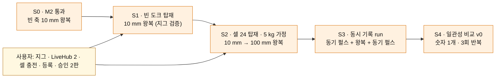
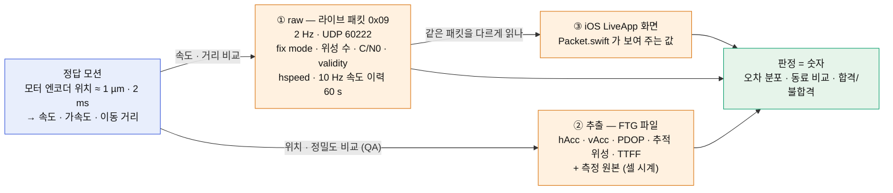
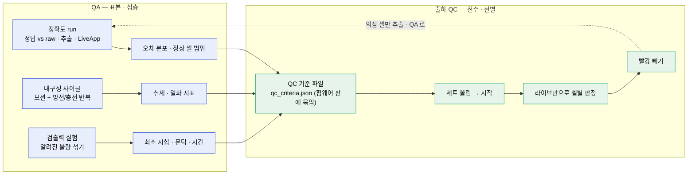
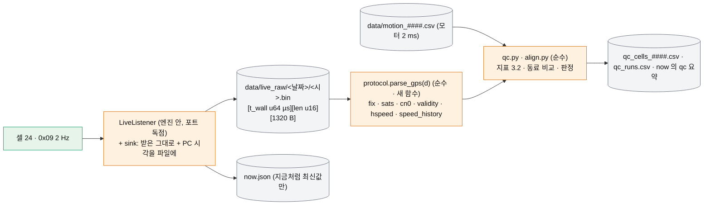
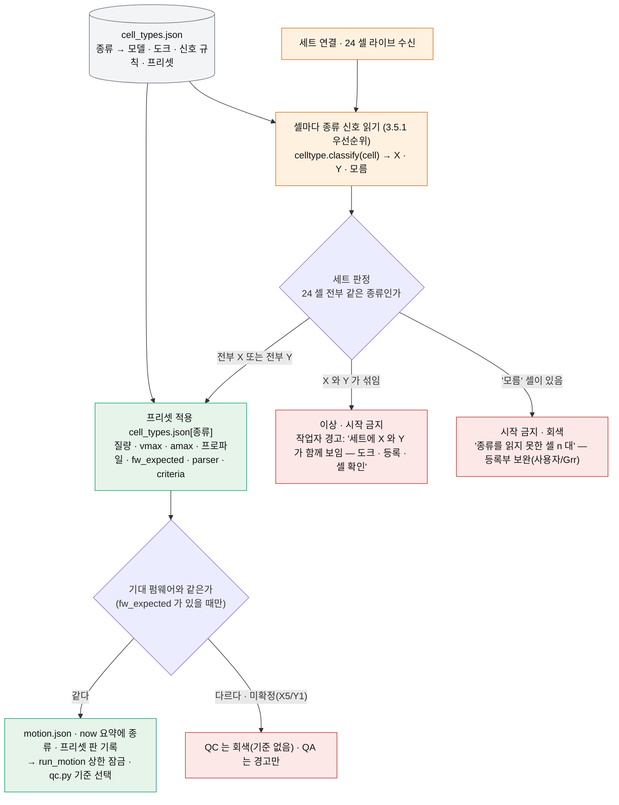
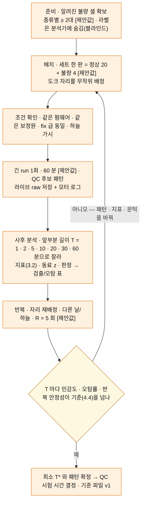
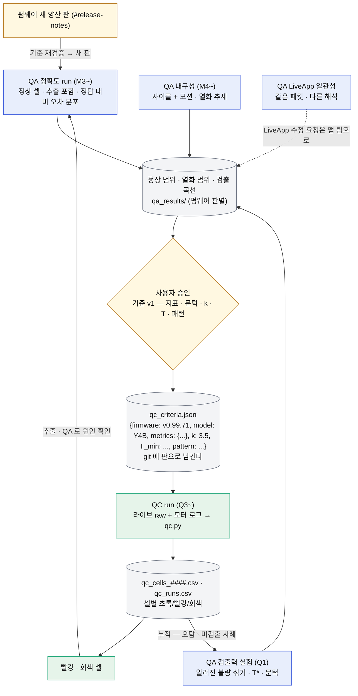
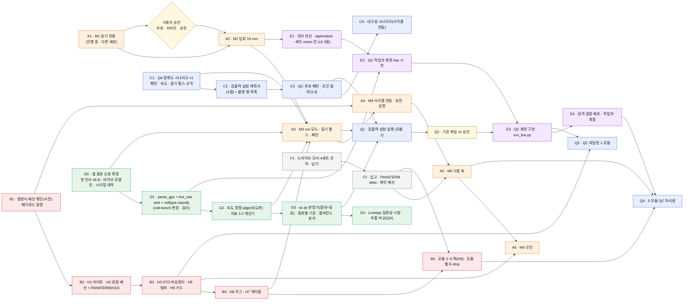
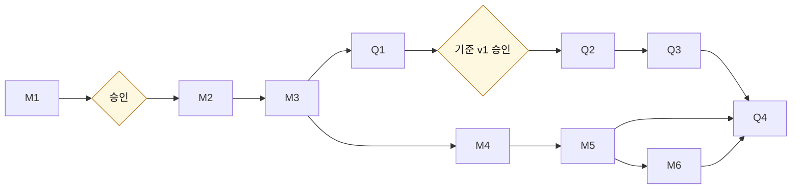

# dynamic-bench 기획 v3 — 정답 모션으로 셀 데이터를 숫자로 판정하고, QA 와 출하 QC 를 가른다

> **한 줄 결론:** 이 시스템의 목적은 **정답 모션(모터 엔코더 ≈ 1 µm)** 을 만들어 셀 데이터 — raw(라이브 패킷) · 추출(FTG 파일) · iOS LiveApp 화면 — 이 맞는지 **숫자로** 판정하는 것이다. 일은 둘로 가른다. **QA** 는 표본 몇 세트를 깊게 보는 설계·펌웨어 검증(정확도 → 내구성)이고, **출하 QC** 는 들어오는 셀을 **전수** 선별해 빨강을 골라내는 장비다 — 5 모듈 × 24 셀은 바로 이 QC 장비이며, **QA 의 결과가 QC 의 합격 기준이 된다.** QC 는 라이브 데이터만으로 판정하고(추출은 QA 와 의심 셀만), QC 시험 시간은 지금 정하지 않는다 — 알려진 불량 셀을 섞어 **검출력**을 먼저 증명하는 실험(4절)으로 정한다. v2 의 구조(cell-bench 위의 모션 엔진 `run_motion.py` · `cell-bench/motionbench/`)와 M1~M6 은 그대로 이어받고, 작업은 **여섯 갈래(A~F)** 로 나눠 동시에 진행한다(6절). 한 모듈에는 **Cell X 세트(X5/X6, 도크 DKPX-1C) 또는 Cell Y 세트(Y1/Y3B/Y4, 도크 DKPY-1C) 중 하나**만 실리고 세트는 절대 섞이지 않는다 — 시스템이 세트가 연결되면 **종류를 세트 단위로 자동 인식**해 페이로드 기반 모션 상한·프로파일, 기대 펌웨어 판, 파서 변형, 종류별 합격 기준을 **작업자 설정 없이** 스스로 고르고, X 와 Y 가 함께 보이면 시작을 막고 경고한다(3.5절).

추가 지시(2026-10-22, 셀 종류 자동 인식)를 같은 파일에 반영했다 `[사실: plan-prompt-v3-addendum.md]`.

**우선순위 변경(2026-10-22 추가 지시 2): 첫 목표는 완벽한 준비가 아니라 내일(2026-10-23)까지 동작하는 수직 슬라이스다** — 도크 1 + 셀 세트 1 을 모터에 싣고 느리게 안정적으로 움직이며, cell-bench 셀 수집과 모터 2 ms 로그가 같은 시간에 기록되고, 셀 vs 모터 일관성 검사가 숫자를 내는 것. 다듬기는 뒤로. 순서는 1.3절 `[사실: plan-prompt-v3-slice.md]`.

작성: 2026-10-22, kimpm 세션. 코드는 쓰지 않았다. `plan-v1.md` · `plan-v2.md` 는 손대지 않았다. 같은 시각 다른 세션(M1 개발)이 `cell-bench/motionbench/` · `run_motion.py` · `dynamic-bench/dev/` · `records/2026-10-22-m1.md` 를 만들고 있으며 그 파일들은 건드리지 않았다. **M1 결과는 아직 없다** — 이 문서는 M1 결과를 모르는 채로 썼다.

표기: `[사실: 출처]` 파일·지시문에서 읽은 것 · `[추정]` 계산·일반 지식 · `[제안값]` 사용자가 바꿀 초기값 · `[확인 필요]` 측정·문의로 확정할 것.

---

## 0. 읽는 법

| 절 | 무엇을 답하나 | 바쁘면 |
|---|---|---|
| 1 | **v2 정정** — 무엇이 바뀌었나 · **1.3 내일(2026-10-23) 수직 슬라이스 — 첫 목표** | 1.1 표 · 1.3 번호 목록 |
| 2 | 목적의 재정의 — 정답 모션, 세 가지 셀 데이터, QA 와 QC 의 분리 | 2.1 · 2.2 그림 |
| 3 | 셀 데이터의 사실과 파서 — GPS 필드, 보정원 조건, 측정 가능한 지표, **셀 종류(X/Y) 자동 인식(3.5)** | 3.2 표 · 3.5 그림 |
| 4 | **QC 검출력 실험 설계** — 표본, 불량 종류, 무작위화, 지표, 반복, 합격 기준 | 4.1 그림 · 4.4 표 |
| 5 | **QA → QC 기준 흐름** 한 장 | 5.1 그림 |
| 6 | **병렬 작업 흐름 A~F** — 의존관계, 목표, 첫 산출물, 선행조건, 담당, 열린 질문 | 6.1 그림 · 6.2 표 |
| 7 | 출하 QC 운영 — 작업자 UI, 물량, 원격 관리 | 7.1 그림 |
| 8 | 마일스톤 — M1~M6 유지 + QC 마일스톤 Q1~Q4 | 8.1 표 |
| 9 | 변경 목록 (v2 6절에 더해지는 것) | 9.1 표 |
| 10 | 열린 질문 · 결정 필요 | 전부 |
| 11 | 남은 것 · 읽은 파일 | — |

---

## 1. v2 정정

### 1.1 무엇이 바뀌었나

| v2 가 말한 것 | v3 의 판정 | 근거 |
|---|---|---|
| 목적 = "움직이는 상태의 셀 내구성과 데이터 확인", 목표 순서 정확도 → 내구성 → 출하 합격선 | **목적을 다시 쓴다** — 정답 모션으로 raw · 추출 · LiveApp 세 데이터를 숫자로 판정. 순서는 같되 **출하 QC 가 5 모듈의 주목적**이고 정확도만큼 중요하다 | `[사실: 지시문 v3 결정 1 · 2]` |
| QA 와 출하 판정을 한 흐름(M3 → M4 → "합격선은 나중에")으로 봤다 | **QA(표본 · 심층) 와 QC(전수 · 선별) 를 가른다.** QA 결과가 QC 기준이 된다(5절). QC 는 별도 엔진 모드 · 별도 UI · 별도 기준 파일 | `[사실: 결정 2]` |
| QC 합격 기준과 시험 시간은 "분포를 보고 사용자가 정한다"로 비워 둠 | 비워 둔 것은 맞다. 다만 **정하는 방법**을 정했다 — 알려진 불량 셀을 섞는 검출력 실험(4절)으로 최소 시험을 찾고, 그 다음 시간을 정한다 | `[사실: 결정 4]` |
| 정확도 판정의 본체 = 추출 파일(L3), 동기 펄스를 IMU 가속도와 상호상관 | **QA 는 그대로.** QC 는 **라이브만** 쓴다 — 라이브 패킷에 10 Hz 속도 이력 60초가 실려 있어(3절) 추출 없이 모터 속도와 비교할 수 있다. 동기 펄스는 가속도 대신 **속도 프로파일**로도 맞춘다 | `[사실: 결정 4 · 5 — bytes 57–1256 speed_history]` |
| "모션 엔진은 셀과 말하지 않는다 · `protocol.py` · `cells.py` 는 손대지 않는다" | 모션 엔진이 셀과 말하지 않는 것은 그대로다. 그러나 **`protocol.py` 에 GPS 파서를 더하고, `cells.py` 의 라이브 수신기에 원시 패킷 저장 통로(sink)를 더한다** — 지금은 GPS 바이트를 하나도 파싱하지 않고, 라이브 포트는 엔진이 독점이라 다른 프로세스가 들을 수 없기 때문이다(9절) | `[사실: 결정 5 "파서 추가 필요", cells.py:65-82 포트 독점]` |
| 결정 1 (Python 3.11 추가 설치) | **해결** — 3.11.9 설치됨, `py -3.11`. M1 개발은 `.venv`(3.11.9, pysoem 1.1.13) 로 돈다 | `[사실: 결정 6, dev/m1-prompt.md 실행 환경]` |
| 결정 2 (모듈 1 의 LiveHub·제어 PC) | **A 안 확정** — LiveHub 2대. QA 제어 PC 2 가 모듈 1 전용 PC, 시험 PC 의 500 사이클 시험은 그대로 | `[사실: 결정 6]` |
| 결정 3 (M1 뒤 부호·리미트·상한 승인) · 입회 운전 | **그대로.** H1~H3 전에는 입회 시에만, 최종 목표 24 h 무인 | `[사실: 결정 7]` |
| 네트워크 — Wi-Fi 하나, EtherCAT 하나, 인터넷 하나 | 그대로. 단 **셀의 RTK 보정원 자동 선택**(v0.99.71) 때문에 시험망에 인터넷이 없다는 사실이 이제 **시험 조건**이 된다(3.3) | `[사실: 결정 5]` |
| 하드웨어 요구 H1~H10 | 그대로. H1~H3 가 무인 운전의 조건이라는 점을 작업 흐름 B 로 옮겼다. 광센서 배선 여부는 사진 대기 중 | `[사실: 결정 8]` |
| 세트 = 도크 1 + 셀 24 (종류 구분 없음), 모터 상한은 세트 줄 `motor.vmax/amax` 에 사람이 적는다 | **세트는 X 또는 Y 한 종류**이고, 종류에 따라 질량 · 기대 펌웨어 · 파서 · 합격 기준이 다르다. 상한과 프로파일은 사람이 적는 것이 아니라 **인식된 종류의 프리셋**에서 온다(세트 줄의 `motor.vmax/amax` 는 프리셋을 덮는 수동 하향만 허용 `[제안값]`). 혼재는 이상 상황 | `[사실: 추가 지시]` |

### 1.2 그대로 이어받는 것

v2 의 2절(아키텍처 · 층 구조 · 5 드라이브 데이지체인 · 시리얼 대조), 3절(시간 정렬 L0~L3), 4절(모터 차선 · `/api/motion` · 세트 줄 `motor` 칸 · 입회 표지), 6절(변경 목록 · `motionbench/` 패키지), 7절(하드웨어 요구), 8절(네트워크)은 전부 유효하다. 이 문서는 그 위에 **목적 · 범위 · 작업 흐름**을 얹는다.

### 1.3 내일(2026-10-23) 수직 슬라이스 — 첫 목표

**결론.** 오늘의 M1(읽기 전용, 진행 중)과 M2(입회 10 mm 왕복, 승인 대기 `[사실: dev/m2-prompt.md]`)는 그대로 가고, 내일은 그 위에 **"도크 + 셀 24 를 싣고 느리게 왕복하면서 셀 라이브와 모터 로그를 같이 찍고, 숫자 하나를 낸다"** 까지만 간다. 전부 **입회 필수**, 페이로드 기본값 **5 kg**, 상한은 M2 승인 파일 수준(**10 mm/s · 50 mm/s²** `[사실: m2-prompt 승인 파일 예시 값, 슬라이스에도 같은 값 [제안값]]`)을 넘지 않는다. 짧은 왕복부터.

**단계 — M2 이후 최소 순서.** 각 줄은 "무엇을 · 통과 기준 한 줄 · 누가".

1. **S0 M2 통과(오늘).** 빈 축에서 10 mm 왕복 3회, Quick stop 시험 — 기준은 m2-prompt 의 기록 항목 그대로. *세션 + 사용자 입회.*
2. **S1 빈 도크 탑재.** 도크(~2.2 kg `[확인 필요]`)만 지그에 고정하고 **같은 `move` 모드 · 같은 승인값**으로 10 mm 왕복 3회. 통과: 알람 0 · 최대 추종 오차가 S0 의 2배 이하 `[제안값]` · 지그가 눈에 띄게 흔들리지 않음(사람 판정). *지그는 사용자, 실행은 세션.*
3. **S2 셀 24 탑재.** 셀을 도크에 꽂아(충전된 상태, 측정 중) 총 페이로드를 **5 kg 로 가정**(저울이 있으면 재서 기록 `[제안값]`). 10 mm 왕복 3회 → 통과하면 **승인 파일 2판**(거리 100 mm · 창 150 mm · vmax 10 · amax 50 · cycles 5 `[제안값]` — m2 코드의 절대 상한 거리 ≤ 10 mm 를 넘으므로 사용자 승인과 코드 상한 상향이 필요하다 `[사실: m2-prompt 절대 상한]`)으로 100 mm 왕복. 통과: 알람 0 · |도달 − 목표| ≤ 50 µm · 추종 오차 ≤ 2 mm `[제안값]`. *승인은 사용자, 실행은 세션.*
4. **S3 동시 기록 run.** 라이브 기록기를 먼저 켜고, 모터가 **동기 이동 3회(10 mm 왕복, amax 50 mm/s²) → 20 s 정지 → 100 mm 왕복 5회 → 동기 이동 3회** 를 돈 뒤 기록기를 끈다. 통과: 모터 CSV 와 라이브 raw 파일의 시각 범위가 겹치고 24 셀 전부 라이브가 끊기지 않음(끊김 0 `[제안값]`). *세션 + 입회.*
5. **S4 일관성 비교 v0.** 아래 3 의 스크립트로 오프셋과 오차 한 줄을 낸다. 통과: **숫자가 나오고, S3 를 3회 반복했을 때 오차가 서로 비슷하다**(예: 속도 RMSE 의 run 간 차이가 평균의 30 % 안 `[제안값]`). 결과는 `records/2026-10-23-slice.md` 에. *세션.*

**동시 기록 — 무엇을 어디에.** 최소 두 파일이다.

| 기록 | 누가 · 어떻게 | 어디에 | 비고 |
|---|---|---|---|
| 모터 2 ms 로그 | `run_motion.py` (M1 의 `motion_record.py` 그대로 — 벽시계 + monotonic + 위치 · 상태 · 추종 오차) | `cell-bench/data/motion_####.csv` | 이미 있다 `[사실: motionbench/motion_record.py 존재]` |
| 셀 라이브 raw | `LiveListener` 를 **상속**해 `_handle` 에서 받은 1320 B 를 PC 시각과 함께 그대로 덧붙여 쓰는 작은 기록기 `motionbench/live_tap.py` + `run_live.py`(슬라이스판) — cell-bench 파일은 고치지 않는다(sink 변경 D1 은 뒤로). 같은 PC 의 라이브 포트는 이 프로세스가 독점하므로 슬라이스 동안 `run_cycle.py` 는 돌리지 않는다 | `cell-bench/data/live_raw/<시각>.bin` | 파싱은 오프라인(speed_history 방향 미확인이라 raw 를 남기는 쪽이 안전) |
| 추출(FTG) | 같은 프로세스의 `CellLink.extract` 로 run 끝에 **한 번** (IMU 가 여기에만 있다) | `data/ftg/slice/` | 셀당 수 분 — 24 셀 ≈ 10 분 `[추정: handover 추출 속도]` |

**첫 단순 일관성 비교 v0.** 정답 = 모터 위치 → 속도 · 가속도(2 ms). 시간 정렬은 **동기 이동**(앞뒤 3회의 뚜렷한 10 mm 왕복)을 셀 신호와 상호상관해 오프셋을 구한다. 무엇이 실제로 쓸 만한지는 장소에 달렸다 — 정직하게 적는다.

| 셀 신호 | 어디서 | 실내일 때 | 비교 |
|---|---|---|---|
| GPS `speed_history`(10 Hz) · fix · 위성 · C/N0 | 라이브 raw | **fix 가 안 잡히면 전부 N · 속도 0 — 비교가 성립하지 않는다.** 그래도 기록은 남겨 "실내에서 GPS 가 무엇을 보고하나"를 사실로 둔다 | fix 가 있을 때만: 셀 속도 vs 모터 속도 RMSE · 지연 |
| IMU 가속도 | **추출 FTG 만** `[사실: 결정 5 — 라이브에는 없다]` | 실내에서도 된다. 다만 amax 50 mm/s² ≈ 5 mg 라 MEMS 잡음(수 mg `[추정]`)과 비슷해 동기 펄스가 묻힐 수 있다 — 펄스만 M2 절대 상한 100 mm/s² 까지 올리는 승인을 받거나, 평균을 내서 본다 `[확인 필요: 실측]` | 셀 가속도 vs 모터 가속도 상관 피크 · 오프셋 · 가속도 RMSE |

합격선은 처음엔 "숫자가 나오고 반복하면 비슷하다" 뿐이다. FTG 파서는 hw-data-qa 것을 가져다 쓰되(질문 8) 내일까지 못 가져오면 IMU 비교는 "추출 파일 확보"까지만 하고 GPS 쪽 숫자(또는 "fix 없음")로 S4 를 닫는다.

**사용자가 물리적으로 준비할 것 (정말 필요한 것만).**

| 준비 | 왜 | 비고 |
|---|---|---|
| 도크 고정 지그 | 도크가 스테이지에 단단히 붙어야 IMU 가 모터 가속을 그대로 받는다 — 양면테이프는 IMU 비교에 나쁘다 `[추정]` | 볼트 · 클램프 `[제안]`. 케이블 가이드 위로 나가는 선은 없다(아래) |
| 두 번째 LiveHub + QA 제어 PC 2 Wi-Fi 고정 192.168.1.100 | 셀 라이브는 그 주소로만 온다 | cell-bench `control-pc-setup.md` 2절 그대로. 방화벽 규칙(`install.ps1 -Only firewall`) |
| 셀 24 충전 · PC 2 의 `bench.json` 세트 등록(`label` 수동) | 라이브가 들리고 시리얼 목록이 있어야 추출 · 신원 확인이 된다 | 등록 화면 대신 `bench.example.json` 을 베껴 손으로 써도 된다(슬라이스) |
| 승인 파일 2판 · 입회 표지 | S2 의 100 mm 와 S3 run 은 M2 승인 밖이다 | 사용자가 만든다 (m2-prompt 규칙과 같은 꼴) |
| 전원 스위치 옆에 사람 · (있으면) 저울 | 안전 · 페이로드 실측 | — |

도크 전원 케이블은 **슬라이스에서는 연결하지 않는다** — 셀은 배터리로 측정하며, cell-bench 의 방전 단계가 플러그 OFF 로 몇 시간을 도는 것이 그 증거다 `[사실: system-map 2.1 DISCHARGE]`. 그래서 움직이는 선이 없다(H7 은 뒤로).

**명시적으로 미루는 것.** QC 작업자 UI(7절) · 다중 모듈(M5) · 내구성(M4) · 완전한 모니터링(모터 차선 · `/api/motion` · 클라우드) · 셀 종류 자동 인식(3.5 — 슬라이스는 세트 1 = Y4B 로 **수동 지정**) · cell-bench 변경 전부(D1 의 sink · `parse_gps` 는 오프라인 스크립트로 대신) · 기준 파일 · 검출력 실험. 슬라이스가 내는 것은 **기록 한 장과 스크립트 두 개**(`live_tap.py` · 비교 v0)이고, 그 둘은 뒤의 D1 · D2 의 씨앗이다.

---

## 2. 목적의 재정의

### 2.1 정답 모션과 세 가지 셀 데이터

- **정답은 모터다.** 스테이지 위치는 엔코더로 µm 단위, 2 ms 격자로 기록된다 `[사실: records §2, plan-v2 3.1 L1]`. 셀이 보고하는 속도·거리는 전부 이 정답과 비교해 **오차**가 된다.
- **셀 데이터는 셋이고 서로 다른 길로 나온다.** raw 는 지금 바로 받을 수 있는 유일한 실시간 경로이고, 추출은 셀당 수 분이 걸리며, LiveApp 은 같은 raw 를 iOS 가 해석해 보여 주는 화면이다. **셋이 서로 맞는지**(예: 위성 수를 iOS 가 다른 비트로 읽는 의심)도 판정 항목이다 `[사실: 결정 5 — Packet.swift 하위 5비트]`.
- **지금 cell-bench 는 raw 의 GPS 부분을 읽지 않는다** `[사실: protocol.py parse_live — serial · rssi · hr · battery · state 만]`. 그래서 D 흐름의 첫 일이 파서다(3절).

### 2.2 QA 와 출하 QC — 같은 장비, 다른 질문

| | **QA (품질 보증)** | **출하 QC (품질 검사)** |
|---|---|---|
| 질문 | 이 설계 · 이 펌웨어가 **얼마나** 정확하고 오래 가나 | 이 셀 한 대가 **합격인가** |
| 대상 | 표본 몇 세트, 깊게 | 들어오는 셀 전수 (한 번에 10~20 세트 × 24 셀) `[사실: 결정 3]` |
| 데이터 | raw + **추출** + LiveApp | **raw 만** (추출은 의심 셀만) `[사실: 결정 4]` |
| 시간 | 길다 (정확도 run 반복, 내구성은 사이클 단위) | 짧다 — 검출력 실험이 정한 최소 시간 |
| 출력 | 오차 분포 · 추세 · 보고서 | 셀별 초록/빨강 · 빨강 목록 |
| 기준 | 없음 — 기준을 **만든다** | QA 가 만든 기준을 **적용한다** |
| 운영자 | 사용자 · Grr · 세션 | 별도 QC 작업자 (코드 · 설정 편집 없음) `[사실: 결정 3]` |
| 모듈 | 모듈 1 (QA 제어 PC 2) | 5 모듈 전부 (모듈 1 은 QA 와 시간을 나눠 쓴다) |

---

## 3. 셀 데이터의 사실과 파서

### 3.1 라이브 패킷 0x09 에서 읽을 수 있는 것 — 펌웨어 사실

양산 펌웨어는 Y4 계열(Y4A · Y4B · Y3B · X6A · X6B) **v0.99.71** 이고(2026-10-13 Slack #release-notes, 담당 김빛 — 양산 판단은 #release-notes 게시만 인정), GPS 라이브/FTG 필드는 v0.99.61 이후 바뀌지 않았다 `[사실: 결정 5, 저장소 fitogether-org/cell-y4-ESP32-S3-firmware master 08fe785e]`.

| 바이트 | 내용 | 단위 · 꼴 | 비고 |
|---|---|---|---|
| 11 | 시리얼 | u16 LE | 이미 파싱 `[사실: protocol.py]` |
| 41 | hspeed | **단위 의심** | 10 Hz 이력과 대조해 단위를 확정한다 `[확인 필요]` |
| 47 | fix mode | ASCII `N` / `A` / `D` / `F` / `R` | N = 없음, A = 단독, D = DGPS, F = RTK float, R = RTK fix `[추정 — NMEA 관례]` |
| 48 | 사용 위성 수 | 상위 5비트 (`>> 3`) | iOS 는 하위 5비트로 읽는다는 의심 → LiveApp 일관성 항목 |
| 49 | 평균 C/N0 | dBHz, u8 | 안테나·차폐 상태의 직접 지표 |
| 50~53 | RSSI · 심박 · 배터리 · 상태 | — | 이미 파싱 |
| 55 | gps_validity 비트 | 비트 묶음 (KINEXON=0 빌드) | 비트 뜻 `[확인 필요 — 펌웨어 소스]` |
| 57~1256 | speed_history | mm/s · 10 Hz · 60 s = 600 표본 (u16 `[추정]`) | **QC 의 핵심** — 패킷마다 지난 60초가 실려 2 Hz 패킷 중 20초마다 하나만 읽어도 10 Hz 전부를 얻는다. 이력의 방향(0번이 오래된 것인가 최신인가)과 표본 폭 `[확인 필요]` |
| 그 밖 | 1320 B 중 나머지 | — | 시각 칸 · 계수기가 있는지 `[확인 필요]` |

**없는 것:** HDOP 은 어디에도 없다. hAcc · vAcc · PDOP · 추적 위성 수 · TTFF 는 **추출 FTG 파일에만** 있다 `[사실: 결정 5]`. 그래서 위치 정밀도 자체는 QA(추출)의 몫이고, QC 는 속도 · fix · 위성 · C/N0 · validity · 끊김으로 판정한다.

### 3.2 측정 가능한 지표 — 셀 하나, run 하나에서

| 지표 | 재료 | 정답과의 비교 | 동료 비교 | 쓰는 곳 |
|---|---|---|---|---|
| `speed_rmse` · `speed_bias` · `speed_lag` | 10 Hz 속도 이력 vs 모터 속도(2 ms → 10 Hz 로 내림) | 있음 — 절대 오차 | 있음 | QA · QC |
| `dist_err` | 속도 이력 적분 vs 모터 이동 거리 | 있음 | 있음 | QA · QC |
| `fix_frac` (N · A · D · F · R 비율) | byte 47 | 없음 | 있음 — 24 셀이 같은 하늘 | QC · 조건 검사(3.3) |
| `sats_mean` · `sats_min` | byte 48 (`>> 3`) | 없음 | 있음 | QC |
| `cn0_mean` · `cn0_min` | byte 49 | 없음 | 있음 — 안테나 불량의 1차 지표 | QC |
| `validity_bad_frac` | byte 55 | 없음 | 있음 | QC (비트 뜻 확인 뒤) |
| `live_gap_n` · `live_gap_max_s` | 수신 시각 `[사실: cells.py:107 time.time()]` | 없음 | 있음 | QC (Wi-Fi · 전원 불량) |
| `rssi_mean` | byte 50 | 없음 | 있음 (도크 위치 효과 큼) | 참고 |
| `batt_slope` | byte 52 추세 | 없음 | 있음 | QA 내구성 · QC(전원) |
| `hr_ok_frac` | byte 51 (심박 짝이 있을 때) | 없음 | 있음 | QA (cell-bench 심박 차선 재사용) |
| `app_consistency` | LiveApp 표시값 vs 같은 패킷의 파싱값 | — | — | QA (LiveApp 일관성) |
| `hacc` · `pdop` · `ttff` | **추출 FTG 만** | 위치 오차 (정답 위치 vs 추정 위치) | 있음 | QA · 의심 셀 |

### 3.3 시험 조건 — "24 셀이 같은 보정 조건"을 보장한다

v0.99.71 은 Y4A/Y4B 에 **RTK 보정원 자동 선택**을 더했다 — 인터넷 NTRIP 이 가능하면 그것을, 아니면 LiveHub 보정을 쓴다 `[사실: 결정 5]`. 동료 비교는 "24 셀이 같은 하늘 · 같은 모션 · **같은 보정**"일 때만 성립한다. 보정원이 섞이면 fix mode 차이가 불량이 아니라 보정원 차이다.

| 조건 | 어떻게 보장하나 | 어떻게 확인하나 |
|---|---|---|
| 같은 보정원 | 시험망 LiveHub 는 WAN 이 비어 **인터넷이 없다** `[사실: handover 2절]` → 셀은 NTRIP 에 닿지 못해 전부 LiveHub 보정으로 떨어진다 `[추정 — 자동 선택 규칙에서]`. 시험 중 LiveHub 에 인터넷을 **붙이지 않는다**는 것이 절차다 | run 시작 전 24 셀의 fix mode 가 같은 급(예: 전부 F/R 또는 전부 A)인지 본다. 섞여 있으면 run 을 시작하지 않고 `cond_mixed_fix` 로 남긴다. 보정원을 라이브에서 직접 읽을 수 있는지(validity 비트?)는 `[확인 필요]` |
| LiveHub 가 RTK 기준국인가 | "LiveHub 보정"이 LiveHub 자체의 기준국 보정인지, LiveHub 를 거쳐 오는 것인지 | `[확인 필요 — 펌웨어 담당 · LiveHub 사양]` |
| 같은 하늘 | 24 셀이 같은 스테이지 위에 있다. **벤치 설치 장소의 하늘 가시성**이 전제다 — 실내면 GPS 가 아예 잡히지 않거나 전부 N 이다 | 10절 결정 1 |
| 같은 모션 | 같은 스테이지 | 모터 로그 |
| 같은 펌웨어 | run 시작 때 24 셀의 펌웨어 판이 같고 양산 판(v0.99.71)인지 — 라이브에 펌웨어 판이 실리는지 `[확인 필요]`, 없으면 추출 또는 LiveApp 으로 run 전 1회 확인 | `fw_version` 칸을 run 기록에 남긴다 |
| Y1 계열(X5/Y1) | 양산 판 미확정 — 릴리스 노트 없음 `[사실: 결정 5]` | QC 대상에서 **제외**(기준 파일에 그 기종 항목을 두지 않는다) — 열린 항목 |

### 3.4 파서와 저장 통로 — 어디에 무엇을 더하나

라이브 포트(UDP 60222)는 cell-bench 엔진이 독점해 다른 프로세스가 들을 수 없다 `[사실: cells.py bind_live_udp SO_EXCLUSIVEADDRUSE]`. 그래서 "모션 엔진이 셀을 듣는다"는 길은 없고, **엔진의 수신기가 받은 원시 패킷을 파일로 흘려 주는 통로(sink)** 를 둔다. 분석기는 그 파일을 읽는다.

- **sink 는 끄면 지금과 바이트 단위로 같다.** `LiveListener._handle` 에서 `self.sink(d, ip, now)` 한 줄 — 기본값은 아무것도 하지 않는 함수. 켜면 1320 B × 2 Hz × 24 셀 ≈ 63 KB/s ≈ 230 MB/h `[추정]` — QC run(수십 분) 동안만 켠다.
- **`parse_live` 는 바꾸지 않는다.** `Live` 가 frozen dataclass 라 칸을 더하면 `CellLive`·`now.json`·검사가 흔들린다. GPS 는 별도 함수 `parse_gps` 로 둔다 — 같은 1320 B 를 받아 3.1 표를 돌려준다.
- **raw 파일의 시각 = PC 수신 시각.** 10 Hz 이력의 각 표본 시각은 "수신 시각 − (599 − i) × 100 ms" `[추정 — 이력 방향 확인 뒤 확정]` 으로 두고, 정확한 오프셋은 모터 속도 프로파일과의 상호상관(v2 3.2 동기 펄스를 속도로)으로 run 마다 잰다. 10 Hz 라 정렬 정밀도는 ±50 ms 가 바닥이다 `[추정]` — QC(속도 RMSE · 거리)에는 충분하고, QA 의 ≤ 10 ms 정렬은 v2 대로 추출 데이터로 한다.

### 3.5 셀 종류(X/Y) 자동 인식 — 세트 단위로 알아내고, 작업자 설정 없이 스스로 맞춘다

**결론.** 세트가 연결되면 시스템이 들리는 셀마다 종류 신호를 읽어 **세트의 종류를 만장일치로** 정한다. 만장일치면 그 종류의 프리셋(질량 · 모션 상한 · 프로파일 · 기대 펌웨어 · 파서 · 합격 기준)이 자동으로 걸리고, **X 와 Y 가 함께 보이거나 종류를 모르는 셀이 있으면 시작을 막고 작업자에게 경고**한다 — 세트는 절대 섞이지 않는다는 것이 사용자의 확인이므로 `[사실: 추가 지시]`, 혼재로 읽힌다는 것은 오인식 · 배선 · 등록 오류다.

#### 3.5.1 어떤 신호로 구분하나 — 근거가 있는 것부터

| 순위 | 신호 | 근거 | 상태 |
|---|---|---|---|
| 1 | **셀이 스스로 보고하는 모델 문자열** | 인수인계가 "셀은 `CLBY4B` 로 보고" 라고 적었다 `[사실: handover.md:48 — 다만 '미확인' 꼬리표, 사용자 말로는 CLBX6]`. 어느 메시지에 실리는지는 코드에 없다 — 추출 때 받는 **46 바이트 첫 인사**는 받기만 하고 해석하지 않으며 `[사실: cells.py:302]`, 라이브 0x09 의 파싱된 바이트(11 · 47~53 · 57~1256)에는 모델 칸이 없다 `[사실: protocol.py, 결정 5]` | `[확인 필요 — 펌웨어 소스 · 첫 인사 46 B 의 내용]`. 라이브에 실려 있으면 이것이 정답이다(연결 즉시 · 추출 없이) |
| 2 | **시리얼 → 종류 등록부** (`cell_types.json` 의 시리얼 범위 · 또는 Fitstack 의 셀 모델 표) | 시리얼은 라이브에 실린다 `[사실: protocol.py byte 11]`. 모델별 시리얼 대역이 있는지는 모른다 — 세트 1 은 11733~11756 (label CLBY4B), 세트 2 예시는 11594~11617 `[사실: bench.example.json, README 등록 예시]` | `[확인 필요 — Fitstack Specification 에서 시리얼↔모델 대역]`. 대역이 있으면 1 순위가 없어도 자동 인식이 된다 |
| 3 | 펌웨어 판 (라이브 또는 첫 인사에 실릴 때) | X6 계열은 Y4 펌웨어 패밀리(v0.99.71 목록에 X6A · X6B 가 있다) `[사실: 결정 5]` — 그래서 **펌웨어 판만으로는 X6 과 Y4 를 못 가른다.** X5/Y1 은 다른 패밀리 | 보조 신호 |
| 4 | 도크 종류 (DKPX-1C · DKPY-1C) | 도크는 PC 와 데이터 선이 없다 — USB-C 는 전원뿐 `[사실: handover 2절]`. 플러그 전력으로 가르는 것은 믿을 수 없다 `[추정]` | **쓰지 않는다** — 등록 때 사람이 적는 참고 칸만 |
| 5 | 세트 줄 `label` 을 사람이 적음 | 지금 cell-bench 의 유일한 "종류" 정보 `[사실: config.py DEFAULT_SET label]` | **자동 인식의 대체가 아니다** — 1·2 순위가 모두 없을 때 QA 에서만 수동 지정 허용, QC 는 회색 |

판정 함수 `celltype.classify(cell) → ("X" | "Y" | None, 근거)` 는 1 순위부터 차례로 보고 처음 확정되는 것을 쓴다. 1 순위와 2 순위가 **서로 다르면** 그 셀은 '모름' 이 아니라 **모순**으로 기록해 시작을 막는다(등록부가 틀렸거나 셀이 바뀐 것).

#### 3.5.2 종류별 프리셋 `cell_types.json` — 무엇이 자동으로 걸리나

| 칸 | Cell X (X5 · X6) | Cell Y (Y1 · Y3B · Y4) | 상태 |
|---|---|---|---|
| `dock` | DKPX-1C | DKPY-1C | `[사실: 추가 지시]` |
| 질량 | 도크 ~2.2 kg + 셀 24 × ~51~60 g ≈ **3.4~3.6 kg** `[추정 — 추가 지시의 수치로 계산]`. X 와 Y 가 다르다고 하나 각각의 값은 모른다 | 같음 | **실측 전까지 둘 다 보수적 기본값 페이로드 5 kg** `[사실: 추가 지시 · 확인 필요 — Fitstack Specification 재확인 중]` |
| `vmax` · `amax` | 페이로드로 정한다 — 모터 추력 한계 · 1.4 g 금지(v1) · 지그 고정력에서 계산. 5 kg 기본값일 때의 수치는 A 흐름이 M3 에서 낸다 | 같음 | `[제안값 — M2 뒤 승인 상한 안에서]` |
| 모션 프로파일 프리셋 | QA 정확도 · 내구성 · QC 패턴(4절) 의 속도 · 가감속 · 정지 시간 | 같음 (질량이 다르면 가감속만 다르게) | `[제안값]` |
| `fw_expected` | X6: **v0.99.71** (Y4 패밀리) · X5: **미확정** | Y4 · Y3B: **v0.99.71** · Y1: **미확정** | `[사실: 결정 5]`, X5/Y1 은 열린 항목 |
| `parser` | X6: Y4 패밀리와 같은 0x09 형식 `[추정 — 같은 펌웨어]` · X5: Y1 패밀리 형식 `[확인 필요]` | Y4/Y3B: 3.1 표 · Y1: `[확인 필요]` | 형식이 다르면 `parse_gps` 에 변형을 둔다 |
| `criteria` | `qc_criteria.X.json` | `qc_criteria.Y.json` | QA 가 종류별로 따로 만든다(5절) — 기준 파일이 종류 · 펌웨어 판 둘에 묶인다 |

`cell_types.json` 은 git 에 두고(기준 파일과 같은 길) 사용자/Grr 만 고친다. 작업자 화면은 인식 결과("Y 세트 · Y4 · v0.99.71 · 프리셋 v1")를 **보여 주기만** 한다(7절).

#### 3.5.3 언제 다시 보나

| 때 | 하는 일 |
|---|---|
| 세트 선택 · 시작 직전 | 24 셀 전부 읽어 판정(만장일치 · 모순 · 모름). 결과를 run 기록(`qc_runs.csv` · `motion_runs.csv`)에 종류 · 근거 · 프리셋 판으로 남긴다 |
| run 중 | 새로 들리는 셀이 다른 종류면 즉시 정지(Quick stop) · 빨강 — 섞일 수 없는 것이 섞였다 |
| 등록(4.4 · v2) | 세트 줄에 `cell_type` 칸을 **기록용**으로 남기되, 다음 시작 때 다시 읽어 다르면 모순으로 막는다 |

---

## 4. QC 검출력 실험 설계 — "불량을 확실히 잡는 최소 시험"

### 4.1 한눈에

**핵심 수법 둘.** 첫째, **긴 run 하나를 찍고 앞부분을 잘라 가며 본다** — 1분짜리 시험과 60분짜리 시험을 따로 돌리지 않아도 "몇 분이면 잡히나"의 곡선이 한 번에 나온다. 둘째, **블라인드** — 어느 자리에 불량이 있는지 분석기(와 가능하면 분석하는 사람)가 모른 채 판정하고, 나중에 라벨을 열어 맞춘다.

### 4.2 표본과 불량 종류

| 항목 | 제안 | 근거 · 모르는 것 |
|---|---|---|
| 한 판의 구성 | 정상 20 + 알려진 불량 4 = 24 `[제안값]` | 24 는 도크 한 세트. 불량이 너무 많으면 동료 비교의 "다수 = 정상" 가정이 흔들린다(4 / 24 ≈ 17 %, 중앙값 기반 통계는 25 % 까지 견딘다 `[추정]`) |
| 불량 종류 | GPS 안테나·RF(낮은 C/N0, fix 못 잡음) · 전원(배터리 급강하, 꺼짐) · 무선(라이브 끊김, RSSI) · 펌웨어/센서(속도 이력 이상, validity) · BLE(심박 못 붙음) `[제안값 — 종류 이름만]` | **알려진 불량 셀의 확보 가능 여부 · 종류별 수량은 사용자 답 대기** `[사실: 결정 8]`. 확보가 안 되는 종류는 **인위 불량**으로 대신한다 — 안테나 차폐(알루미늄 테이프), 배터리 노화 셀, Wi-Fi 감쇠(금속 상자) — 다만 인위 불량은 "그 종류를 잡는다"의 증거이지 실제 불량 분포의 증거는 아니다 |
| 종류별 수 | 종류당 ≥ 2대, 전체 ≥ 8대 `[제안값]` | 2대면 "우연히 그 한 대만" 을 거른다 |
| 정상 셀 | 양산 펌웨어 v0.99.71 · 같은 기종 · QA 정확도 run 을 한 번 통과한 셀 | 정상의 정의가 순환하지 않게 — 정상 셀은 **QA 로 먼저** 확인한 셀 |

### 4.3 배치 · 무작위화 · 반복

| 요소 | 제안 | 왜 |
|---|---|---|
| 도크 자리 | run 마다 24 자리를 난수로 재배정, 배정표를 `qc_layout_####.csv` 로 남긴다 | 자리(앞/뒤 · 안테나 방향 · LiveHub 거리)가 RSSI · C/N0 에 영향을 준다 `[추정]`. 섞어야 자리 효과와 셀 효과가 갈린다 |
| 날 · 하늘 | R = 5 회를 **다른 날 · 다른 시간대**에 `[제안값]` | 위성 배치가 바뀐다. 하늘 가시성이 나쁜 날의 오탐을 본다 |
| 패턴 | QC 후보 패턴 1개로 시작 — 왕복 정속 0.5 ~ 1.5 m/s + 정지 구간 `[제안값]`, 속도는 A 흐름의 승인 상한 안에서 | 속도가 0 과 양수를 오가야 속도 오차 · 지연이 보인다. 상한은 10절 결정 3 |
| 조건 기록 | run 마다 펌웨어 판 · fix 급 · 날씨/하늘 · 자리표 · 패턴 · 모터 상한 | 나중에 기준이 안 맞을 때 되짚을 수 있게 |
| 블라인드 | 라벨 파일은 run 이 끝날 때까지 분석기가 읽지 않는 폴더에 | 판정 규칙을 불량에 맞춰 조정하는 유혹을 막는다 |

### 4.4 판정 지표와 합격 기준 — 무엇을 세나

| 지표 | 정의 | 목표 `[제안값]` | 모르는 것 |
|---|---|---|---|
| **민감도(검출률)** | 시간 T 에서, 불량 셀 중 빨강으로 판정된 비율 | 100 % (모든 반복에서) | 종류별로 따로 센다 — 한 종류가 안 잡히면 그 종류는 "이 시험으로 못 잡음"으로 기록하고 QA(추출)로 보낸다 |
| **오탐률** | 정상 셀 중 빨강 비율 | ≤ 1 / 24 / run (약 4 %) | 오탐은 재검사 비용이지 출하 사고가 아니다 — 민감도보다 느슨하게 |
| **반복 안정성** | 같은 셀의 판정이 R 회 중 일치하는 비율 | 정상 셀 ≥ 95 %, 불량 셀 100 % | 자리 재배정 뒤에도 유지돼야 한다 |
| **최소 시간 T\*** | 위 셋을 모두 넘는 가장 짧은 T, 그리고 그 두 배 `[제안값: 여유 2배]` 를 QC 시험 시간 후보로 | — | 사용자가 정한다(결정 4) |
| **문턱의 신뢰 구간** | 불량 시도 수 n = (불량 셀 수) × R 에서 미검출 0 일 때, 미검출률의 95 % 상한 ≈ 3 / n `[추정 — rule of three]` | — | 아래 표 |

| 불량 시도 수 n (불량 셀 × 반복) | 미검출 0 일 때 미검출률 95 % 상한 | 뜻 |
|---|---|---|
| 20 (4 × 5) | ≈ 15 % | "확실히 잡는다"고 말하기엔 약하다 — 첫 라운드용 |
| 40 (8 × 5) | ≈ 7.5 % | 종류당 2대 × 5회 |
| 60 (8 × 7.5 또는 12 × 5) | ≈ 5 % | 사용자가 "5 % 이하" 를 원하면 이 규모가 필요하다 |

이 표는 **"미검출률 ≤ x % 를 95 % 신뢰로 말하려면 불량 시도가 ≈ 3/x 번 필요하다"** 는 것 하나만 말한다. 원하는 x 는 사용자가 정한다(10절 결정 2).

### 4.5 판정 규칙의 꼴 — 절대 기준 + 동료 기준

셀 c 의 run 지표 m 에 대해 둘을 함께 본다.

1. **절대 기준** — QA 가 정상 셀 분포로 정한 범위 밖이면 빨강(예: `speed_rmse > a`, `cn0_mean < b`). 값 a · b 는 **QA 의 산출**이지 여기서 정하지 않는다.
2. **동료 기준** — 같은 run 의 24 셀 중앙값과 MAD(중앙 절대 편차)로 로버스트 z 를 구해 `|z| > k` 면 빨강 `[제안값 k = 3.5]`. 24 셀이 같은 하늘 · 모션 · 보정을 공유하므로 그날의 조건이 나빠도 "남들과 다른 셀"이 드러난다 `[사실: 결정 5 의 발상]`.
3. **조건 검사가 먼저** — fix 급이 섞여 있거나 라이브가 반 넘게 끊긴 run 은 판정하지 않고 `cond_fail` 로 남긴다(3.3). 동료 비교는 다수가 정상일 때만 뜻이 있다.

둘 중 하나라도 빨강이면 빨강, 둘 다 통과면 초록, 조건 실패면 회색("판정 불가 · 다시")이다. 이 셋이 작업자 화면의 색이다(7절).

### 4.6 QC 는 라이브만 — 추출은 언제

QC 판정에 추출을 쓰지 않는 이유는 셀당 수 분이 걸려 전수 검사에 맞지 않아서다 `[사실: 결정 4, handover 추출 속도 6대 2.88 MB/s]`. 추출은 **① QA run, ② QC 에서 빨강 · 회색이 난 셀**(원인을 hAcc · PDOP · TTFF 로 확인) 에만 한다. 그래서 QC 모듈의 도크에서도 cell-bench 의 추출 기능(`CellLink.extract`)은 그대로 쓸 수 있어야 한다 — 다만 QC 중이 아니라 끝난 뒤, 사람이 고른 셀만.

---

## 5. QA → QC 기준 흐름 — 한 장

### 5.1 그림

### 5.2 규칙 셋

1. **기준은 펌웨어 판에 묶인다.** `qc_criteria.json` 의 `firmware` 칸이 run 의 셀 펌웨어와 다르면 QC 엔진은 판정하지 않는다("기준 없음 · 회색"). 양산 판이 바뀌면(#release-notes 게시) QA 정확도 run 을 다시 돌려 기준을 새 판으로 올린다.
2. **기준 파일은 git 에 판으로 남는다.** 작업자 PC 의 설정을 손으로 고치지 않는다 — 사용자/Grr 이 저장소에서 고치고 원격으로 배포한다(7.3).
3. **QC 결과는 QA 로 되돌아온다.** 빨강 셀의 추출 결과와 "나중에 현장에서 불량으로 드러난 셀"(미검출)이 쌓이면 검출력 실험을 다시 돌려 문턱을 조정한다. 이 되먹임 없이는 QC 기준이 늙는다.

---

## 6. 병렬 작업 흐름 A~F

### 6.1 의존관계 — 무엇이 무엇을 기다리나

읽는 법: 같은 색이 한 흐름이다. 화살표가 없는 두 상자는 **동시에** 해도 된다. 지금 당장 동시에 시작할 수 있는 것은 **A1(진행 중) · B1 · C1 · D1 · E1(설계만) · F1** 여섯이다.

### 6.2 흐름별 — 목표 · 첫 산출물 · 선행조건 · 담당 · 열린 질문

| 흐름 | 목표 | 첫 산출물 | 선행조건 | 담당 | 열린 질문 |
|---|---|---|---|---|---|
| **A 모션 제어** | `run_motion.py` 가 M1 → M6 를 지나 입회 없이 24 h 도는 것. 상한 · 프로파일은 **인식된 셀 종류의 프리셋**(3.5.2)에서 읽고, 종류를 모르거나 혼재면 서보를 켜지 않는다 | `records/2026-10-22-m1.md` (진행 중, 다른 세션) | M2 는 사용자 승인(부호 · 리미트 · 상한) · M3 는 B4(지그) · C1(패턴 규격) · D0(종류 신호) · D2(정렬) · M6 는 B3 | 세션(kimdeveloper) · 승인은 사용자 | Windows 주기 p99 가 4 ms 를 넘으면? (v1 대비책: 주기 스레드만 C) · 페이로드 5 kg 기본값일 때 vmax/amax 를 무엇으로 계산하나(추력 · 지그) |
| **B 기계 · 안전** | H1~H3 를 갖춰 무인 운전의 전제를 만들고, 지그 · 케이블 · 랙 | B1 — 광센서 배선 사진과 판정, 페이로드 질량 | 없음 (지금 시작) | **사용자** (기계 개발자) · 매뉴얼 확인은 세션이 돕는다 | X3/X4 핀 · Pr5.04 뜻 · STO 5대 직렬 가능 여부 `[확인 필요]` (v2 7.1) |
| **C 시험 시나리오** | QA 정확도 · 내구성 시나리오와 QC 검출력 실험 계획 — **X 와 Y 를 따로**(질량 · 펌웨어 · 기준이 다르다). 검출력 실험(4절)은 종류마다 한 번씩 | C1 — 정확도 시나리오 v1 (패턴 · 속도 · 동기 펄스 규격 · run 기록 칸, 종류별 프로파일 프리셋 초안) | C1 은 없음 · C2 는 불량 셀 목록(결정 8) · Q1 은 A3 + D3 | 세션(kimpm/kimqa) 초안 · 사용자 승인 | 불량 셀 확보 · 종류 · 원하는 미검출률 x(4.4) · 하늘 가시성(10절 결정 1) · X 세트를 먼저 할지 Y 를 먼저 할지(지금 있는 세트 1 은 Y4B) |
| **D 데이터 정렬 · 분석** | 라이브 raw 를 파싱 · 저장 · 정렬 · 판정하는 순수 함수 묶음, 추출 · LiveApp 비교, **셀 종류 자동 인식** | D0 — 종류 신호 확정 메모(첫 인사 46 B 내용 · 라이브 모델/펌웨어 칸 · 시리얼 대역) · D1 — `protocol.parse_gps` + `live_raw` sink + `celltype.classify` + pytest | 바이트 사실(3.1)은 있음. speed_history 방향 · 폭 · hspeed 단위 · validity 비트 · **모델 문자열의 자리**는 펌웨어 소스 확인 | 세션(kimdeveloper) · 펌웨어 사실 확인은 사용자 ↔ 김빛 · 시리얼 대역은 사용자 ↔ Fitstack | 라이브에 시각 · 계수기 · 펌웨어 판 · 모델이 있나 · X5/Y1 패킷 형식이 다른가 · FTG 파서(hw-data-qa) 재사용 가능 여부 |
| **E 모니터링 + QC 작업자 UI** | cell-bench 결과판 위에 모터 차선(v2 4절)과 **작업자용 QC 화면**, 원격 설정 배포. 화면은 인식된 종류 · 프리셋을 보여 주기만 하고 바꾸는 칸이 없다 | E1 — v2 6.1 의 변경 8파일 · E2 — `#qc` 화면 시안(7절, 혼재 경고 포함) | E1 은 A2 뒤(모터 상태가 있어야 보인다) · E2 는 D1(인식 결과 꼴) · E3 는 Q2(기준 v1) · E4 는 원격 통로 결정 | 세션(kimdesigner/kimdeveloper) · 작업자 계정 · 원격 통로는 사용자/Grr | 세트 식별(스캔? 시리얼 범위?) · 작업자 PIN · Tailscale 승인 상태(handover 미결) · Grr 의 역할 `[확인 필요]` |
| **F 조달** | 모터 · 드라이브 4세트 추가(총 5) | F1 — 견적 · 납기 · 동일 모델(MBDLN25BL + 같은 모터/스테이지) 확인 | 없음 (지금 시작) · F2 입고 뒤 PANATERM 으로 Station alias = 모듈 번호 | **사용자** | 같은 스테이지 길이(1768 mm)인가 · 전원 용량 · EtherCAT 케이블 길이 · 납기가 B5 랙보다 빠른가 |

### 6.3 지금 당장 — 다음 2주 `[제안값]` 에 동시에 도는 것

| 갈래 | 무엇 | 누가 | 막히는 것 |
|---|---|---|---|
| A1 | M1 10분 읽기 전용 시험 · 기록 | 세션 (진행 중) | Npcap 권한 |
| B1 | 광센서 사진 · 배선 판정 · 페이로드 질량 답 | 사용자 | 사진 · Fitstack 문의 |
| C1 | 정확도 시나리오 v1 초안 | 세션 | 없음 |
| D0 | 종류 신호 확정 — 첫 인사 46 B 를 한 번 받아 보고(추출 때 이미 받는다) 펌웨어 소스에서 모델 칸을 찾기 · Fitstack 에 시리얼 대역 문의 | 세션 + 사용자 | 펌웨어 저장소 접근 · Fitstack 답 |
| D1 | `parse_gps` · sink · `celltype.classify` · 검사 (cell-bench 변경, 별도 브랜치 세션) | 세션 | speed_history 방향 · 폭 `[확인 필요]` — 모르면 두 가지 다 받는 파서로 쓰고 실데이터로 정한다. 종류 신호가 없으면 등록부(2 순위)만으로 먼저 만든다 |
| E2 | QC 작업자 화면 시안(HTML 목업) | 세션(kimdesigner) | 세트 식별 방식 |
| F1 | 견적 · 납기 | 사용자 | 없음 |

---

## 7. 출하 QC 운영

### 7.1 작업자 화면 — 상용 제품만큼 쉬워야 한다

| 작업자가 하는 것 | 작업자가 **못 하는** 것 | 왜 |
|---|---|---|
| 세트 올리기 · 선택 · 시작 · 정지 · 결과 보기 · 빨강 빼기 · **인식된 종류 확인(보기만)** | 설정 편집 · 기준 파일 변경 · 모터 상한 변경 · **셀 종류 · 프리셋 선택**(자동 인식 결과를 덮어쓰는 칸이 없다) · 코드 · PIN 이 필요한 cell-bench 기능(등록 · 짝 검증 · 운전 켜기) | 설정은 사용자/Grr 이 원격으로만 `[사실: 결정 3 · 추가 지시]`. 결과판의 기존 화면(관제 · 세트 상세 · 점검 · 등록)은 **작업자 모드에서 숨긴다**. 혼재 · 모름 경고가 뜨면 작업자가 할 일은 "도크 · 셀 확인 뒤 다시" 와 "사용자/Grr 호출" 둘뿐 |
| — | 모션 시작은 H1~H3 전에는 작업자 몫이 아니다 — 사용자 입회 표지가 있어야 시작 단추가 켜진다(v2 4.2). H1~H3 뒤에는 "안전장치 확인 표지"로 바뀌어 작업자가 시작할 수 있다 | `[사실: 결정 7]` |

화면은 cell-bench 결과판 `board/index.html` 의 새 view `qc`(주소 `#qc`)로 둔다 — 결과판은 이미 해시 라우팅과 세트 카드 · 셀 24칸 그리기를 갖고 있다 `[사실: index.html:1242-1245 ops · set · trend · proc · check · register]`. 작업자 모드는 서버 시작 인자(`serve_board.py --worker`)로 켜서 다른 view 를 숨기고 `#qc` 만 보인다 `[제안값]`.

### 7.2 QC 모듈의 프로그램 구성 — 사이클 엔진 없이

QC 는 방전 → 추출 → 충전 사이클이 필요 없다(들어온 셀을 도크에 올려 켠 채 수십 분 움직이고 판정한다). 그런데 라이브 포트는 한 프로그램만 열 수 있고 그 프로그램이 `now.json` · sink 를 써야 한다. 그래서 QC 모듈에는 **가벼운 라이브 프로그램 `run_live.py`** 를 둔다 — `LiveListener`(sink 켜짐) + `Plug`(켜 둠) + `now.json` 심박만. 사이클 엔진(`run_cycle.py`)은 내구성 QA 모듈에서만 돈다.

| 모듈 용도 | 라이브 포트 주인 | 모션 | 판정 |
|---|---|---|---|
| QA 정확도 | `run_cycle.py` (사이클 중 run) 또는 `run_live.py` | `run_motion.py run` | `align.py` · 추출 비교 |
| QA 내구성 | `run_cycle.py` (sink 켜짐) | `run_motion.py` 사이클 연동 | 추세 |
| 출하 QC | `run_live.py` | `run_motion.py qc` (기준 파일의 패턴 · T) | `qc.py` |

감시자 · 결과판 · Slack · 클라우드는 셋 다 같다. `run_live.py` 도 `engine.json` · `now.json` 을 cell-bench 꼴로 써서 감시자가 "엔진 없음"으로 보지 않게 한다 — 다만 감시자가 `run_live.py` 를 되살릴지는 10절 결정 4.

### 7.3 물량과 처리량 `[추정]`

한 번에 10~20 세트가 들어온다 `[사실: 결정 3]`. 모듈 M 개, QC 시험 시간 T 분, 세트 교체 H 분이면 한 묶음(20 세트)에 걸리는 시간 ≈ ⌈20 / M⌉ × (T + H).

| M | T | H | 20 세트 소요 |
|---|---|---|---|
| 1 | 20 | 10 | 10 h |
| 5 | 20 | 10 | 2 h |
| 5 | 60 | 10 | 4 h 40 m |

T 는 검출력 실험(4절)이 정한다. 이 표는 "5 모듈이 왜 필요한가"의 산수일 뿐이다.

### 7.4 원격 관리 — QA 제어 PC 2 는 항상 켜 두고 원격으로

| 할 일 | 통로 `[제안값]` | 상태 |
|---|---|---|
| 상태 보기 · 알림 | 클라우드 결과판 · Slack (cell-bench 그대로) | 있음 `[사실: remote-access.md]` |
| 기준 파일 · 설정 배포 | 저장소 커밋 → PC 에서 `git pull` + 재시작(`tools/restart_at_boundary.ps1` 꼴) — **사람이 PC 앞에서** 또는 원격 데스크톱 | 원격 데스크톱/Tailscale 은 회사 정책 승인 대기 `[사실: handover 5절 미결]` |
| 모터 상한 · 리미트 변경 | 같은 길 (bench.json `motor` 칸은 PIN 으로 결과판에서 — 작업자 모드에서는 숨김) | — |
| 긴급 정지 | 결과판 정지 단추(로컬) · 클라우드 결과판에는 모션 명령을 두지 않는다(v2 4.3) | 클라우드에서 모션 **정지**만은 허용할지 10절 결정 4 |

---

## 8. 마일스톤 — M1~M6 유지, QC 는 Q1~Q4

### 8.1 한눈에

| 단계 | 흐름 | 무엇 | 통과 기준 (측정 가능) | 입회 |
|---|---|---|---|---|
| M1 | A | 읽기 전용 모니터 (진행 중) | v2 5.1 M1 의 8개 — 결과는 `records/2026-10-22-m1.md` | 통보 |
| M2 | A | 입회 10 mm · Quick stop · 두절 시험 | v2 5.1 M2 의 8개 | 필수 |
| M3 | A · C · D | **QA 정확도 1차** — 세트 탑재, 동기 펄스, 패턴, **raw(속도 이력) 와 추출 둘 다** 정답과 비교 | v2 M3 ①~④ + ⑤ `parse_gps` 로 24 셀 속도 이력을 얻어 속도 RMSE 분포 1부 ⑥ 속도판 정렬 오프셋이 추출판(IMU) 정렬과 ±100 ms 안에서 일치 `[제안값]` | 필수 |
| **Q1** | C · D · A | **검출력 실험** (4절) — 모듈 1, R 회 | 4.4 의 민감도 · 오탐 · 안정성 표와 T* 곡선, 블라인드 기록 | 필수 |
| **Q2** | C · 사용자 | 기준 파일 v1 승인 | `qc_criteria.json` 이 git 에 있고 펌웨어 판 · 지표 · 문턱 · k · T · 패턴이 채워져 있다 | — |
| M4 | A · C | 내구성 — 사이클 연동 모션 | v2 M4 ①~⑤ | 사이클 단위 입회 |
| **Q3** | E · B | **QC 파일럿** 1 모듈 — 작업자 화면으로 실제 입고 1 묶음(10 세트)을 돈다 | ① 작업자가 설명서 한 장으로 세트 10개를 혼자 처리 ② 빨강 셀의 추출 확인에서 실제 이상이 발견된 비율 기록 ③ 회색 비율 ≤ 5 % `[제안값]` | H1~H3 뒤면 불필요 |
| M5 | A · F · B | 다중 축 2~5 | v2 M5 ①~④ | 필수 |
| M6 | A · B | 24 h 무인 | v2 M6 ①~③ | 불필요 |
| **Q4** | E · C | 5 모듈 QC 처리량 — 20 세트 묶음을 7.3 의 산수대로 | 실제 소요가 계산의 1.3배 안 · 모듈 간 판정 일치(같은 세트를 두 모듈에서 돌려 빨강 목록이 같다) | — |

### 8.2 흐름

QA(M3 · M4)와 QC(Q1 → Q4)는 M3 뒤 갈라져 동시에 간다. Q3 는 H1~H3 가 있으면 작업자가, 없으면 사용자 입회로 돈다.

---

## 9. 변경 목록 — v2 6절 위에 더해지는 것

### 9.1 cell-bench 변경 (v2 의 8파일에 더해 4파일)

| 파일 | 변경 | 크기 `[추정]` | 왜 이것만 |
|---|---|---|---|
| `cellbench/protocol.py` | `parse_gps(d) -> Gps` 새 함수 (fix · sats · cn0 · validity · hspeed · speed_history). `parse_live` 는 그대로. 모델 문자열이 라이브 또는 첫 인사(46 B)에 있으면 `parse_model(d)` 도 여기 | ~40~60줄 | 기존 `Live` 를 건드리지 않는다 |
| `cellbench/cells.py` (추가) | `_serve` 가 받는 첫 인사 46 B 를 `CellResult.greeting` 에 **그대로** 남긴다(해석은 protocol) — 종류 신호 1 순위가 거기 있을 때 추출 없이도 한 번 읽을 수 있게 | ~3줄 | D0 가 "라이브에 모델이 없다"로 결론 나면 이 길이 필요하다 |
| `cellbench/cells.py` | `LiveListener.__init__(cfg, sink=None)` · `_handle` 끝에 `self.sink(d, ip, now)` 한 줄. 기본 sink 는 아무것도 안 함 | ~6줄 | 포트 독점은 그대로. 끄면 바이트 단위로 같다(골든 기록 검사가 지킨다 `[사실: multi-set-plan G1]`) |
| `run_cycle.py` | `--live-raw` 인자 → sink 켜기 (내구성 QA 모듈용) | ~10줄 | v2 는 손대지 않기로 했으나 sink 를 켜는 길이 필요하다. 기본은 꺼짐 |
| `serve_board.py` · `board/index.html` | view `qc` · `--worker` 모드 · `/api/qc` | ~300줄 (E3) | v2 의 모터 패널 변경과 같은 PR 이 아니라 **E3 별도** |

### 9.2 새 코드 (v2 `motionbench/` 8파일에 더해)

| 파일 | 역할 | 순수? | 크기 `[추정]` |
|---|---|---|---|
| `cell-bench/run_live.py` | QC 모듈의 라이브 주인 — `LiveListener`(sink) + `Plug` 켜 둠 + `now.json`/`engine.json` 심박 | 아니오 | ~100줄 |
| `motionbench/qc.py` | 3.2 지표 계산 · 동료 로버스트 z · 절대/동료 판정 · 조건 검사 · 블라인드 분석(라벨 파일은 끝에만) · 종류에 맞는 기준 파일 선택 | **예** | ~250줄 |
| `motionbench/celltype.py` | `classify(cell) → (종류, 근거)` · `judge_set(cells) → 만장일치 · 혼재 · 모름 · 모순` · 프리셋 읽기 (3.5) | **예** | ~120줄 |
| `cell-bench/cell_types.json` · `cell_types.example.json` | 종류 → 모델 · 도크 · 신호 규칙(모델 문자열 · 시리얼 대역) · 질량(기본 5 kg) · vmax/amax · 프로파일 · fw_expected · parser · criteria (3.5.2) | — | — |
| `motionbench/live_raw.py` | `live_raw/*.bin` 읽기 · 셀별 10 Hz 속도 시계열 복원(겹치는 60초 창 병합) | **예** | ~120줄 |
| `motionbench/align.py` (v2) | **속도판** 추가 — 모터 속도 vs 셀 속도 이력 상호상관 | **예** | +60줄 |
| `cell-bench/qc_criteria.json` · `qc_criteria.example.json` | 기준 파일 (git 에 판으로) | — | — |
| `tests/test_protocol_gps.py` · `test_qc.py` · `test_live_raw.py` | 바이트 고정 패킷 · 합성 run 으로 판정 규칙 검사 | — | ~400줄 |

### 9.3 기록 파일 (data/)

| 파일 | 쓰는 쪽 | 내용 |
|---|---|---|
| `live_raw/<날짜>/<시>.bin` | LiveListener sink | 원시 0x09 + PC 시각 — run 동안만, 커밋하지 않는다 |
| `qc_runs.csv` | qc.py | run · 세트 · 펌웨어 판 · 기준 판 · T · 조건 결과 · 초록/빨강/회색 수 |
| `qc_cells_####.csv` | qc.py | 셀 · 자리 · 지표 전부 · z · 판정 · 이유 |
| `qc_layout_####.csv` · `qc_labels_####.csv` | 실험(Q1) | 자리표 · 블라인드 라벨(끝에만 읽음) |
| `qa_results/` | QA 분석 | 분포 · 곡선 · 보고서 (기준 파일의 근거) |

---

## 10. 열린 질문 · 결정 필요

### 10.1 열린 질문 — 답만 채우면 잇는다

1. **벤치 설치 장소와 하늘** — 리니어 모터가 지금 어디 있나(실내 / 옥상 / 창가)? GPS fix 가 잡히는 곳인가, GNSS 리피터·시뮬레이터가 있나? *기본값: 모른다 — 결정 1 에 걸려 있다. 조시우 매뉴얼은 야외 실험 준비물(파워뱅크 · 접이식 테이블 · 달구지)을 적고 있어 야외 이동 운용을 했던 것으로 보인다 `[사실: 유저 매뉴얼 pptx]`.*
2. **speed_history 의 방향과 폭, hspeed 의 단위, validity 비트 뜻, 라이브에 시각·계수기·펌웨어 판이 있는지** — 펌웨어 소스(08fe785e)에서. *기본값: 방향은 "끝이 최신"으로 가정하되 파서는 둘 다 받게.*
3. **알려진 불량 셀** — 확보 가능한가, 몇 대, 어떤 종류? *기본값: 종류별 인위 불량으로 시작(4.2).*
4. **원하는 미검출률 x** — "확실히 잡는다"를 숫자로. *기본값: 5 % (95 % 신뢰) → 불량 시도 60회 규모.*
5. **세트 식별 방식** — 도크·셀에 바코드/QR 이 있나, 시리얼 범위 입력으로 충분한가? *기본값: 시리얼 범위 입력(cell-bench 등록 화면과 같은 꼴).*
6. **Grr 의 역할과 원격 통로** — 설정을 원격으로 고치는 사람이 누구이며 어떤 통로(Tailscale 승인 여부)인가? *기본값: 통로가 열릴 때까지 PC 앞에서.*
7. **LiveHub 보정** — LiveHub 가 RTK 기준국인가, 보정원을 라이브에서 읽을 수 있나? *기본값: 시험망에 인터넷을 두지 않는 것으로 같은 보정원을 보장(3.3).*
8. **FTG 파서 재사용** — hw-data-qa 의 `FtgParser` 를 가져다 써도 되나? *기본값: 가져다 쓴다(D4).*
9. **Y1 계열(X5/Y1)** — 양산 판이 정해지면 QC 대상에 넣는다. *기본값: 제외.*
10. **페이로드 질량 · 광센서 배선** — 답 대기 중 `[사실: 결정 8]`. 질량은 도크 ~2.2 kg · 셀 ~51~60 g(기록이 서로 안 맞아 Fitstack Specification 재확인 중), X 와 Y 각각의 값은 모른다. *기본값: 둘 다 5 kg 보수적 페이로드.*
11. **셀 종류 신호** — 모델 문자열이 라이브 0x09 에 있나, 첫 인사 46 B 에 있나, 아니면 어디에도 없나? 시리얼 대역으로 X/Y 를 가를 수 있나(Fitstack)? 인수인계의 "셀은 CLBY4B 로 보고" 는 무엇을 보고 적은 것인가? *기본값: D0 가 확인할 때까지 등록부(시리얼 대역)만으로 인식하고, 대역도 없으면 QC 시작을 막는다(결정 5).*
12. **X5 · Y1 패킷 형식** — Y4 패밀리와 같은 0x09 형식인가? 다르면 파서 변형이 필요하다. *기본값: 양산 판이 미확정이라 QC 대상에서 제외(3.3).*

### 10.2 결정 필요

#### 결정 1 — 벤치 설치 장소: 하늘이 보이는 곳으로 옮길 것인가, GNSS 신호를 끌어올 것인가

- **무엇이 걸려 있나:** QA 정확도도 QC 판정도 GPS 지표(fix · 위성 · C/N0 · 속도 이력)에 기대는데, 실내에서는 그 지표가 전부 "없음"이라 시스템의 목적 자체가 성립하지 않는다. 장소를 옮기면 전원 · LiveHub · 가드 · 랙 계획이 바뀌고, 리피터/시뮬레이터는 비용과 "같은 하늘" 조건의 뜻이 바뀐다.
- **결정 질문:** 모듈 1(그리고 5 모듈)을 **하늘이 보이는 장소**에 둘 것인가, 실내에 두고 **GNSS 리피터 또는 시뮬레이터**로 신호를 공급할 것인가?

| 옵션 | 비용 | 시간 | 위험 | 되돌리기 |
|---|---|---|---|---|
| A. 옥상 · 창가 등 하늘 가시 장소 | 설치 공사 · 날씨 보호(가드 H6 에 포함) | 수 주 `[추정]` | 날씨 · 온도가 시험 조건을 흔든다 — 조건 기록으로 흡수 | 어려움 |
| B. 실내 + GNSS 리피터 | 리피터 장비 | 수 주 | 리피터는 **한 안테나의 신호를 재방송**하므로 24 셀의 위치 차이가 사라져 "동료 비교"는 되지만 위치 정확도 QA 는 뜻이 약해진다 `[추정]` | 쉬움 |
| C. 실내 + GNSS 시뮬레이터(모션 연동) | 높음 | 수 개월 | 정답 모션과 시뮬레이터 궤적을 동기해야 한다 — 범위 밖 | 쉬움 |

- **추천:** A (QA 정확도의 뜻을 살린다). QC 만이면 B 도 가능. **전문 검증:** 라이브에 실린 GPS 지표가 판정 재료의 대부분임을 3.2 표로 확인. **무응답 시 기본 행동:** 진행 불가 — M3 전까지 답이 필요하다(M1 · M2 는 무관).

#### 결정 2 — 검출력 실험의 규모: 미검출률 상한 x 와 반복 횟수 R

- **무엇이 걸려 있나:** x 가 작을수록 불량 시도 수가 늘어(≈ 3/x) 알려진 불량 셀과 run 시간이 더 든다. 5 % 면 60회(불량 8대 × 7~8회 또는 12대 × 5회), 15 % 면 20회로 충분하다.
- **결정 질문:** "확실히 잡는다"를 **몇 % 미검출률(95 % 신뢰)** 로 정의할 것인가?

| 옵션 | 비용 | 시간 | 위험 | 되돌리기 |
|---|---|---|---|---|
| A. x = 15 % (불량 4 × R 5) | 불량 셀 4~8대 | run 5회 | 첫 기준이 느슨할 수 있다 — Q3 파일럿에서 미검출이 드러나면 재실험 | 쉬움 |
| B. x = 5 % (불량 시도 60회) | 불량 셀 8~12대 | run 5~8회 | 불량 셀 확보가 병목 | 쉬움 |

- **추천:** A 로 Q1 을 시작하고 B 로 올린다(같은 데이터를 누적하면 된다). **무응답 시 기본 행동:** A.

#### 결정 3 — QC 후보 패턴의 속도 상한

- **무엇이 걸려 있나:** 속도가 높을수록 속도 오차 · 지연이 잘 보이지만, A 흐름의 승인 상한(M3 500 mm/s `[제안값]`)과 안전장치(B)에 묶인다. QC 는 하루 수십 번 도는 시험이라 상한이 낮을수록 기계 수명과 안전 여유가 크다.
- **결정 질문:** QC 패턴은 **M3 상한 안(≤ 0.5 m/s)** 으로 설계할 것인가, M4 상향(≤ 1.5 m/s) 뒤로 미룰 것인가?
- **추천:** M3 상한 안에서 Q1 을 시작한다 — 검출력이 모자라면 그때 올린다. **무응답 시 기본 행동:** M3 상한.

#### 결정 4 — `run_live.py` 를 감시자가 되살리나 · 클라우드에서 모션 정지를 허용하나

- **무엇이 걸려 있나:** QC 모듈에서 `run_live.py` 가 죽으면 라이브 기록이 끊겨 run 이 회색이 된다 — 되살리면 무인 QC 가 가능하지만 감시자 코드를 더 고친다. 클라우드 정지는 "원격에서 모터를 움직이지 않는다"(v2)의 예외다 — 정지는 안전 쪽이라 위험이 늘지 않는다.
- **결정 질문:** 둘 다 허용할 것인가? **추천:** 되살리기는 M6 와 함께(그 전에는 알림만), 클라우드 **정지**는 허용. **무응답 시 기본 행동:** 추천대로.

#### 결정 5 — 셀 종류 신호가 패킷에 없을 때: 시리얼 대역 등록부로 자동 인식을 갈음할 것인가

- **무엇이 걸려 있나:** "작업자 설정 없이 스스로 인식"은 셀이 종류를 말해 줄 때 가장 단단하다. D0 가 "라이브에도 첫 인사에도 모델이 없다"로 끝나면 남는 길은 **시리얼 → 종류 등록부**(Fitstack 의 모델 표를 `cell_types.json` 에 옮긴 것)뿐이다. 등록부는 새 시리얼이 들어올 때마다 사용자/Grr 이 갱신해야 하고, 갱신이 늦으면 새 세트가 '모름' 으로 막힌다(안전 쪽 실패 — 잘못 인식해 상한을 잘못 거는 것보다 낫다). 대안은 펌웨어에 모델 칸을 넣어 달라고 요청하는 것인데, 양산 판이 바뀌어야 하므로 기간이 길다.
- **결정 질문:** 등록부 방식으로 먼저 가고 펌웨어 요청은 별도로 낼 것인가, 펌웨어에 모델 칸이 생길 때까지 수동 `label`(QA 전용)로 버틸 것인가?

| 옵션 | 비용 | 시간 | 위험 | 되돌리기 |
|---|---|---|---|---|
| A. 등록부(시리얼 대역) 우선 + 펌웨어 모델 칸 요청 병행 | 등록부 유지 공수 · Fitstack 조회 | D0 뒤 1주 `[추정]` | 등록부 누락 → '모름' 으로 막힘(안전) · 대역이 모델별로 안 나뉘면 성립 안 함 | 쉬움 |
| B. 펌웨어 모델 칸이 생길 때까지 QA 는 수동 `label`, QC 는 보류 | 0 | 펌웨어 양산 판 주기 | QC 장비의 출발이 펌웨어 일정에 묶인다 | 쉬움 |

- **추천:** A. **전문 검증:** 시리얼은 지금도 라이브에 실려 셀마다 읽힌다(`protocol.py` byte 11). **무응답 시 기본 행동:** A 로 설계하되, 시리얼 대역이 모델별로 나뉘지 않는다는 답이 오면 즉시 다시 올린다.

---

## 11. 남은 것 · 읽은 파일

### 11.1 확인하지 못한 것 (요청 범위 안)

| 항목 | 왜 | 언제 |
|---|---|---|
| 펌웨어 바이트 세부(이력 방향 · 폭 · hspeed 단위 · validity 비트 · 시각/계수기/판 칸) | 펌웨어 저장소는 이 세션의 읽기 범위 밖 — 지시문이 준 사실만 썼다 | D1 착수 때 소스 확인 |
| M1 결과 | 다른 세션 진행 중 | `records/2026-10-22-m1.md` 가 생기면 A 흐름의 첫 산출물로 반영 |
| 벤드 매뉴얼 핀 배열(v2 7절) | PDF 미독 | B 흐름 |
| cell-bench `board/index.html` 의 세트 상세 · 셀 24칸 구현 | 라우팅과 topo 함수 위치만 읽었다 | E2 시안 때 |
| 4.4 의 통계 규칙(rule of three)은 근사다 | 정확한 구간은 이항 신뢰구간 | Q1 분석에서 정확 계산 |

### 11.2 함께 발견한 것 (지시 없으면 착수하지 않는다)

- cell-bench 의 `tests/test_system_map.py` 는 새 모듈 이름을 지도에 요구한다 — D1 · E3 PR 은 `docs/system-map.md` 를 같은 PR 에서 고쳐야 한다(v2 6.1 과 같다).
- `dynamic-bench/README.md` 는 이번에 v3 를 가리키도록 고쳤다(지시문대로).

### 11.3 읽은 파일

- 지시문·기록: `dynamic-bench/plan/plan-prompt-v3.md` · `dev/m1-prompt.md` · `plan/plan-v2.md`(이전 턴) · `plan/plan-v1.md`(이전 턴) · `records/2026-10-21-commissioning.md`(이전 턴) · `README.md`
- cell-bench: `README.md`(303~396행 — 다중 세트 보는 법 · 자동 합류 · 실측값) 와 이전 턴에 읽은 문서 · 코드 전부(v2 11.3), `board/index.html`(라우팅 995 · 1242~1251행)
- 펌웨어 사실은 전부 지시문 v3 결정 5 에서 가져왔다(저장소 직접 열람 없음).
- 셀 종류 인식(3.5)의 근거 조사: `plan-prompt-v3-addendum.md` · cell-bench 전체에서 `CLBY|CLBX|기종|model|DKP` 검색(모델 문자열은 `config.py` 의 `label` 과 `handover.md:48` 에만, 도크는 `DKP2` 로만 등장) · `cells.py:302` 첫 인사 46 B 수신 · `bench.example.json` 의 시리얼 대역.
