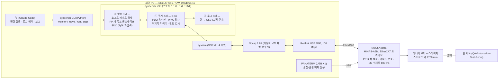
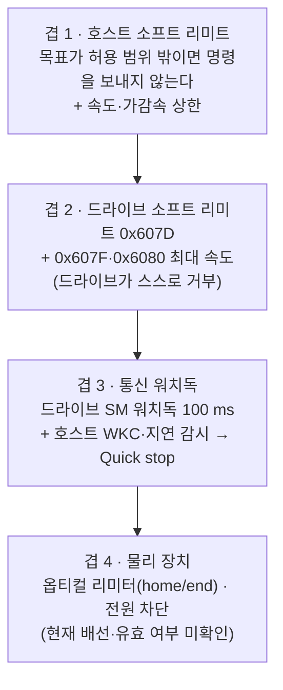
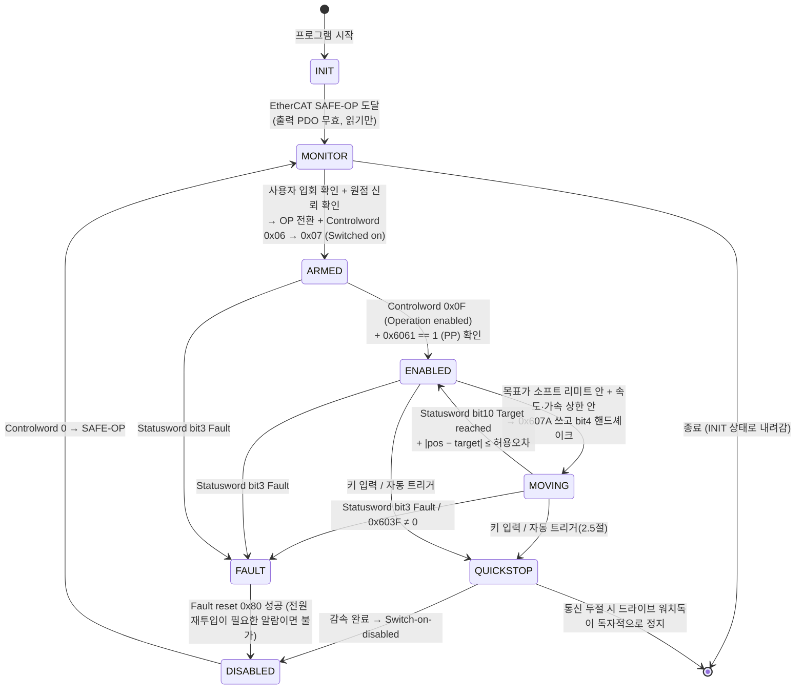
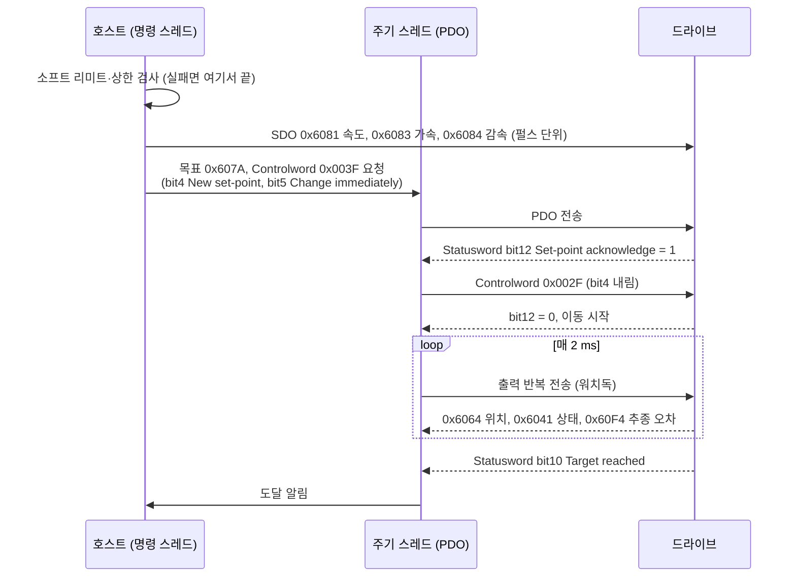

# 리니어 모터 EtherCAT 새 제어 프로그램 기획 v1 (plan-v1)

> **한 줄 결론:** 새 마스터는 **Python + pysoem(SOEM 래퍼)** 로 만들고, 궤적은 PC가 아니라 **드라이브가 만들게(CiA402 Profile Position 모드)** 하며, 안전은 **"호스트 소프트 리미트 + 드라이브 소프트 리미트 + 속도·가속 상한 + 100 ms 통신 워치독"** 네 겹으로 건다. Windows + Npcap + USB 랜카드 조합은 1 ms급 동기 제어(CSP)에는 못 미치지만, 드라이브가 궤적을 만드는 PP 모드에는 충분하다는 것이 이 선택의 근거다. 모터는 **M1(읽기 전용 모니터링)** 을 통과하기 전까지 절대 움직이지 않고, **M2(사용자 입회, 10 mm, ≤ 20 mm/s)** 부터 한 단계씩 올라간다.

작성: 2026-10-22, kimpm 세션. 이 문서는 파일을 읽고 쓴 결과만 담았다 — 어떤 실행 파일도 돌리지 않았고 모터는 움직이지 않았다.

**사실과 추정의 구분 규칙.** 본문에서 `[사실]`은 `records/2026-10-21-commissioning.md`, 조시우의 소스·로그, ESI xml, WMX3 로그 등 **파일에서 직접 읽은 것**이다. `[추정]`은 일반 지식이나 계산으로 낸 것이고, `[제안값]`은 사용자가 바꿀 수 있는 초기 설정값이다. `[확인 필요]`는 M1·M2에서 측정으로 확정해야 하는 항목이다.

---

## 0. 이 문서를 어떻게 읽나

| 절 | 무엇을 답하나 | 바쁘면 |
|---|---|---|
| 1 | 무엇으로 만들 것인가 (아키텍처·언어·라이브러리·타이밍 한계) | 1.1 결론 표만 |
| 2 | 어떻게 사고를 막을 것인가 (안전 설계, 상태 전이) | 2.1 네 겹 요약과 2.7 상태도 |
| 3 | 어떤 순서로 올라갈 것인가 (M1–M4, 통과 기준, 입회 여부) | 3.1 표 |
| 4 | 조시우 자료에서 무엇을 가져오고 무엇을 버리나 | 4.1·4.2 표 |
| 5 | 사용자만 답할 수 있는 열린 질문 | 전부 (짧다) |
| 6 | 결정 필요 — 진행을 가르는 갈림길 | 전부 |
| 7 | 남은 것 — 이 기획이 확인하지 못한 것 | 전부 |

---

## 1. 권장 아키텍처 — 드라이브가 궤적을 만들고, PC는 명령·감시·기록만 한다

### 1.1 결론

| 항목 | 선택 | 한 줄 이유 |
|---|---|---|
| 마스터 라이브러리 | **pysoem** (SOEM의 Python 바인딩) | 봇(Claude Code)이 직접 돌리고 고치는 운영 방식에 가장 맞고, SOEM이 이 드라이브와 통하는 것은 이미 확인됐다 `[사실: records §7]` |
| 제어 모드 | **PP (Profile Position, 0x6060 = 1)** | 가감속 궤적을 드라이브가 생성하므로 PC의 주기 지터가 모션 품질에 직접 들어가지 않는다 |
| 동기 방식 | **FreeRUN (DC SYNC0 끔)**, PDO 주기 **2 ms `[제안값]`** | 이 PC는 1 ms를 안정적으로 지키지 못한다 (1.4절). PP 모드에는 DC가 필요 없다 |
| 명령 통로 | Controlword·Target position은 **PDO**, 속도·가감속(0x6081/0x6083/0x6084)은 이동 직전 **SDO** | 기본 RxPDO(0x1600)에 속도·가속 객체가 없다 `[사실: records §7]`. 시간에 민감한 것(정지·새 목표)만 PDO로 보낸다 |
| 비상정지 | PDO Controlword의 **Quick stop (bit2 = 0)** + 키 입력 비차단 감시 | 다음 PDO 주기(≤ 2 ms)에 전달된다. 조시우 방식(SDO + `cin.get()`)은 느리고 스레드가 꼬였다 `[사실: 4.2]` |
| 운영 인터페이스 | CLI 한 개(`dynbench`)에 `monitor / move / run <pattern> / stop` 부명령 + 설정 파일(yaml) + CSV 로그 | 봇이 명령줄로 돌리고 파일로 결과를 받는 구조. 대화형 메뉴를 두지 않는다 |

### 1.2 구성도

세 스레드를 나누는 이유는 조시우 프로그램의 핵심 실패가 "명령 처리·키 입력·로그가 PDO 주기 스레드를 멈추게 했다"는 데 있기 때문이다(4.2절). 새 프로그램에서는 **① 주기 스레드는 어떤 경우에도 멈추지 않는다.** 명령이 없으면 직전 출력을 그대로 반복 전송해 워치독을 먹이고, 키 입력은 ②가 비차단으로 본다.

### 1.3 대안 비교 — 왜 pysoem인가

| 후보 | 장점 | 단점 | 판정 |
|---|---|---|---|
| **pysoem (Python)** | 봇이 바로 실행·수정·테스트할 수 있다. pandas로 로그 분석이 쉽다. SOEM과 같은 프로토콜 스택이라 조시우가 확인한 드라이브 호환성이 그대로 유효하다 | Python의 지터가 C보다 크다(아래 1.4). Windows 휠과 Npcap 연동은 설치 시 확인이 필요하다 `[확인 필요]` | **채택.** PP 모드라 지터가 모션 품질에 직결되지 않는다 |
| SOEM (C/C++) 새로 작성 | 지터가 가장 작다. 조시우 빌드 환경(VS, CMake)이 있었다 | 봇이 컴파일·디버그 루프를 돌리기 무겁다. 조시우 코드와 "비슷해질" 유혹이 크다 | **대비책.** M1에서 Python 주기 측정이 기준(1.4절)을 못 넘기면 주기 스레드만 C로 내린다 |
| WMX3 3.6 (SoftServo) | 상용 모션 엔진. 소프트 리미트·가감속 프로파일·DC가 내장돼 있다 | **라이선스가 없다.** 2025-04-14 로그에 "Valid WMX3 license code is not found … stop communication after one hour" `[사실: C:\Program Files\SoftServo\WMX3\Log\2025-04-14_17.13.41.635.txt]`. 비용 결정이 필요하다 | 보류. 6절 결정 2 |
| TwinCAT 3 / Linux PREEMPT_RT + SOEM | 진짜 실시간. CSP 모드까지 간다 | PC·OS·랜카드 교체가 필요하다. 지금 환경에서 벗어난다 | 참고만. CSP가 필요해지면(5절 질문 1) 재검토 |

### 1.4 Windows + Npcap + USB 랜카드의 주기 타이밍 한계 — 사실과 추정

이 절이 "왜 PP 모드인가"의 근거다.

| 항목 | 내용 | 구분 |
|---|---|---|
| Windows 타이머 | SOEM의 win32 OSAL은 `timeBeginPeriod(1)`로 스케줄러 틱을 1 ms로 당긴다 | `[사실: SOEM/osal/win32/osal.c:21]` |
| 폴링 실측 (조시우) | 125 µs 주기로 돌린 루프의 실제 간격이 **715–975 µs**였다 (샘플 간 타임스탬프 차) | `[사실: SOEM/build/Release/log_20250722_150436 5ms2.csv]` — 1 ms 아래로는 내려가지 않는다는 뜻 |
| WMX3 실측 | 8 ms 주기에서 인터럽트 간격이 ±5 % 안에 88.1 %, +5~20 % 에 10.7 %, 180 % 초과(14 ms 이상) 20회/45만 | `[사실: WMX3 Log 2025-04-14_17.13.41.635.txt]` — 전용 엔진으로도 수 ms 튐이 있다 |
| USB 랜카드 | USB 버스 폴링(125 µs 마이크로프레임)과 드라이버 큐가 왕복 지연을 더한다. 조시우 PC와 지금 PC의 Npcap 장치 GUID가 다르다 — 랜카드가 바뀌었으므로 조시우 수치를 그대로 믿을 수 없다 | `[사실: 장치명 차이 — records §1 vs build/Debug/last_good_adapter.txt]`, 지연량은 `[추정]` |
| Npcap | 사용자 모드 pcap 송수신(`pcap_sendpacket`/`pcap_next_ex`)이라 커널 드라이버 직결보다 느리다 | `[사실: SOEM/oshw/win32/nicdrv.c:271,341]`, 크기는 `[추정]` |
| DC (분산 클럭) | 드라이브는 FreeRUN과 DC SYNC0(AssignActivate 0x0300) 두 모드를 제공한다. SM2 동기는 ESI에 없다 | `[사실: MBDLN25BL EtherCAT_ESI.xml:506-521]` |
| DC를 켜면 | SYNC0가 1 ms인데 마스터 프레임이 수 ms 늦으면 드라이브는 동기 이탈로 본다. CSP 모드였다면 추종 오차·동기 알람이 난다. PP 모드에서는 DC가 궤적에 관여하지 않으므로 끄는 것이 안전하다 | `[추정 — CiA402/EtherCAT 일반 동작]` |
| SM 워치독 | ESI의 ESC 레지스터 0x0400 = 2498, 0x0420 = 1000 → 40 ns × 2499 × 1000 ≈ **100 ms**. 이 시간 안에 출력 PDO가 안 오면 드라이브가 OP를 벗어난다 | 레지스터 값 `[사실: ESI xml:523-524]`, 환산 `[추정]`, 이탈 시 서보 동작은 `[확인 필요]` |

**결론으로 내리는 설계 수치 `[제안값]`:** PDO 주기 2 ms, 주기 스레드의 허용 최대 지연 20 ms(워치독의 1/5), 20 ms 초과가 1분에 1회 이상이면 경고, 50 ms 초과가 한 번이라도 나오면 자동 Quick stop. 이 수치는 M1 측정으로 재조정한다.

---

## 2. 안전 설계 — 가장 먼저, 네 겹으로

### 2.1 요약

겹 1이 평소 전부를 막고, 겹 2는 프로그램 버그를, 겹 3은 PC 멈춤을, 겹 4는 그 셋이 다 뚫렸을 때를 막는다. **겹 4의 상태가 미확인이라는 것이 지금 가장 큰 구멍이다** — 파라미터 백업에서 Pr5.04(구동 금지 입력 설정) = 1 로 읽혔는데 `[사실: records/20261021_원복백업.prm5:223]`, MINAS A6 계열에서 이 값은 "POT/NOT 입력 무효"를 뜻할 가능성이 크다 `[추정 — 매뉴얼로 확인 필요]`. 그렇다면 조시우 매뉴얼의 옵티컬 리미터는 드라이브를 세우지 못한다. 6절 결정 1.

### 2.2 좌표계와 원점 — 소프트 리미트는 "숫자"가 아니라 "절차"에 걸려 있다

**핵심 사실.** 인크리멘털 스케일이라 **위치 0 = 드라이브 전원 투입 시 슬라이더 위치**다 `[사실: records §2]`. 실측 범위 +687,339 / −1,080,400 pulse는 **그날 전원을 넣은 자리를 0으로 한 값**이지, 레일에 새겨진 절대 좌표가 아니다. 전원을 다시 넣는 순간 이 숫자는 무효가 된다.

그래서 소프트 리미트를 "+687k / −1,080k 안쪽"으로 하드코딩하면 안 된다. 대신 좌표계를 이렇게 세운다.

1. **전원 투입 전** 스테이지를 왼쪽 Home 끝에 손으로 밀어 둔다 `[사실: records §2 운용 절차]`. 이때 0 = Home 끝이 된다.
2. 프로그램은 "기계 좌표" `d` = Home 끝에서 떨어진 거리(mm, 항상 0 이상)로만 생각하고, 드라이브 펄스로 바꿀 때 **방향 부호 `s`** 를 곱한다. `pulse = s × d × 1000`.
3. `s`는 설정 파일 값이고, **M1에서 손으로 밀어 보며 확정한다**(3.2절). 지금은 두 자료가 어긋난다 — records는 "케이블 쪽이 사용자를 향할 때 + = 왼쪽 = MAX" `[사실: records §3]`이고, 조시우 매뉴얼과 명령 파일은 Home에서 **양수**(0 → 100 mm, 0 → 1700 mm)로 움직였다 `[사실: 유저 매뉴얼 pptx "목적지가 1700 이상이거나 음수인지 확인", build/Release/log_20250723_173028.txt]`. 보는 방향이 달랐을 가능성이 크지만 **추측으로 정하지 않는다.**
4. 프로그램 시작 시 0x6064를 읽어 `|pos| > 2 mm`이면 "원점을 신뢰할 수 없음"으로 표시하고, 사용자가 "Home에서 전원을 넣었다"를 명시적으로 확인하기 전에는 어떤 이동 명령도 받지 않는다. (전원을 끄지 않는 한 프로그램을 재시작해도 0점은 유지된다 `[사실: 유저 매뉴얼 pptx]`.)
5. 옵티컬 home 센서가 드라이브 디지털 입력(0x60FD)에 배선돼 있다면 M1에서 그 비트를 찾아, 시작 시 "home 센서 ON + pos ≈ 0"을 원점 신뢰 조건으로 쓴다 `[확인 필요]`.

### 2.3 소프트 리미트 `[제안값]`

| 항목 | 제안값 | 근거 |
|---|---|---|
| 기계 스트로크 | 1,768 mm | `[사실: records §4]` (매뉴얼은 약 1770 mm) |
| 허용 범위 (겹 1·2 공통) | `d ∈ [30 mm, 1,738 mm]` — 양 끝 30 mm 여유 | 30 mm는 M2 속도(≤ 20 mm/s)에서 넉넉하다. 속도를 올리면 아래 "정지 거리" 항으로 자동 보정 |
| 정지 거리 보정 | 목표 검사 시 `d_eff = d ± v² / (2·a_qs)` 로 Quick stop 감속 `a_qs`에서의 정지 거리를 더한다 | 1.9 m/s·10 m/s² 조합이면 정지 거리 **180 mm** — 30 mm 여유로는 턱없다는 것이 계산으로 보인다 |
| 드라이브 0x607D (min/max) | 겹 1과 같은 값을 M2 시작 전에 SDO로 쓴다 | 조시우 코드가 0x607D:01/02를 읽어 출력했으므로 객체가 존재할 가능성이 높다 `[사실: command_parser.h:609-614]`, 실제 지원과 단위는 `[확인 필요 — M1 SDO 읽기]` |
| M2 전용 범위 | 시작 지점 ± 15 mm 안에서만 (10 mm 이동 + 여유) | 첫 구동은 범위를 더 좁힌다 |

### 2.4 속도·가속도 상한 `[제안값]`

| 단계 | 최대 속도 | 최대 가감속 | 근거 |
|---|---|---|---|
| M2 | **20 mm/s** | 100 mm/s² | 지시문의 조건. 20 mm/s는 PANATERM 시운전에서 Err26이 났던 10 mm/s보다 크므로, **M2 전에 Pr5.13(과속도 레벨, 현재 7400) 단위를 확인**해 20 mm/s가 그 아래인지 본다 `[사실: prm5:232 값, 단위는 확인 필요]` |
| M3 | 500 mm/s | 2,000 mm/s² | 반복·로깅 검증용. 1.4절 지터와 무관하게 드라이브가 궤적을 만든다 |
| M4 (프로그램 절대 상한) | 1,500 mm/s | 10,000 mm/s² (≈ 1 g) | 조시우 기록: 1.9 m/s 에서 변동으로 비상정지 발생, 물리 한계 2 m/s, 무부하 최대 가속 13.7 m/s², "1.4 g 이상 사용 금지" `[사실: FTG reporter pptx, 유저 매뉴얼 pptx]`. 셀 세트를 실으면 더 낮아진다 |
| 드라이브 쪽 | 0x607F(최대 프로파일 속도)·0x6080을 단계 상한과 같게 SDO로 쓴다 | 프로그램이 틀려도 드라이브가 막는다. 지원 여부 `[확인 필요]` |

프로그램은 설정 파일의 상한을 **단계별로 잠근다**: M2 설정으로 시작하고, 사용자가 M2 통과를 기록(3.1절)해야 M3 상한을 풀 수 있다.

### 2.5 비상정지 세 가지 길

| 길 | 동작 | 지연 | 비고 |
|---|---|---|---|
| 소프트웨어 Quick stop | 주기 스레드가 Controlword를 `0x0002`(bit2 = 0)로 바꿔 전송. 드라이브는 0x6085(Quick stop 감속)로 세운다 | ≤ 1 PDO 주기 + 드라이브 처리 | 0x605A(Quick stop option code) = 2 `[제안값]` — 감속 후 Switch-on-disabled로. 지원 여부 `[확인 필요]` |
| 호스트 자동 트리거 | WKC 불일치 3주기 연속, 주기 지연 50 ms 초과, Statusword fault 비트, 0x603F ≠ 0, 추종 오차(0x60F4) 임계 초과, 소프트 리미트 밖 위치 관측 → Quick stop | 같음 | 임계값은 M2에서 정한다 |
| 물리 | 드라이브 전원 차단 (사용자). 전원을 끄면 **원점이 사라지므로** 다음 투입 전 Home 재배치가 필요하다 | 즉시 | 하드웨어 비상정지 버튼은 현재 없다 `[사실: 매뉴얼에 언급 없음]` → 6절 결정 1 |

**조시우 방식을 쓰지 않는 이유.** 그는 정지를 SDO `0x6040 = 0x0002`로 보냈고 `[사실: command_parser.h:523-530]`, 키 입력을 `std::cin.get()`으로 막아 기다렸다 `[사실: eram8s_20250613.cpp:1076]`. SDO는 메일박스 왕복이라 수 ms 이상 걸리고, 입력 대기가 스레드를 묶어 "엔터를 안 누르면 서브 스레드가 join되지 못하고 오작동"했다 `[사실: 유저 매뉴얼 pptx 4항]`.

### 2.6 워치독과 통신 두절

- **드라이브 쪽**: SM 워치독 약 100 ms(1.4절). 만료되면 드라이브가 OP를 벗어나며 출력 PDO가 무효가 된다. 그때 서보가 즉시 정지하는지, Pr6.14(알람 시 즉시 정지 시간 = 200 ms `[사실: prm5:284]`)로 감속하는지, 프리런하는지는 **M2에서 사용자 입회 하에 저속으로 실제로 끊어 보고** 확정한다 `[확인 필요]`. 이 시험 없이 무인 운전(M3 이후)으로 넘어가지 않는다.
- **호스트 쪽**: 주기 스레드가 매 주기 WKC를 기대값과 비교하고, 직전 주기와의 간격을 잰다. 2.5절 기준으로 Quick stop을 건다. 통신이 완전히 끊기면 보낼 길이 없으므로 **드라이브 워치독이 마지막 보루**다 — 그래서 워치독 시간을 늘리지 않는다.
- **프로그램 종료 시**: Quick stop → Shutdown(0x0006) → Controlword 0 → SAFE-OP → INIT 순서로 내려온다. 비정상 종료(예외) 핸들러에서도 같은 순서를 시도한다.

### 2.7 Err26(과속도) 이력에서 가져오는 규칙

- 시운전 모드의 과속도 레벨이 10 mm/s로 자동 설정된 상태에서 더 빠르게 움직여 Err26.0이 났고, 50 mm/s 설정에서는 정상이었으며, **알람 해제로 안 풀리고 전원을 껐다 켜야 했다** `[사실: records §5]`.
- 따라서 새 프로그램은 (가) PANATERM 시운전 모드를 쓰지 않는다, (나) 어떤 이동도 Pr5.13 과속도 레벨 아래에서만 명령한다, (다) **Err26처럼 전원 재투입이 필요한 알람은 원점 상실을 뜻하므로** 복구 절차에 "Home 재배치 → 전원 투입 → 프로그램 재시작 → 원점 확인"을 묶어 둔다. 알람 코드별 복구 절차는 M2에서 실제로 만난 것부터 기록한다.

### 2.8 상태 전이

프로그램 상태(바깥)와 CiA402 드라이브 상태(안쪽)를 함께 그렸다. 굵은 전이만 사용자 확인이 필요하다.

---

## 3. 단계별 마일스톤

### 3.1 한눈에

| 단계 | 무엇을 하나 | 모터 | 사용자 입회 | 통과 기준 (측정 가능한 것만) | 다음 단계로 넘어가는 조건 |
|---|---|---|---|---|---|
| **M1** 읽기 전용 모니터링 | pysoem으로 SAFE-OP까지만 가서 입력 PDO를 2 ms로 읽고 기록 | 서보 온 없음, Controlword 전송 없음 | 첫 실행만 통보. 손으로 미는 방향 시험은 사용자가 직접 | ① 10분 연속 WKC 오류 0, ② 주기 간격 p99 ≤ 4 ms·최대 ≤ 20 ms, ③ 손으로 밀 때 0x6064 변화 방향으로 부호 `s` 확정, ④ 0x60FD 비트와 옵티컬 센서 대응 확인(배선돼 있다면), ⑤ 0x607D·0x607F·0x6080·0x605A·0x6085·0x60C5 SDO 읽기 성공 여부 표, ⑥ 0x603F = 0 | 통과 기준 6개를 `records/`에 기록하고 사용자가 승인 |
| **M2** 첫 구동 | OP → 서보 온 → +10 mm → 복귀, 속도 ≤ 20 mm/s | 움직임 | **필수.** 사용자가 전원 스위치 옆에 있을 것 | ① 명령 방향과 실제 방향 일치, ② 자로 잰 이동량 10 ± 0.5 mm(스케일 1 µm/pulse 검증), ③ 도달 후 \|pos − target\| ≤ 50 µm, ④ 이동 중 키 입력 Quick stop이 동작하고 정지까지 위치 변화 ≤ 5 mm, ⑤ 소프트 리미트 밖 목표 명령이 전송 없이 거부됨, ⑥ 저속 이동 중 케이블을 뽑는 통신 두절 시험에서 드라이브가 멈추는 방식 기록, ⑦ 0x603F = 0 유지 | 7개 기록 + 사용자가 M3 상한(2.4절) 해제를 승인 |
| **M3** 반복 + 고정 주기 로깅 | A↔B 왕복 N회, 매 PDO 주기 CSV 기록 | 움직임 | 첫 1회는 필수, 이후 무인 여부는 결정 1(6절)에 달림 | ① 로그 행 간격 p99 ≤ 1.5 × 주기, 누락 0, ② 100회 왕복에서 도달 위치 반복성 ≤ 50 µm, ③ 추종 오차(0x60F4) 최대값 기록, ④ 자동 트리거 오발동 0, ⑤ 세션 요약(횟수·최대 속도·최대 추종 오차·알람) 자동 생성 | 요약 보고를 사용자가 승인 |
| **M4** 셀 세트 시험 루틴 | 사용자가 정한 패턴(5절)을 셀 데이터와 시각 동기해 실행 | 움직임 (셀 탑재) | 첫 회 필수 | 5절 답에 따라 정의. 최소한 ① 모션 로그와 셀 로그의 시각 정렬 오차 ≤ 10 ms, ② 패턴당 합격/불합격 판정 자동 출력 | — |

### 3.2 흐름

### 3.3 M2의 PP 새 목표 핸드셰이크 (조시우가 "이게 없으면 치명적 알람"이라 적은 부분)

조시우는 bit4를 내리는 `0x002F` 쓰기를 빠뜨리면 "다음 명령을 받지 않고 껐다 켜지 않으면 안 되는 치명적 알람"이 났다고 적었다 `[사실: command_parser.h:696-698]`. 새 프로그램은 이 핸드셰이크를 **bit12 응답을 확인하며** 한다(그는 확인 없이 고정 대기로 넘어갔다).

---

## 4. 조시우 자료 — 사실로 재사용할 것 vs 버릴 것

코드는 한 줄도 복사하지 않는다. 아래는 "그 코드가 드라이브에 대해 증명한 사실"과 "그 코드가 만든 함정"이다.

### 4.1 재사용할 사실

| 사실 | 출처 (읽기 전용) |
|---|---|
| 기본 PDO 바이트 오프셋 — RxPDO 0x1600: Controlword@0, Modes of operation@2, Target position@3, Touch probe function@7 (9 byte). TxPDO 0x1A00: Error code@0, Statusword@2, Mode display@4, Position actual@5, Touch probe status@9, Touch probe pos1@11, Following error@15, Digital inputs@19 (23 byte) | `SOEM/src/pdo_offsets2.h:33-47`, `records §7`과 일치 |
| 드라이브는 PDO 재할당을 받아들인다. 0x1603(RxPDO 8항목: 6040·6060·6071·6072·607A·6080·60B8·60FF)과 0x1A01(TxPDO 9항목: 603F·6041·6061·6064·**606C 속도**·6077·60B9·60BA·60FD)을 PRE-OP에서 1C12/1C13 비활성 → 매핑 쓰기 → 재활성 순서로 넣은 기록이 있다 | `C:\eni\0000066f_60540006.txt:39-65` (WMX3가 만든 ENI 캐시). M3에서 속도 실측(0x606C)이 필요하면 이 순서를 참고한다 |
| EtherCAT 초기화 순서: `ec_init` → `ec_config_init` → `ec_config_map` → `ec_configdc` → SAFE-OP → OP. expectedWKC = outputsWKC × 2 + inputsWKC | `SOEM/src/eram8s_20250613.cpp:743-798` |
| CiA402 서보 온 순서: Fault reset(0x80) → 0x6060 = 1(SDO와 PDO 모두) → 0x06 → 0x07 → 0x0F, 각 단계 Statusword 마스크 0x006F로 확인 (0x21 / 0x23 / 0x27) | 같은 파일 281-384 |
| PP 새 목표 핸드셰이크와 bit4 내림의 필요성 | `SOEM/src/command_parser.h:696-746` (3.3절) |
| 속도·가감속은 펄스 단위(µm, µm/s, µm/s²)로 0x6081/0x6083/0x6084에 쓴다. 입력 mm × 1000 | `command_parser.h:31-32, 123-126` |
| 경험 한계: 1.9 m/s(물리 2 m/s, 변동으로 비상정지), 무부하 13.7 m/s²에서 4.8 m/s 도달, 1.4 g 이상 금지. 명령 사이 "십수 ms" 간격 | `Documents/Linear motor and FTG reporter.pptx`, `Linear motor 유저 매뉴얼.pptx` |
| 도달 판정 허용오차 10 µm 고정, 위치 노이즈 ±10 µm 수준 | `command_parser.h:34`, 유저 매뉴얼 |
| 전원을 끄지 않으면 프로그램을 껐다 켜도 0점이 유지된다 | 유저 매뉴얼 pptx |
| PANATERM으로만 해제되는 알람이 가끔 있다. 알람 로그 제거 후 전원 재투입, Home 재배치 | 유저 매뉴얼 pptx "문제 해결" |
| 드라이브가 읽어 준 제한 객체: 0x607D:01/02, 0x60C5, 0x60C6, 0x607F (코드가 SDO로 읽어 출력했으므로 존재 가능성 높음 — 값은 로그에 없음) | `command_parser.h:609-624` |
| 접속 이력: PRE-OP 메일박스 타임아웃 10 s, SM 워치독 100 ms, DC 모드 FreeRUN/DC SYNC0 두 가지 | `MBDLN25BL EtherCAT_ESI.xml:27-31, 506-525` |
| WMX3는 라이선스 없음(무료 모드 1시간 제한). 8 ms 주기로 1시간 통신한 지터 분포 | `C:\Program Files\SoftServo\WMX3\Log\2025-04-14_*.txt` |

### 4.2 버릴 것 (함정)

| 함정 | 무엇이 문제였나 | 출처 |
|---|---|---|
| 모션 명령을 SDO로 보냄 | 메일박스 왕복이라 느리고 시간이 불규칙. Quick stop도 SDO | `command_parser.h:645-746, 523-530` |
| 모션 중 주기(PDO) 스레드를 **멈춤** (`inOP = FALSE`) | 워치독을 모션 루프가 대신 먹이는 구조. 루프가 막히면 100 ms 뒤 드라이브가 OP를 벗어난다 | `eram8s_20250613.cpp:1057-1058` |
| `std::cin.get()`으로 Enter 대기 = 비상정지 | 블로킹. Enter를 안 누르면 스레드 join 실패·오작동 | `eram8s_20250613.cpp:1076`, 유저 매뉴얼 4항 |
| 이벤트 트리거 로깅 (10 µm 이상 변할 때만 기록) | 시간 간격이 불규칙(0.7–1 ms에서 10–30 ms까지). 속도·가속도는 그 불규칙 간격으로 미분한 추정치라 잡음이 크다 | `command_parser.h:309-374`, 유저 매뉴얼 "로그 확인", `build/Release/*.csv` |
| DC SYNC0 125 µs 설정 + 1 ms 루프 | 주기 불일치. 본인도 "특정 상황에 버그" | `eram8s_20250613.cpp:594-668, 757` |
| PDO 맵 변경 함수 | "오작동이 심함", 매뉴얼에서도 "손대지 말 것" | `eram8s_20250613.cpp:534-592` |
| `MM_PER_PULSE = 20000 / 838860800` 상수 | 실제 스케일(1 pulse ≈ 1 µm)과 무관한 레거시 값. 실제 변환은 별도 상수 1000으로 했다 | `command_parser.h:19-26, 32` |
| `v`(속도)·`h`(호밍) 모드 | "구현이 불안정하므로 사실상 봉인" | 유저 매뉴얼 2항 |
| 어댑터 자동 순회 + 캐시 파일 | EtherCAT 장치가 아닌 어댑터에도 `ec_init`을 시도. 새 프로그램은 Npcap 장치명을 설정 파일에 고정 | `eram8s_20250613.cpp:1120-1148` |
| 파일 사본 13개(날짜별 cpp·h) | 어느 것이 최종인지 코드만으로 알 수 없다. `eram8s.cpp`와 `eram8s_20250613.cpp`가 같은 내용 | `SOEM/src/` |

---

## 5. 사용자만 답할 수 있는 열린 질문

각 질문에 기본값을 달았다. **답만 채우면** 다음 세션이 그대로 잇는다.

1. **시험 동작 패턴** — 왕복(A↔B 정속)만 필요한가, 아니면 사인파·가변 속도 같은 임의 궤적도 필요한가? *기본값: 왕복 정속 + 가감속 구간. (임의 궤적이면 CSP 모드가 필요해 1.3절 결론이 바뀐다.)*
2. **속도 범위** — 셀 시험에서 실제로 보고 싶은 속도는 몇 mm/s 대인가 (예: 보행 1,500 mm/s, 달리기 5,000 mm/s?). *기본값: M3 500 mm/s까지, M4는 답에 따름. 참고로 이 스테이지의 실측 한계는 1,900 mm/s다.*
3. **반복 횟수·시간** — 1회 시험이 몇 왕복, 몇 분인가? 야간 무인 운전을 원하는가? *기본값: 100 왕복, 입회 운전.*
4. **셀과 동기화할 데이터** — 셀 로그와 맞출 기준이 PC 시각인가, 트리거 신호인가, 사후 정렬인가? 셀 세트 소프트웨어가 어떤 언어·인터페이스로 돌아가는가? *기본값: PC 단조 시각(perf_counter)으로 두 로그를 사후 정렬.*
5. **탑재 질량** — 셀 세트와 지그의 무게는? 가속도 상한에 직접 들어간다. *기본값: 없음 — 답 전까지 M4 상한을 M3 값에 묶는다.*
6. **제어 PC의 개발 환경** — Python(버전)과 pip 설치가 가능한가? Visual Studio 빌드 도구가 있는가? *기본값: Python 3.11 설치 가능, VS 없음.*
7. **옵티컬 리미터 배선** — home/end 센서가 드라이브 POT/NOT(또는 다른 입력)에 연결돼 있는가? *기본값: 모름 — M1에서 0x60FD로 확인하되, 배선 사실은 사용자가 안다.*

---

## 6. 결정 필요

### 결정 1 — 물리 안전장치 없이 무인 운전(M3 이후)을 허용할 것인가

- **무엇이 걸려 있나:** 현재 확인된 정지 수단은 소프트웨어(Quick stop)와 사람이 전원을 끄는 것뿐이다. 하드웨어 비상정지 버튼이 없고, 옵티컬 리미터가 드라이브를 세우는지(Pr5.04 = 1의 뜻)도 미확인이다. 봇이 돌리는 운영 방식에서 사람이 없을 때 PC가 멈추면 마지막 보루는 드라이브 워치독 100 ms 하나다.
- **결정 질문:** 무인 운전을 하려면 물리 안전장치(비상정지 버튼, 리미터 배선 확인·유효화)에 투자할 것인가, 아니면 입회 운전으로만 운용할 것인가?

| 옵션 | 비용 | 시간 | 위험 | 되돌리기 |
|---|---|---|---|---|
| A. 입회 운전만 (M3 이후도 사람이 옆에) | 0 | 시험마다 사람 시간 | 낮음 | 언제든 |
| B. 리미터 배선 확인 + Pr5.04 유효화 + 비상정지 버튼 추가 후 무인 허용 | 부품·배선 공수 (소) | 1–2일 `[추정]` | 중간 — 장치가 실제로 동작하는지 M2에서 검증 필요 | 쉬움 |
| C. 지금 상태로 무인 허용 | 0 | 0 | **높음** — PC 멈춤·버그 시 기계 충돌 | 충돌 뒤엔 불가 |

- **추천:** A로 시작하고 M2를 통과한 뒤 B를 검토. **전문 검증:** 2.1절 네 겹 분석에서 겹 4가 비어 있음을 파라미터 백업으로 확인.
- **무응답 시 기본 행동:** A (입회 운전만). M3 무인 모드는 코드에 잠가 둔다.

### 결정 2 — WMX3 라이선스 구매를 검토할 것인가

- **무엇이 걸려 있나:** WMX3는 소프트 리미트·궤적·DC가 내장된 상용 엔진이지만 라이선스가 없어 1시간마다 통신이 끊긴다. 구매하면 CSP 수준 제어와 상용 안전 기능을 얻지만 비용이 들고, 봇이 다루기엔 Python 쪽이 가볍다.
- **결정 질문:** 질문 1(임의 궤적)의 답이 "필요하다"일 때만 의미가 있다. 그때 WMX3 구매와 Linux 실시간 PC 중 무엇을 고를 것인가?
- **무응답 시 기본 행동:** 검토하지 않음. pysoem + PP로 간다.

### 결정 3 — 방향 부호 `s`와 소프트 리미트 수치 확정 (M1 결과를 보고)

- M1 결과 기록을 받은 뒤 사용자가 `s`, 양 끝 여유(제안 30 mm), 단계별 상한(2.4절)을 승인한다. 승인 전에는 M2를 시작하지 않는다.
- **무응답 시 기본 행동:** 진행 불가 (이 결정 없이는 모터를 움직이지 않는다).

---

## 7. 남은 것 — 이 기획이 확인하지 못한 것

| 항목 | 왜 못 했나 | 언제 메우나 |
|---|---|---|
| 벤더 PDF(A6B EtherCAT 통신·기능 사양, 기본기능 매뉴얼)의 객체·파라미터 정의 | 이 세션 환경에서 PDF 렌더링 도구가 없었다 | 사용자가 PANATERM 또는 PDF에서 Pr5.04·Pr5.13 단위·0x605A·0x607D 지원 여부를 확인하거나, 다음 세션에서 도구를 갖춰 읽는다 |
| `E-RAM시리즈_파나소닉파라미터.xlsx` | 같은 이유(Python 실행 차단) | 같음 |
| 지금 PC에서의 실제 주기 지터 | 실행 금지 규칙 | **M1이 바로 이것을 잰다** |
| 옵티컬 리미터 배선과 0x60FD 비트 대응 | 파일에 없음 | M1 + 질문 7 |
| 드라이브 워치독 만료 시 서보 동작 | 파일에 없음 | M2 통신 두절 시험 |
| pysoem의 Windows 휠·Npcap(wpcap.dll) 연동 | 설치 금지 범위 | M1 착수 시 첫 작업 |
| 조시우의 `simple_test`·`slaveinfo` 소스 | 표준 SOEM 예제라 별도 분석 생략 | 필요 없음 |

**함께 발견한 것(요청 범위 밖, 지시 없으면 착수하지 않음):** 조시우 매뉴얼의 프로그램 저장소 주소(`github.com/fitogether-org/hw-linear-actuator`)가 적혀 있다. 로컬 `C:\Users\HW team\SOEM`과 같은 내용인지 확인하지 않았다.

---

## 부록 A. 읽은 파일 목록 (판단 근거)

- `C:\Dev\dynamic-bench\dynamic-bench\records\2026-10-21-commissioning.md`, `records\20261021_원복백업.prm5`(Pr 일부), `README.md`, `plan-prompt.md`
- `C:\Users\HW team\SOEM\src\eram8s_20250613.cpp`, `src\command_parser.h`, `src\pdo_offsets2.h`, `osal\win32\osal.c`, `oshw\win32\nicdrv.c`, `ChangeLog`, `README.md`, `drvcomment.txt`, `build\Debug\last_good_adapter.txt`, `build\Debug\command_[mm]100-1900-10000-10000_10times.txt`, `build\Release\command_[mm]500-1900-10000~14500.txt`, `build\Release\log_20250723_173028.{csv,txt}`, `log_20250723_173247.csv`, `log_20250722_150436 5ms2.csv`, `build\Debug\log_20250618_175353.{csv,txt}`
- `C:\Users\HW team\Documents\Linear motor 유저 매뉴얼.pptx`, `Linear motor and FTG reporter.pptx` (슬라이드 XML을 표준출력으로만 읽음)
- `C:\Users\HW team\Fitogether\Research Collaboration - 문서\FIFA_FPP\Linear Motor\E-RAM8-S_Data\E-RAM8-S\MBDLN25BL EtherCAT_ESI.xml` (장치 헤더, PDO 정의, Dc, ESC 레지스터)
- `C:\eni\0000066f_60540006.txt`, `C:\Program Files\SoftServo\WMX3\Log\2025-04-14_17.06.50.072.txt`, `2025-04-14_17.13.41.635.txt`
- 웹: Panasonic A6B 제품 페이지(동기 모드 DC/SM2/FreeRUN, 주기 125 µs–10 ms), SOEM 이슈·WinPcap 메일링(Windows 타이밍 일반론) — 수치 근거로는 쓰지 않았다.

## 부록 B. 용어

- **EtherCAT PDO / SDO**: PDO는 매 주기 자동으로 오가는 작은 데이터(위치·상태·명령). SDO는 필요할 때 한 번씩 읽고 쓰는 설정값 통로로, 메일박스를 거쳐 느리다.
- **CiA402**: 서보 드라이브의 표준 상태 기계와 객체 번호(0x6040 Controlword, 0x6041 Statusword, 0x607A 목표 위치, 0x6064 실제 위치 등).
- **PP / CSP**: PP(Profile Position)는 목표·속도·가감속만 주면 드라이브가 궤적을 만든다. CSP(Cyclic Synchronous Position)는 PC가 매 주기 위치를 직접 보내므로 PC 주기가 곧 궤적 품질이다.
- **DC(분산 클럭) / FreeRUN**: DC는 드라이브와 마스터가 같은 시계로 동기해 매 주기를 맞추는 방식, FreeRUN은 동기 없이 도착하는 대로 처리하는 방식.
- **SM 워치독**: 드라이브가 "정해진 시간 안에 출력 데이터가 안 오면 통신이 끊긴 것"으로 보고 안전 상태로 가는 타이머.
- **WKC(Working Counter)**: 프레임이 슬레이브를 제대로 거쳤는지 세는 값. 기대값과 다르면 통신 이상.
- **Quick stop**: CiA402의 급정지 명령(Controlword bit2 = 0). 드라이브가 정해진 감속도로 세운다.
